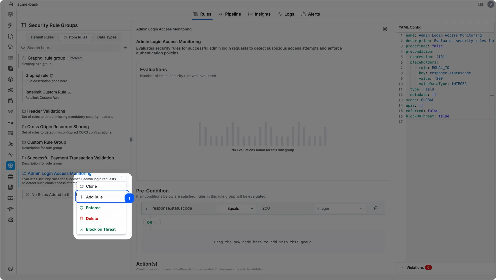
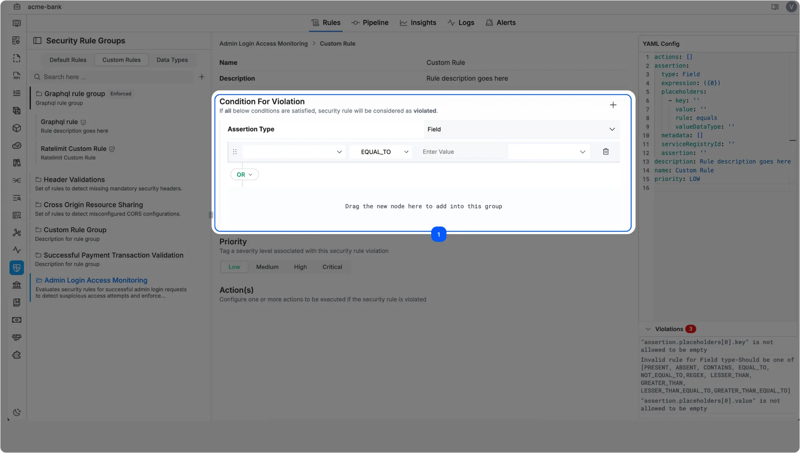
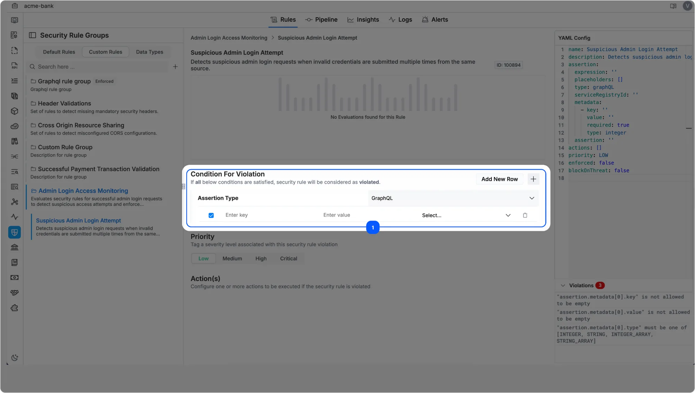
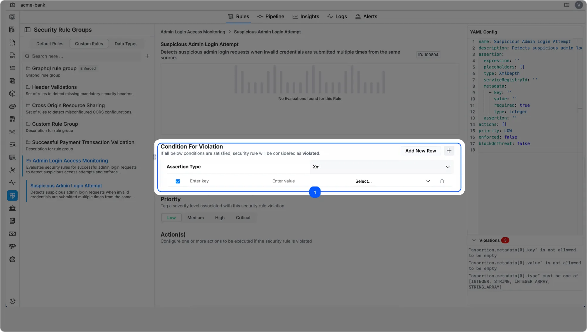
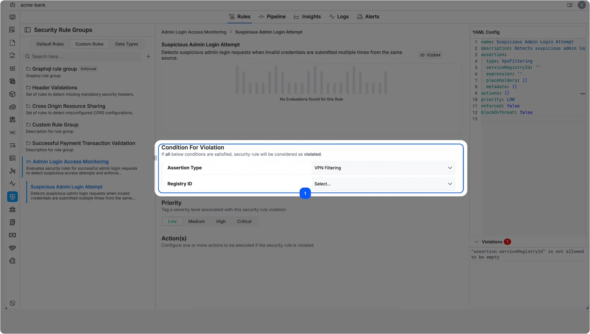
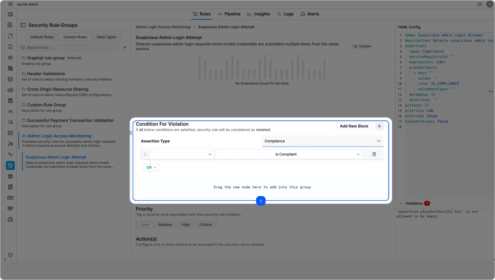
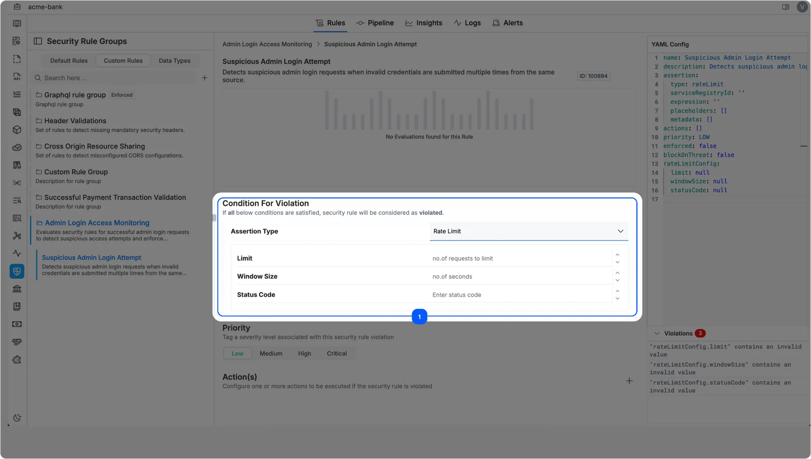

A rule is a configurable security condition that the system evaluates against incoming API traffic within a rule group. It defines what to check, how to evaluate it, and how critical a violation is. When all its conditions are satisfied, the system logs the violation based on the rule's priority. Security Analysts, InfoSec, and SecOps teams use rules to detect, block, or audit API threats across the design, build, and run phases.

#### Key features

#### Key benefits

- Saves processing power and reduces false positives by skipping invalid requests before full evaluation.
- Let's teams audit live traffic in Passive mode without disrupting legitimate transactions.
- Integrates with enterprise SIEM tools, such as Splunk or Cisco, through service callouts.
- Gives analysts actionable data: drill into a violation's node graph on the **Logs** page and select **Inspect** to view the raw request and response payloads.

## Adding a rule to a rule group

After a rule group is created, add rules to define the security conditions the system evaluates within that group.

**Prerequisites**

### Create a rule

To add a new rule to a rule group, do the following:

1. Hover over the rule group.
1. Select the **More Options** \(⋮\) menu.
1. Select **\+ Add Rule**.
  

A configuration panel opens in the center of the screen.

1. Enter the following details:

1. Select **Save**.

The rule is added to the selected rule group and is ready for evaluation based on the configured rule group settings.

### Configure assertions and conditions

Use the **Assertion Type** field to define what the rule evaluates under **Condition for Violation**. Select an assertion type from the following options.

#### Configure a field assertion

Use a field assertion to validate specific fields in a request or response.

1. In **Assertion Type**, select **Field**.
  
1. From the dropdown list, select the required field name.
1. Select an operator: EQUAL\_TO, CONTAINS, MATCHES, GREATER\_THAN, or LESSER\_THAN. Enter the comparison value.
1. Select the data type if required.
1. To add more conditions, select the \+ icon.
1. Combine conditions using AND or OR operators for advanced logic.
1. To add a condition to an existing group, drag the new node into the group area.
1. Select Save.

**Common use cases:**

- Validate authorization headers
- Detect malicious query parameters
- Match suspicious payload values
- Validate request methods or paths

#### Configure a JSON assertion

Use a JSON assertion to validate the structure, depth, or content of JSON request or response payloads.

1. In **Assertion Type**, select **JSON**.
  
1. Select **\+ Add New Row**.
1. Enter the JSON key name.
1. Enter the expected value, if required.
1. Select the appropriate data type.
1. Repeat to add more rows if multiple JSON fields must be validated.
1. Select **Save**.

**Common use cases:**

- Validate that the required JSON keys are present
- Restrict invalid or unexpected values
- Validate numeric or string data types
- Detect malformed JSON content

#### Configure a GraphQL assertion

Use a GraphQL assertion to validate GraphQL request structure, query depth, fields, or payload content.

1. In **Assertion Type**, select **GraphQL**.
  
1. Select **\+ Add New Row**.
1. Enter the field name, query element, or parameter to validate.
1. Enter the expected value, if required.
1. Select the appropriate data type.
1. Repeat to add more rows if multiple GraphQL checks are required.
1. Select **Save**.

**Common use cases:**

- Restrict deeply nested GraphQL queries
- Validate that required fields are present
- Detect unauthorized schema access attempts
- Validate argument values

#### Configure an XML assertion

Use an XML assertion to validate XML request or response structure, tags, attributes, or content.

1. In **Assertion Type**, select **XML**.
  
1. Select **\+ Add New Row**.
1. Enter the XML tag, attribute, or element name to validate.
1. Enter the expected value, if required.
1. Select the appropriate data type.
1. Repeat to add more rows if multiple XML checks are required.
1. Select **Save**.

**Common use cases:**

- Restrict deeply nested XML payloads
- Validate that required tags are present
- Detect invalid attribute values
- Identify malformed XML content

#### Configure an IP filtering assertion

Use an IP filtering assertion to validate incoming requests based on IP address rules or trusted network registries.

1. In **Assertion Type**, select **IP Filtering**.
  
1. In **Registry ID**, select the required IP registry or predefined IP list.

>

1. Configure the rule behavior based on the selected registry.
1. Add additional conditions if required.
1. Select **Save**.

**Common use cases:**

- Allow traffic only from trusted IP ranges
- Block requests from suspicious IP addresses
- Restrict access to admin endpoints
- Enforce approved partner network access

#### Configure a VPN filtering assertion

Use a VPN filtering assertion to detect or restrict requests originating from known VPN or anonymized network sources.

1. In **Assertion Type**, select **VPN Filtering**.
  
1. In **Registry ID**, select the required VPN registry or predefined VPN source list.

>

1. Select **Save**.

The rule evaluates incoming traffic against the selected VPN registry and triggers a violation when a match is found.

#### Configure a compliance assertion

Use a compliance assertion to validate whether requests or responses meet predefined security, policy, or regulatory compliance requirements.

1. In **Assertion Type**, select **Compliance**.
  
1. Select the required compliance category or policy from the dropdown list.
1. Select the validation condition, such as **Is Compliant**.
1. To add more conditions, select **\+ Add New Block**.
1. Combine conditions using **AND** or **OR** logic.
1. To add a condition to an existing group, drag the new node into the group area.
1. Select **Save**.

The rule validates traffic against the selected compliance checks and triggers a violation when the request or response does not meet the required standards.

#### Configure a rate limit assertion

Use a rate limit assertion to restrict the number of requests allowed within a defined time window.

1. In **Assertion Type**, select **Rate Limit**.
  
1. In **Limit**, enter the maximum number of requests allowed.
1. In **Window Size**, enter the time period in seconds.
1. In **Status Code**, enter the HTTP status code to return when the limit is exceeded.
1. Select **Save**.

The rule monitors incoming traffic and triggers a violation when requests exceed the configured threshold within the specified time window.