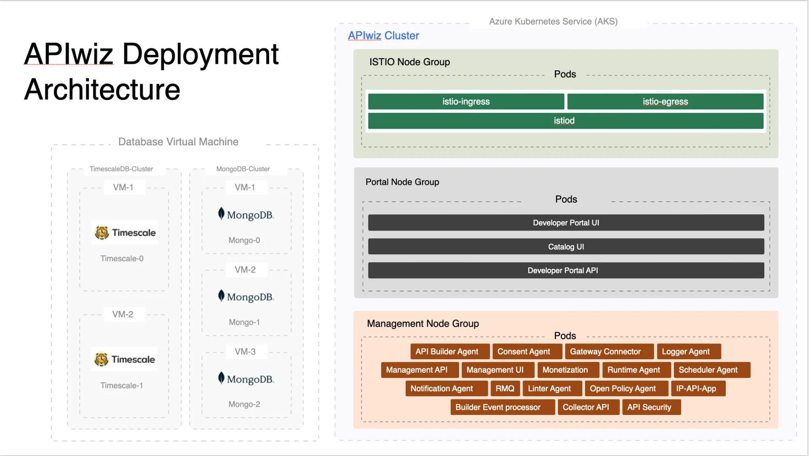

This guide provides step-by-step instructions for installing the APIwiz platform on Kubernetes and virtual machine \(VM\) environments. It's written for readers with basic Linux knowledge.

APIwiz specializes in low-code API operations \(API Ops\).

- **Low-code**: You don't need to write extensive code to build and manage APIs. The APIwiz platform provides visual tools that simplify these tasks.
- **API Ops**: This term covers the full API lifecycle: creating, testing, publishing, and maintaining APIs. APIwiz streamlines this lifecycle.

### About this installation guide

The best deployment architecture for the APIwiz platform across multiple nodes or VMs depends on your organization's requirements. The APIwiz team can help you determine the optimal setup for your environment.

The next section lists the prerequisites you need before you begin installation.

## Prerequisites

Before you install the APIwiz platform, gather the following items.

### License key and API keys

The license key and API keys grant permission to install and run the APIwiz platform; the software doesn't install or run without them. Contact the APIwiz DevOps team to request your keys.

### Domain names, SSL certificates, and SMTP details

The APIwiz platform requires domain names and SSL certificates to secure communication between clients and the APIwiz application.

**Main APIwiz platform domains**

**Developer Portal domains**

### Tools and packages

Gather the following tools and packages before you begin:

- Kubernetes cluster \(cloud or on-premises\)
- Container registry
- Istio \(optional\)
- Helm \(optional\)
- kubectl
- Virtual machines for databases
- Ansible, if you plan to install databases using Ansible

### Required databases

APIwiz requires the following databases:

- **MongoDB \(version 7\)**: APIwiz uses MongoDB 7 for its scalability, performance, flexible schema, and developer experience across use cases.
- **PostgreSQL \(version 16\), TimescaleDB \(version 2.18.0\), and btree\_gin \(version 1.3\)**: This combination manages and analyzes time-series data at scale. APIwiz uses PostgreSQL as the foundation, TimescaleDB for time-series optimization, and btree\_gin for indexing complex queries.

## Setting up the databases: MongoDB and TimescaleDB \(PostgreSQL\)

This section covers two approaches to database setup: manual configuration and Ansible-based automation.

### Disabling SELinux

Disable SELinux so it doesn't block the database software from running or accessing files. See [Disabling SELinux](https://linuxconfig.org/how-to-disable-selinux-on-linux) for instructions.

### Installing the MongoDB software

Install the MongoDB package on all nodes where MongoDB will run. Installation steps vary by Linux distribution; refer to the official documentation for your system:

- [RHEL/CentOS](https://www.mongodb.com/docs/v7.0/tutorial/install-mongodb-on-red-hat/)
- [Ubuntu](https://www.mongodb.com/docs/v7.0/tutorial/install-mongodb-on-ubuntu/)
- [Debian](https://www.mongodb.com/docs/v7.0/tutorial/install-mongodb-on-debian/)
- [Amazon Linux](https://www.mongodb.com/docs/v7.0/tutorial/install-mongodb-on-amazon/)
- [SUSE](https://www.mongodb.com/docs/v7.0/tutorial/install-mongodb-on-suse/)

### Configuring the MongoDB cluster

After you install MongoDB on your nodes, configure them to work together as a replica set.

#### Generating the cluster key file

The MongoDB nodes in the cluster need a shared secret key to authenticate with each other and prevent unauthorized nodes from joining the cluster.

**Prerequisites**: MongoDB is installed on Node 1, Node 2, and Node 3.

Do the following:

1. On Node 1, create the secret key file:
  ```text
  sudo mkdir -p /opt/apiwiz/secret && \
  sudo openssl rand -base64 756 > /opt/apiwiz/secret/mongo-cluster-keyfile
  ```
1. Copy the key file from Node 1 to Node 2 and Node 3.
1. On Node 1, Node 2, and Node 3, secure the file permissions:
  ```text
  sudo chmod 400 /opt/apiwiz/secret/mongo-cluster-keyfile && \
  sudo chown mongodb:mongodb /opt/apiwiz/secret/mongo-cluster-keyfile
  ```

All three nodes share a secured cluster key file.

#### Creating MongoDB users

Create the database users that APIwiz and the Developer Portal use.

**Prerequisites**: The cluster key file is in place.

1. Log in to Node 1 and create a template folder:
  ```text
  sudo mkdir -p /opt/apiwiz/templates
  ```
1. Add the following script to `/opt/apiwiz/templates/create_db_user.js`:
  ```javascript
  db = db.getSiblingDB('apiwiz');
  db.createUser(
  {
      user: "DB_USER",
      pwd: "DB_PASS",
      roles: [ { role: "root", db: "admin" } ]
  }
  ),
  db = db.getSiblingDB('offline-devportal');
  db.createUser(
  {
      user: "DB_USER",
      pwd: "DB_PASS",
      roles: [ { role: "root", db: "admin" } ]
  }
  )
  db = db.getSiblingDB('admin');
  db.createUser(
  {
      user: "DB_USER",
      pwd: "DB_PASS",
      roles: [ { role: "root", db: "admin" } ]
  }
  )
  ```
1. Replace the placeholder values with your MongoDB credentials:
  ```text
  sed -i "s/DB_USER/<MongoDBUserName>/g" /opt/apiwiz/templates/create_db_user.js
  sed -i "s/DB_PASS/<MongoDBPassword>/g" /opt/apiwiz/templates/create_db_user.js
  ```
1. Run the script:
  ```text
  mongosh admin /opt/apiwiz/templates/create_db_user.js
  ```

MongoDB users exist for the `apiwiz`, `offline-devportal`, and `admin` databases.

#### Configuring replication settings

Configure replication settings in the MongoDB configuration file.

**Prerequisites**: MongoDB users are created.

On Node 1, Node 2, and Node 3, run the following commands:

```text
sed -i "/#security:/c security:" /etc/mongod.conf
sed -i "/security/a \ \ \ keyFile: /opt/apiwiz/secret/mongo-cluster-keyfile" /etc/mongod.conf
sed -i "s/bindIp: 127.0.0.1/bindIp: 0.0.0.0/g" /etc/mongod.conf

## Enable replication ##
sed -i "/#replication:/c replication:" /etc/mongod.conf
sed -i '/replication/a \ \ \ replSetName: "rs"' /etc/mongod.conf
```

Restart the MongoDB service on each node:

```text
sudo service mongod restart
```

All three nodes are configured for replication and running.

#### Initializing replication

Initialize the replica set and add the secondary nodes.

**Prerequisites**: MongoDB is configured for replication on all nodes.

1. Log in to Node 1 and initialize the replica set:
  ```text
  mongosh -u <MongoDBUsername> -p <MongoDBpassword> --eval "rs.initiate()"
  ```
1. Add the secondary nodes:
  ```text
  mongosh -u <MongoDBUsername> -p <MongoDBpassword> --eval "rs.add('<MONGOClientIP1>')"
  mongosh -u <MongoDBUserName> -p <MongoDBPassword> --eval "rs.add('<MONGOClientIP2>')"
  ```
1. Check the replication status:
  ```text
  mongosh -u <MongoDBUserName> -p <MongoDBPassword> --eval "rs.status()"
  ```

The MongoDB replica set is initialized and running across all nodes.

#### Creating the first APIwiz workspace

APIwiz organizes data into workspaces, dedicated areas for teams or projects. This task creates the first workspace and its administrator account.

**Prerequisites**: MongoDB replication is initialized.

1. On Node 1, add the following script to `/opt/apiwiz/templates/create_workspace.js`, and replace `WORKSPACE_NAME`, `LOGIN_ID`, `EMAIL_ID`, `LAST_NAME`, and `FIRST_NAME` with your values:
  ```javascript
  var workspaceName ='WORKSPACE_NAME';
  var plan = 'enterprise';
  var loginId = 'LOGIN_ID';
  var emailId = 'EMAIL_ID';
  var lastName = 'LAST_NAME';
  var firstName = 'FIRST_NAME';
  var key = UUID().toString('hex').replace(/^(.{8})(.{4})(.{4})(.{4})(.{12})$/, '$1-$2-$3-$4-$5');
  var licenceKey = UUID().toString('hex').replace(/^(.{8})(.{4})(.{4})(.{4})(.{12})$/, '$1-$2-$3-$4-$5');
  var time = Date.now();

  db.Users.Workspace.List.insertOne(
  {
      '_id' : workspaceName,
      'planId' : plan,
      'status' : 'active',
      'tenant' : workspaceName,
      'key' : key,
      'seats' : NumberLong("200"),
      'paymentSchedule' : 'monthly',
      'trialPeriod' : '14',
      'isTrial' : false,
      'expiresOn' : ISODate('2021-12-03T12:18:07.469Z'),
      'licenceKey' : licenceKey ,
      'ssoEnabled' : false,
      '_class' : 'com.itorix.apiwiz.identitymanagement.model.Workspace'
  }
  );

  db.Users.List.insertOne(
  {
      "loginId" : loginId,
      "email" : emailId,
      "password" : "ef85585805585e73a697e078263de63558287b37d497eef9db712dcbf36bed24",
      "passwordLastChangedDate" : 1725000151162,
      "lastName" : lastName,
      "firstName" : firstName,
      "userStatus" : "active",
      "workspaces" : [
      {
          "roles" : [
              "Developer",
              "Admin",
              "Portal",
              "Analyst",
              "Project-Admin",
              "QA",
              "Operation",
              "Test",
              "Default"
          ],
          "workspace" : {
              '_id' : workspaceName,
              'planId' : plan,
              'status' : 'active',
              'tenant' : workspaceName,
              'key' : key,
              'seats': NumberLong("200"),
              'paymentSchedule' : 'monthly',
              'trialPeriod' : '14',
              'isTrial' : false,
              'expiresOn' : ISODate('2021-12-03T12:18:07.469Z'),
              'licenceKey' : licenceKey ,
              'ssoEnabled' : false,
              '_class' : 'com.itorix.apiwiz.identitymanagement.model.Workspace'
          },
          "userType" : "Site-Admin",
          "acceptInvite" : true,
          "active" : true
      }],
      "userCount" : NumberLong("0"),
      "subscribeNewsLetter" : false,
      "invited" : false,
      "cts" : NumberLong(String(time)),
      "mts" : NumberLong(String(time)),
      "_class" : "com.itorix.apiwiz.identitymanagement.model.User"
  }
  );

  db.API.Clients.List.insertOne(
  {
      _id: workspaceName,
      clientSecret: key,
      disabled: false
  }
  );
  ```
1. Run the script:
  ```text
  mongosh mongodb://<MongoDBUserName>:<MongoDBPassword>@127.0.0.1/apiwiz /opt/apiwiz/templates/create_workspace.js
  ```

The first APIwiz workspace and administrator account are created.

#### Importing static data

Import the static reference data that APIwiz requires.

**Prerequisites**: The first workspace is created.

1. Create the import folder:
  ```text
  mkdir -p /opt/apiwiz/mongo
  ```
1. Upload `db-collections.zip` to `/opt/apiwiz/mongo`.
1. Restore the data:
  ```text
  mongorestore --host <pvtIP> -u <MongoDBUserName> -p <MongoDBPassword> --port 27017 --gzip /opt/apiwiz/mongo/db-collections
  ```

The static reference data is imported into MongoDB.

### Installing MongoDB and TimescaleDB using Ansible

As an alternative to manual configuration, you can install MongoDB and TimescaleDB using Ansible playbooks that APIwiz provides.

**Prerequisites**:

- Ansible is installed on a node with SSH access to all database nodes.
- The `apiwiz-db-automation-ansible.zip` file, which contains the Ansible playbooks, is uploaded to the Ansible node. The SSH user must have root privileges on all target nodes.

#### Configuring firewall rules for a multi-node setup

In your cloud environment, configure the security group to allow the following ports for each MongoDB node.

#### Installing the MongoDB replica set with Ansible

MongoDB can run on a single node or across multiple nodes.

**Prerequisites**: Ansible and the playbook package are installed, and firewall rules are configured.

1. Log in to the Ansible node and go to the MongoDB playbook directory:
  ```text
  cd {{path}}/apiwiz-db-automation-ansible/mongodb
  ```
1. In `group_vars/mongo-replicaset.yaml`, enter your MongoDB username and password:
  ```text
  vim group_vars/mongo-replicaset.yaml
  ```
1. In `inventory/replicaset.ini`, update the replica set nodes and SSH user:
  ```text
  node1 ansible_host=<IP1> ansible_user=<user>
  node2 ansible_host=<IP2> ansible_user=<user>
  node3 ansible_host=<IP3> ansible_user=<user>
  ```
1. Run the Ansible playbook:
  ```text
  cd {{path}}/apiwiz-db-automation-ansible/mongodb/playbook
  ansible-playbook -i ../inventory/replicaset.ini replicaset.yaml
  ```

The MongoDB replica set is installed and configured.

#### Installing TimescaleDB with a master-replica setup using Ansible

**Prerequisites**: Ansible and the playbook package are installed, and firewall rules are configured.

1. Log in to the master node where the Ansible files are uploaded, and go to the TimescaleDB playbook directory:
  ```text
  cd path/apiwiz-db-automation-ansible/timescaledb
  ```
1. In the `inventory` file, enter your PostgreSQL user and password:
  ```text
  vim inventory
  ---
  [master]
  master-node ansible_host=<IP1> ansible_user=<user>

  [replica]
  replica-node ansible_host=<IP2> ansible_user=<user>

  [all:vars]
  pg_version=16
  tsdb_version=2.18.0
  pg_password='<password>'
  pg_repuser=<user>
  repuser_password='<password>'
  pg_rep_slot=replica_1_slot
  pg_database=apiwiz
  allow_cidr=10.1.0.0/24
  ```
1. Complete the prerequisites in the [TimescaleDB Ansible documentation](#bookmark-4221ffaf-95c6-44d1-994b-5a5b5e2d4310).
1. Run the Ansible playbook:
  ```text
  cd {{path}}/apiwiz-db-automation-ansible/timescaledb
  ansible-playbook -i inventory playbook.yml
  ```

TimescaleDB is installed with a master-replica configuration.

## Kubernetes deployment

After you set up the databases, install the APIwiz platform on your Kubernetes cluster. APIwiz supports self-hosted Kubernetes and managed Kubernetes services on any cloud — for example, EKS, GKE, AKS, and OpenShift.

### Deployment architecture

The following diagram shows a typical APIwiz deployment architecture on Azure Kubernetes Service \(AKS\), alongside a separate database virtual machine.



The diagram shows two main areas:

- **Database virtual machine**: A TimescaleDB cluster \(VM-1 and VM-2, each running Timescale\) and a MongoDB cluster \(VM-1 through VM-3, each running MongoDB\).
- **APIwiz cluster on AKS**, organized into three node groups:
  - **Istio node group**: runs the `istio-ingress`, `istio-egress`, and `istiod` pods.
  - **Portal node group**: runs the Developer Portal UI, Catalog UI, and Developer Portal API pods.
  - **Management node group**: runs the API Builder Agent, Consent Agent, Gateway Connector, Logger Agent, Management API, Management UI, Monetization, Runtime Agent, Scheduler Agent, Notification Agent, RabbitMQ \(RMQ\), Linter Agent, Open Policy Agent, IP-API-App, Builder Event Processor, Collector API, and API Security pods.

### Configuration file reference

Before you request deployment files from APIwiz, gather the values for the following configuration fields.

**Domain and namespace settings**

**Application host settings**

**License and API key settings**

**AWS and image pull settings**

**MongoDB settings**

**PostgreSQL settings**

**Rate limiting settings \(optional\)**

**API Builder settings**

**RabbitMQ settings**

**Frontend configuration settings**

### Installing the main APIwiz platform components

Deploy the core APIwiz platform components to your Kubernetes cluster.

**Prerequisites**: A running Kubernetes cluster, a completed database setup \(MongoDB and PostgreSQL with extensions\), and the `kubectl` tool.

#### Configuring kubectl

Point `kubectl` to the correct Kubernetes cluster before you deploy APIwiz.

1. Check the current context:
  ```text
  kubectl config current-context
  ```
1. Set the context to your cluster. Replace `my-cluster-name` with your actual cluster name:
  ```text
  kubectl config use-context my-cluster-name
  kubectl config set-cluster my-cluster-name
  ```

#### Creating the namespace

Create a dedicated namespace to isolate the APIwiz deployment.

Replace `<NAMESPACE>` with the value from your configuration file, and run:

```text
kubectl create namespace <NAMESPACE>
```

Example:

```text
kubectl create namespace apiwiz-system
```

#### Deploying platform components

Deploy each APIwiz component using its deployment file.

1. Deploy an application component:
  ```text
  kubectl -n apiwiz-system apply -f <app-name>-deploy.yaml
  ```
1. Deploy the OPA server:
  ```text
  kubectl -n apiwiz-system apply -f opa-server-deploy.yaml
  ```
1. Deploy RabbitMQ:
  ```text
  kubectl -n apiwiz-system apply -f rabbitmq-deploy.yaml
  ```

The core APIwiz platform components are running in the `apiwiz-system` namespace.

### Installing the APIwiz Developer Portal

Deploy the components that make up the Developer Portal.

**Prerequisites**: `kubectl` is configured to connect to your APIwiz Kubernetes cluster.

Deploy the Developer Portal components:

```text
kubectl -n apiwiz-system apply -f devportal-api-deploy.yaml
kubectl -n apiwiz-system apply -f devportal-ui-deploy.yaml
kubectl -n apiwiz-system apply -f apiwiz-api-catalog-ui-deploy.yaml
```

The Developer Portal UI, Developer Portal API, and Catalog UI are running.

**Developer Portal components**

## APIwiz list of applications

The following table lists all applications deployed as part of the APIwiz platform.