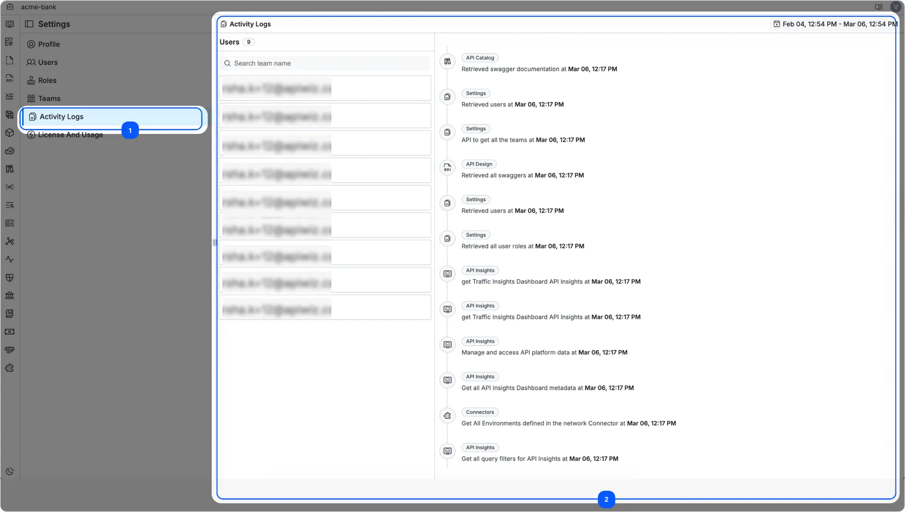
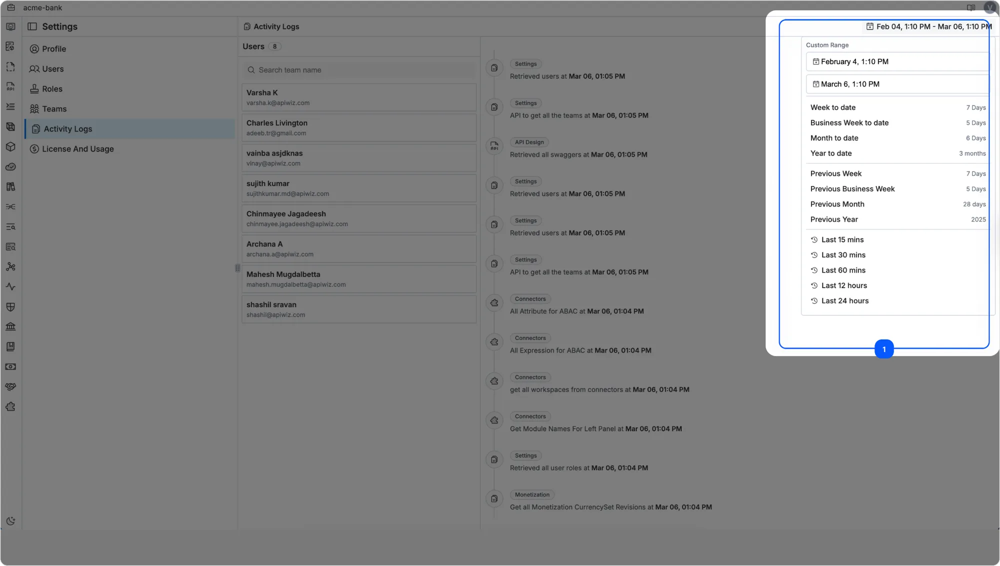

The **Activity Logs** tab provides a detailed record of user actions within the system. Administrators use this feature to track user activity for auditing, troubleshooting, and compliance purposes.

To access activity logs, select **Activity Logs** from the left navigation menu under **Settings**.

The **Users** panel, displayed on the left side of the page, lists all users in your organization. Use this panel to locate a user and view their activity history.

Each entry in the **Users** panel includes the following details:

To view a user's activity:

1. In the **Users** panel, enter a name or email in the **Search** bar to find a specific user.
1. Select the user from the list.

The user's activity history appears in the **Activity Timeline** panel.

### Activity Timeline

The **Activity Timeline** panel, located on the right side of the page, displays a chronological list of actions performed by the selected user. The most recent activity appears at the top of the list.

Each log entry includes the following details:

### Filtering activity logs by date range

The **Date Range Selector**, located at the top-right corner of the **Activity Logs** page, lets you filter user activities by a specific time period.

To filter activity logs by date range, do the following:

1. Select the **Date Range Selector** at the top-right corner of the page. The date range panel opens, displaying multiple filtering options.
  
1. Choose one of the following filter types:
  - **Custom Range**: Select a start date and time, and an end date and time.
  - **Predefined Time Ranges**: Week to date, Business Week to date, Month to date, or Year to date.
  - **Previous Periods**: Previous Week, Previous Business Week, Previous Month, or Previous Year.
  - **Recent Activity**: Last 15 mins, Last 30 mins, Last 60 mins, Last 12 hours, or Last 24 hours.

The **Activity Timeline** updates automatically to display logs within the selected time period.