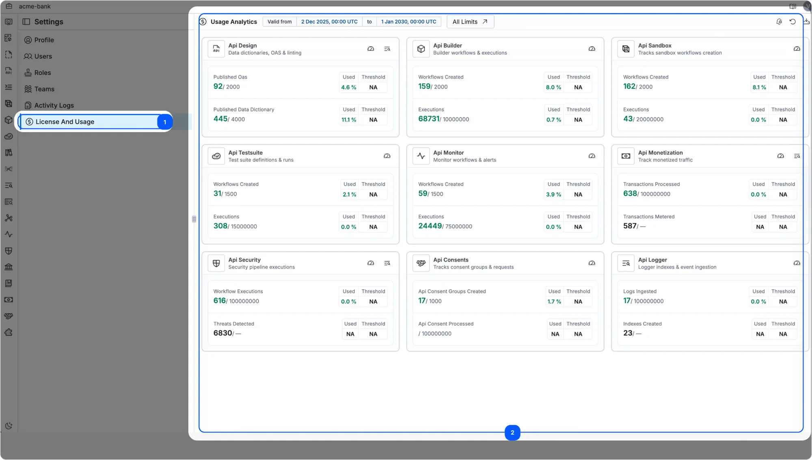
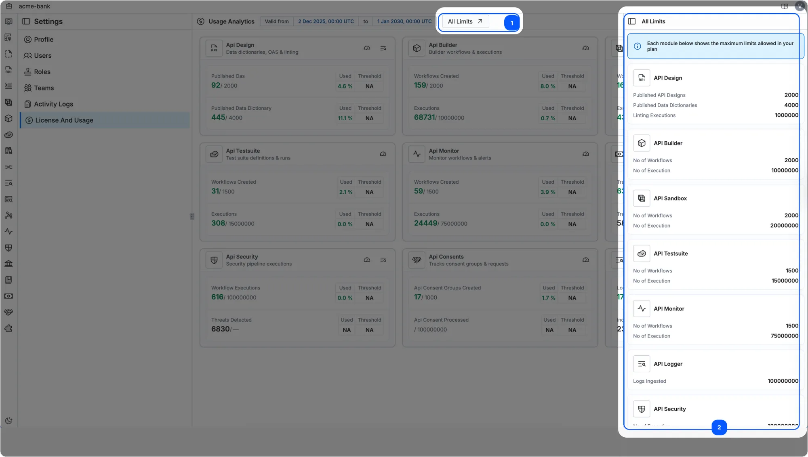
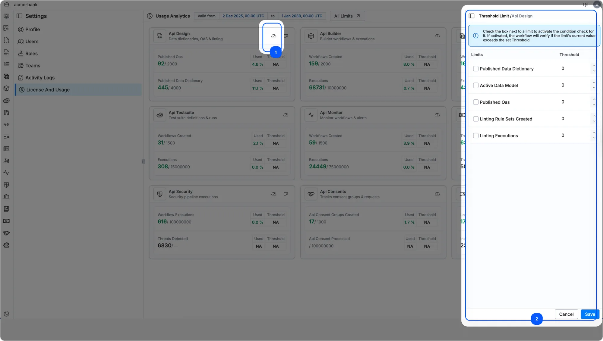
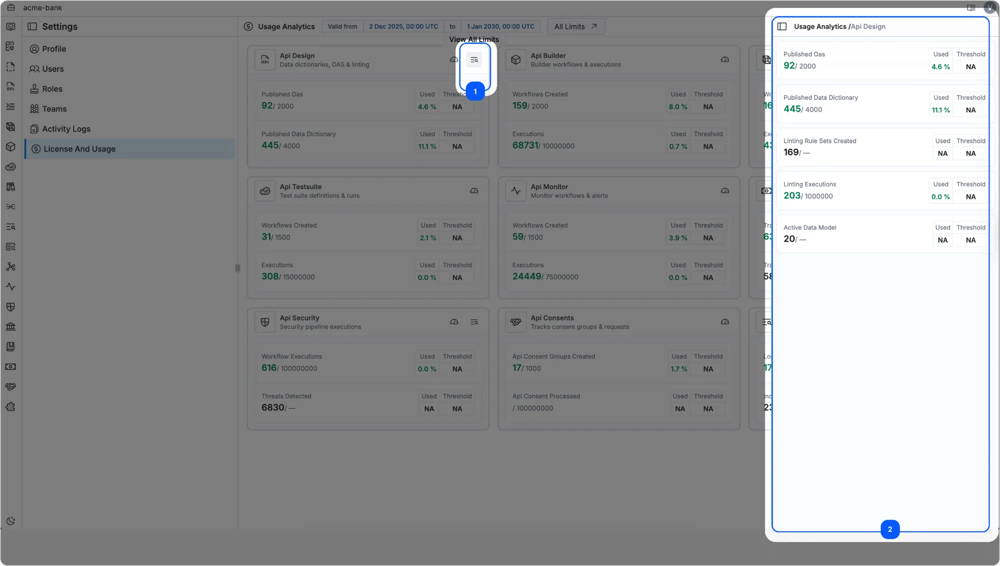

**License and Usage** gives you detailed visibility into how your organization consumes platform resources. The feature organizes usage metrics into nine modules, including **API Design**, **API Builder**, **API Sandbox**, **API Testsuite**, **API Monitor**, **API Monetization**, **API Security**, **API Consents**, and **API Logger**.

Each module displays the usage count, the configured limit, and the percentage of consumption, helping you understand your overall utilization.

The header bar also displays license validity information, including the license start date and expiry date, so you can clearly understand the duration and validity window of your subscription.

To access usage and license details, select **License and Usage** from the left navigation menu under **Settings**.

The **Usage Analytics** window appears on the right side of the page, displaying usage details for each module.

### Usage limits and tracking

When a license is created, you can define usage limits for each module. A limit determines how many items you can create or process, such as workflows in **API Sandbox** or executions in **API Builder**.

Usage counters increase automatically as users perform actions. Each module card displays the following details:

Not all modules require limits. You configure limits only where needed, based on your operational scale.

### Thresholds and notifications

You can configure threshold values for individual usage metrics to trigger an alert at a specific percentage of usage. When usage crosses the configured threshold, the system triggers a one-time alert.

The system delivers alerts through one of the following channels:

- Slack
- Email
- Microsoft Teams

### License expiry alerts

The system supports proactive license management. When a license has fewer than 30 days remaining, an alert message appears in the top-right corner of the workspace. This alert gives you enough time to renew or update your license.

### Module-wise usage tracking

The following table describes the usage metrics tracked for each module.

Each module displays the usage count, allowed limit, and percentage consumed, and highlights items that are nearing or exceeding their configured limits. Metrics without a configured limit display **NA**.

### Viewing limits for all modules

The **All Limits** panel shows the maximum limits defined for each module in your plan.

To view limits for all modules, do the following:

1. Select **All Limits** from the header bar.
  

A panel opens on the right side of the page, listing module-wise limits, such as the number of workflows, executions, logs ingested, and other items allowed under your current license.

### Managing module thresholds

You can configure threshold values for individual modules to control when the system triggers usage alerts.

To manage the threshold for a module, do the following:

1. On the module card you want to configure, select the **Manage Threshold** icon \(gauge icon\).  A panel opens on the right side of the page displaying all configurable threshold items for the selected module.
  
1. For each line item, select the checkbox to enable threshold monitoring.
1. Enter the required threshold value.
1. Select **Save** to apply the settings, or select **Cancel** to close the panel without making changes.
1. Enter the threshold values for the items you want to monitor.
1. Select **Save** to apply the threshold settings, or select **Cancel** to close the panel without making changes.

When you activate a threshold, the system checks whether the current usage exceeds the configured value and sends an alert when it does.

### Viewing module usage

The usage breakdown for a module shows your consumption against the limits defined in your license.

To view the usage breakdown for a module, do the following:

1. On the module card, select **View All Limits**, located next to the **Manage Threshold** icon.
  

The **Usage Analytics** panel opens on the right side of the page, showing the complete limit breakdown for the selected module. The panel lists the key usage items, their current consumption, the maximum limits defined in your license, and any configured threshold values.