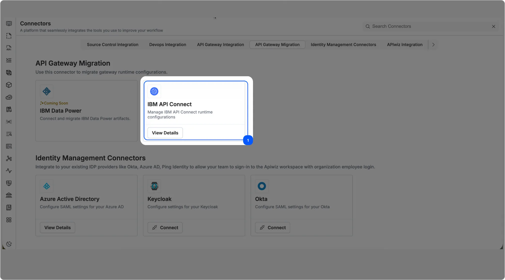
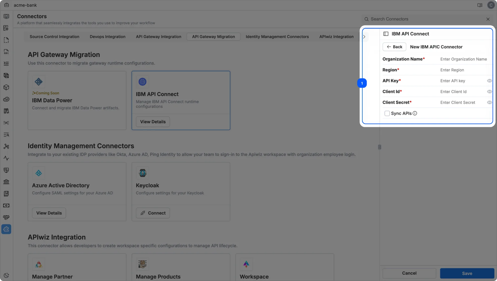

API Gateway Migration is the specialized process of transferring API assets, configurations, routing logic, and security policies from one API gateway environment to another. In modern software architectures, an API gateway acts as the central control point for managing API traffic, enforcing security, and handling routing. However, as organizations evolve, they frequently need to switch their gateway providers—for example, moving from a legacy system or an existing solution like IBM API Connect to a different platform like Google Apigee.

Because different gateway vendors use entirely different underlying architectures, proprietary policy formats, and configuration structures, manually moving these assets is notoriously difficult. API Gateway Migration within the APIwiz platform solves this by providing automated utilities and specialized wizards. These tools automatically connect to the source gateway, read the existing API definitions, and handle the complex mapping of endpoints, policies, and configuration differences so they can be seamlessly translated and deployed to the target gateway.

**The Role of API Gateway Migration in API Management**

Migration connectors play a pivotal, strategic role in maintaining a flexible, scalable, and secure API ecosystem. Their primary functions and benefits include:

- **Eliminating Vendor Lock-in:** Historically, organizations were trapped with a single gateway provider because the cost and technical difficulty of migrating hundreds of APIs were too high. Migration utilities break down these barriers, giving organizations the freedom to switch gateways to take advantage of better pricing, performance, or modern cloud-native features without having to manually rebuild their entire API infrastructure.
- **Risk Mitigation and Error Reduction:** Manually recreating API endpoints and security policies across platforms is highly prone to human error. A single misconfigured authorization policy or rate limit during a manual move can lead to severe security vulnerabilities or system outages. Automated migration handles the mapping of these policies programmatically, significantly reducing the manual effort and the inherent risks associated with enterprise migration projects.
- **Accelerated Time-to-Market:** Enterprise migration projects that once took months or years can be reduced to days. By using wizards to automate the extraction and translation of API assets, development and operations teams can migrate massive catalogs of APIs quickly, ensuring business continuity and faster delivery.
- **Consolidation of Infrastructure:** Large enterprises or companies that have recently undergone mergers and acquisitions often inherit a fragmented landscape of multiple different API gateways. Migration connectors allow these organizations to consolidate their APIs into a single, unified gateway platform, standardizing their governance, monitoring, and security models.
- **Centralized Synchronization:** Migration isn't always a one-time shift; sometimes it involves pulling existing APIs into a centralized management plane. These connectors allow the platform to synchronize APIs directly from a gateway into the APIwiz design studio. This gives teams a single pane of glass to view, manage, and subsequently deploy their API configurations.

## **IBM API Connect**

IBM API Connect is a robust, enterprise-grade API management solution used to create, run, manage, and secure APIs across cloud and on-premises environments. Within the APIwiz platform, the IBM API Connect connector functions as a specialized migration tool that integrates directly with IBM’s environment. Relying on strict API Key and OAuth authentication, it empowers organizations to securely connect, manage, and seamlessly sync or migrate their IBM API configurations and catalogs into the centralized APIwiz design studio.

### **Prerequisites: Preparing to Connect IBM API Connect**

Before configuring the connector in the APIwiz workspace, you must gather five specific pieces of information from your IBM API Connect environment: Organization Name, Region, API Key, Client ID, and Client Secret.

**Step 1: Locate your Organization Name and Region.**

1. Log in to your [IBM Cloud](https://cloud.ibm.com/login) account or your on-premises IBM API Connect API Manager console.
1. Navigate to your API Connect service instance.
1. Identify your **Provider Organization Name** \(the specific organization that manages your APIs\) and note it down.
1. Identify the specific **Region** where your IBM Cloud service is hosted \(e.g., us-south, eu-gb\). Note this down.

**Step 2: Generate an IBM Cloud API Key.**

1. In the IBM Cloud console, go to the **Manage** menu at the top and select **Access \(IAM\)**.
1. On the left-hand navigation, click on **API keys**.
1. Click the **Create an IBM Cloud API key** button. Provide a name and description \(e.g., *APIwiz Migration Key*\).
1. Click **Create**. **Copy or download this API Key immediately**, as it will be hidden after you close the window.
  You can refer to [this](https://cloud.ibm.com/docs/account?topic=account-userapikey) documentation for more and updated information.

  **Step 3: Register an Application for OAuth Credentials.**
1. You need a Client ID and Client Secret to authenticate the integration via OAuth.
1. Within the IBM API Connect API Manager, navigate to the **Consumer API** or **App Registration** section associated with the Catalog you want to access.
1. Register a new Application for the APIwiz integration.
1. Upon successful registration, the system will generate a **Client ID** and a **Client Secret**.
1. Securely document both of these strings, as they are required for APIwiz to establish a secure connection.
  You can refer to [this](https://adityasingh-lab.com/posts/apim-oauth-client-cred-simple/) documentation for more and updated information.

### **Connecting IBM API Connect in the APIwiz Workspace**

Once you have gathered your Organization Name, Region, API Key, Client ID, and Client Secret, follow these step-by-step instructions to establish the connection:

**Step 1: Locate the Connector**

1. Log in to your APIwiz workspace dashboard.
1. Navigate to the **Connectors** module from the left-hand main menu.
1. Select the **API Gateway Migration** category from the top navigation tabs.
1. Locate the **IBM API Connect** Connector card.

**Step 2: Initiate the Connection**

1. Click the **Connect** button directly on the IBM API Connect connector card.
1. A configuration panel will immediately slide open on the right-hand side of your screen.
1. Click on the **\+ New Connection** button inside this panel to start your configuration.

**Step 3**: Enter Configuration Details \*\* In the configuration form, carefully enter the details you gathered during the prerequisite phase:

1. **Organization Name:** Enter the exact IBM API Connect provider organization name you located in Step 1 of the prerequisites \(e.g., *my-org*\).
1. **Region:** Enter the corresponding IBM Cloud region where your instance is hosted \(e.g., *us-south*\).
1. **API Key:** Paste the secure API key you generated in IBM Cloud IAM.
1. **Client ID:** Enter the OAuth client ID you generated during your app registration.
1. **Client Secret:** Enter the matching OAuth client secret.

**Step 4: Configure API Synchronization**

1. Below the credential fields, locate the checkbox labeled **Sync APIs**.
1. **Enable Synchronization:** If you check this box, the platform will automatically synchronize all APIs from your IBM API Connect catalogs directly into your APIwiz design studio.
1. **Important Limitation to Note:** Be aware that this synchronization is a one-time pull at the moment of sync. Any subsequent updates or changes made directly within the IBM API Connect console *after* you configure this connector will not be automatically pulled into the APIwiz platform.

**Step 5: Save the Configuration**

1. After entering all the required details and choosing your sync preference, click the **Save** button located at the bottom of the panel.
1. Look for a **success message** appearing at the bottom of the screen, indicating that the connection to IBM API Connect has been successfully established.

**Step 6: Verify and Manage the Connector**

1. Observe the IBM API Connect Connector card on your dashboard; the button will have changed from "Connect" to **"View Details"**.
1. Whenever you need to manage this integration in the future, click the **View Details** button.
1. A window will open displaying your current configuration. From here, you can seamlessly use the **Edit** function to update your credentials \(e.g., if your IBM API Key or Client Secret rotates\) or use the **Delete** function to completely remove the connection if the migration project is finished.