APIwiz Integration connectors are designed to manage the internal configurations of the APIwiz workspace itself. Unlike external connectors that bridge the platform to third-party tools, these connectors form the operational backbone of the platform, connecting internal components to provide a unified environment for end-to-end API lifecycle management.

Administrators and developers use these connectors to define workspace-specific rules, establish security protocols, map deployment environments, and manage business-level logic such as API products and partner data.

### Role in API management

### Supported connectors

## Manage Partner

The Manage Partner connector centralizes the creation and administration of your partner ecosystem. It lets you securely connect, manage, retrieve, and update partner-related data directly within the platform — ensuring that APIs, workflows, and integrations associated with partners are organized effectively.

### Prerequisites

Before configuring the Manage Partner connector, gather the following information:

- **Partner entity**: Identify the external organization or internal business unit you are integrating, and understand their role, for example, a third-party payment gateway or an internal data team.
- **Naming convention**: Decide on a system-friendly unique identifier such as partner-alpha-payments and a human-readable display name such as Alpha Payment Gateway.
- **Partner description**: Draft a clear, concise description of what the partner does and why they are integrated into the workspace.
- **Default status**: Decide whether this partner should be the default partner group for your workspace.

### Configure Manage Partner

To configure the Manage Partner connector, follow these steps:

**Step 1: Locate the connector**

1. Sign in to your APIwiz workspace.
1. In the left navigation menu, select **Connectors**.
1. Select the **APIwiz Integration** category.
1. Locate the **Manage Partner** connector card.
  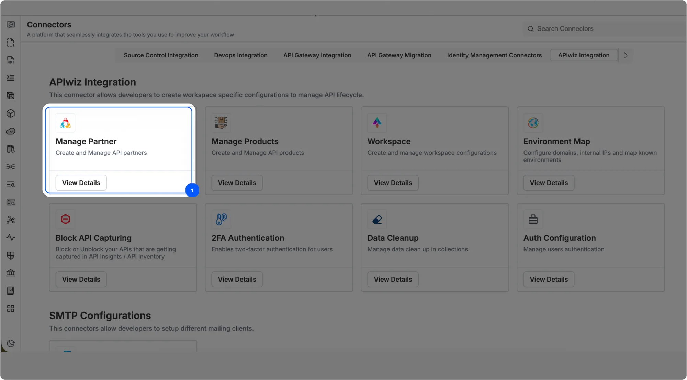

**Step 2: Initiate the connection**

Select **Connect**. If partners already exist, select **View Details** instead. The configuration panel opens on the right side of the screen.

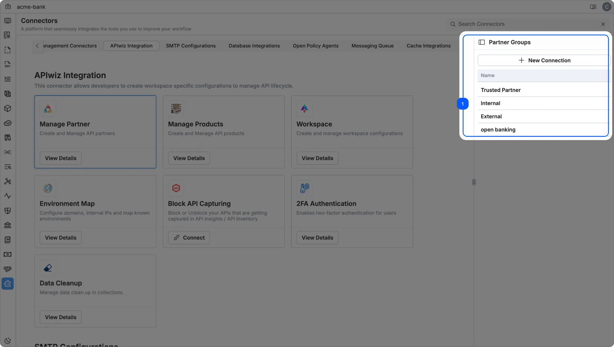

**Step 3: Create a new partner connection**

In the right panel, select **\+ New Connection** to begin defining your new partner.

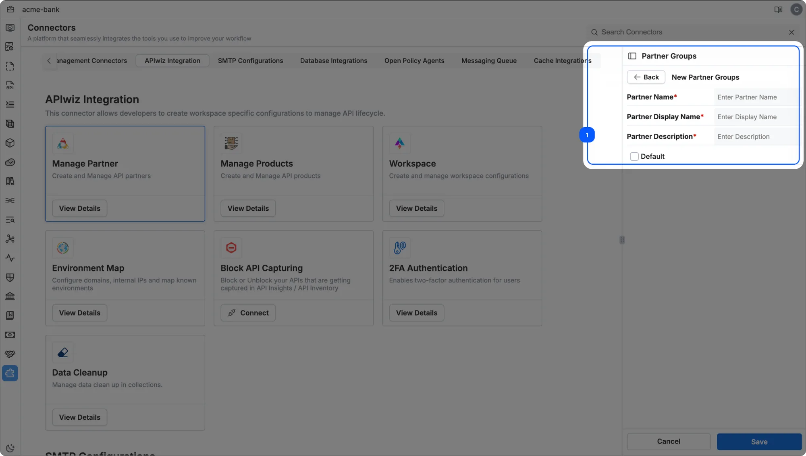

**Step 4: Enter partner configuration details**

Fill in the following fields:

**Step 5: Save the configuration**

Select **Save**.

The **Connector** button on the Manage Partner card changes to **View Details**.

**Step 6: Manage the connector**

1. Select **View Details** on the connector card to review or update the partner configuration.
1. Select an action:
  - **Edit**: Update the partner's display name or description.
  - **Delete**: Remove the partner from your workspace.

## Manage Products

The Manage Products connector lets you create and configure API products within the platform. In API management, a product is a logical bundle of one or more APIs packaged together for a specific audience or use case, such as a Starter tier or an Enterprise tier. This connector helps organizations package backend services, attach usage plans or rate limits, and streamline the consumption and monetization of their API catalog.

### Prerequisites

Before configuring the Manage Products connector, gather the following information:

- **APIs to bundle:** Determine which individual APIs or microservices will be packaged into this product, for example, a Payments API, an Inventory API, and a Shipping API.
- **Naming convention**: Decide on a unique, clear name that reflects the product's purpose or tier, for example, AcmePayments\_STARTER or CrossBorderPay\_ENTERPRISE.
- **Target audience:** Define who will consume this product; internal developers, external partners, or public consumers, to ensure the product is mapped to the correct access controls.

### Configure Manage Products

To configure the Manage Products connector, follow these steps:

**Step 1: Locate the connector**

1. Sign in to your APIwiz workspace.
1. In the left navigation menu, select **Connectors**.
1. Select the **APIwiz Integration** category.
1. Locate the **Manage Products** connector card.
  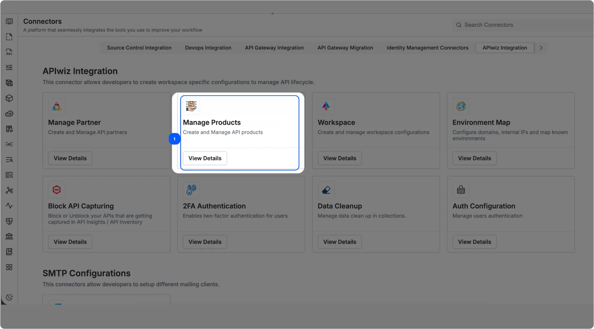

**Step 2: Initiate the connection**

Select **Connect**. If products already exist, select **View Details** instead. The configuration panel opens on the right side of the screen.

**Step 3: Create a new product**

In the right panel, select the **\+** icon at the top right of the Products list.

**Step 4: Enter product configuration details**

Fill in the following field:

**Step 5: Save the configuration**

Select **Save**.

The new product appears in the Products list, and the connector card button changes to **View Details**.

**Step 6: Manage the connector**

1. Select **View Details** on the connector card to review or add products.
1. Select an action:
  - **Edit**: Modify the connector details.
  - **Delete**: Remove the product from your workspace.

## Workspace

The Workspace connector lets administrators and developers manage and store workspace-level configurations centrally. It provides a secure repository for defining key-value configuration pairs that control how the workspace operates or interacts with other modules. Built-in encryption capabilities protect sensitive configuration values.

### Prerequisites

Before configuring the Workspace connector, gather the following information:

- **Required configurations**: Identify what workspace-level settings need to be established, such as timeout limits, default source control branches, or feature toggles.
- **Encryption needs**: Review the values you plan to store. If a value contains sensitive data, plan to enable encryption for that key-value pair.
- **Available keys**: Review the predefined list of configuration keys available for your workspace to ensure they are applied correctly across all workflows.

### Configure Workspace

To configure the Workspace connector, follow these steps:

**Step 1: Locate the connector**

1. Sign in to your APIwiz workspace.
1. In the left navigation menu, select **Connectors**.
1. Select the **APIwiz Integration** category.
1. Locate the **Workspace** connector card.
  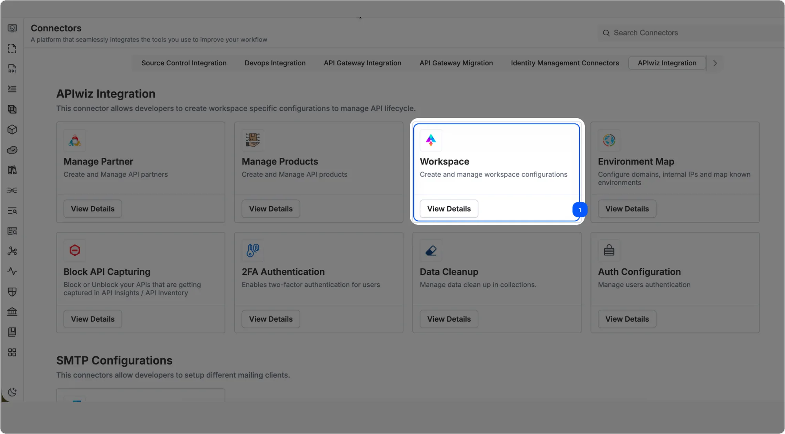

**Step 2: Initiate the connection**

Select **Connect**. If a workspace already exists, select **View Details** instead. The configuration panel opens on the right side of the screen.

**Step 3: Add a new configuration pair**

In the right panel, select the **\+** icon at the top right of the Manage Workspace list.

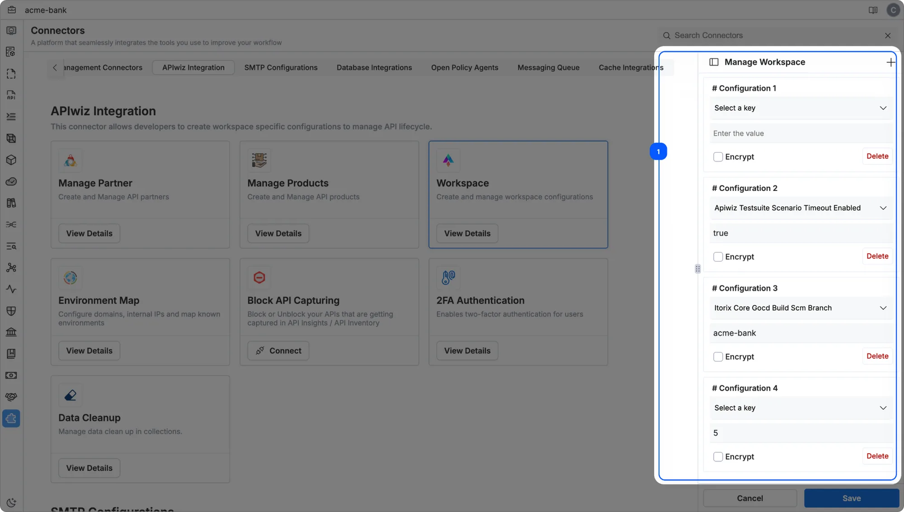

**Step 4: Enter configuration details**

Fill in the following fields:

**Step 5: Save the configuration**

Select **Save**.

The connector card button changes to **View Details**.

**Step 6: Manage the connector**

1. Select **View Details** to review or update workspace configurations.
1. Select an action:
  - **Edit** – Update specific configuration values.
  - **Delete** – Remove a configuration rule from your workspace.

**Step 2: Initiate the Connection**

1. Click the **Connector button** \(or "View Details" if already partially active\) directly on the Workspace card.
1. A configuration panel will immediately slide open on the right-hand side of your screen.

## Environment Map

The Environment Map connector lets you define and centrally manage environment-specific mappings. It controls how your APIs, backend services, and workspace configurations behave as they move across different lifecycle stages such as Development, Staging, and Production — ensuring precise traffic routing, consistent deployment behavior, and seamless transitions between testing and production environments.

### Prerequisites

Before configuring the Environment Map connector, gather the following information:

- **Environment lifecycle**: Define the distinct environments your organization uses, such as DEV, QA, STAGE, and PROD.
- **Domain names**: For each environment, identify the specific URLs or domain names that route traffic to it, for example, api-stage.company.com for staging and api.company.com for production.
- **Internal IP addresses**: Identify any specific internal IP addresses used for private routing within each environment, for example, 10.10.161.49.
- **Public exposure needs**: Decide whether each domain should be locked down for internal use only or exposed to the public internet.

### Configure Environment Map

To configure the Environment Map connector, follow these steps:

**Step 1: Locate the connector**

1. Sign in to your APIwiz workspace.
1. In the left navigation menu, select **Connectors**.
1. Select the **APIwiz Integration** category.
1. Locate the **Environment Map** connector card.
  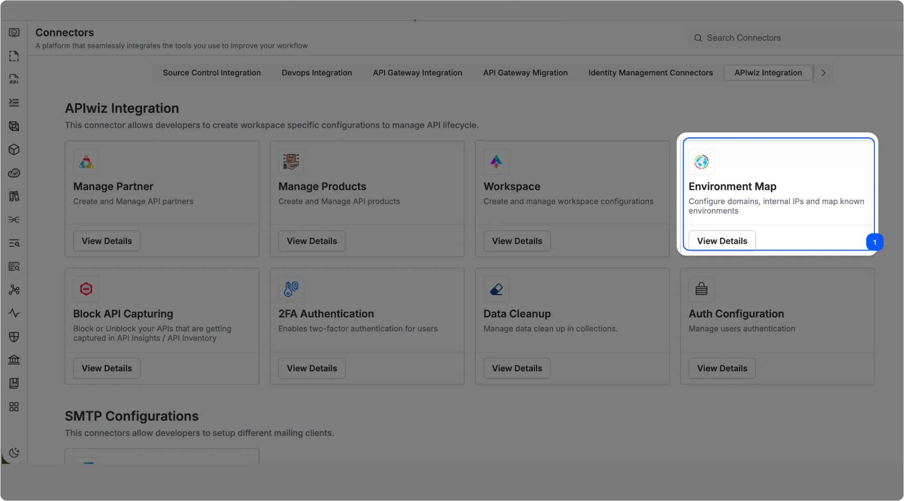

**Step 2: Initiate the connection**

Select **Connect**. If the environment already exists, select **View Details** instead. The configuration panel opens on the right side of the screen.

**Step 3: Create a new environment**

1. In the right panel, select the **\+** icon.
1. Enter the **Environment Name**, for example, PROD or DEV. The name must be unique within your workspace.
1. Select the **✅** check mark to save the environment.

A success message confirms the environment has been created.

**Step 4: Map domains to the environment**

1. Next to the newly created environment, select the **\>** button to expand the domain window.
1. Select the **\+** icon next to **Domains**.
1. Enter the **Domain Name**, for example, api.apiwiz.io.
1. Select **Externally Expose** if this domain needs to be accessible from the internet.
1. Select the **✅** check mark to save.

A success message confirms the domain has been added and it appears nested under the environment.

**Step 5: Configure internal IPs \(optional\)**

1. In the expanded environment view, locate the **Internal IPs** section.
1. Select the **\+** icon to add a new internal IP address.
1. Enter the IP address, for example, 10.10.161.49, and save it.

**Step 6: Manage the connector**

1. Select the **⋮** menu next to an environment name to manage it.
1. Select an action:
  - **Edit**: Modify the environment or domain name.
  - **Delete**: Remove the environment mapping from your workspace.

## Block API Capturing

The Block API Capturing connector lets administrators configure rules to prevent specific API traffic from being logged, monitored, or captured in API Insights and API Inventory. Use this connector to exclude sensitive data such as payment processing endpoints or personally identifiable information from being recorded, ensuring strict data privacy and compliance. It also helps maintain platform performance by filtering out high-volume, low-value API calls such as routine health checks.

### Prerequisites

Before configuring the Block API Capturing connector, gather the following information:

- **Sensitive or noisy endpoints**: Identify APIs that handle sensitive information that should never be logged, such as /login or /checkout, or APIs that generate excessive unnecessary logs, such as /ping or /health.
- **URL path patterns**: Determine the specific path patterns to block, for example, a single endpoint like /payments/v1/process or a wildcard directory like /payments/v1/\*.
- **HTTP methods**: Decide whether to block all traffic to a path or only specific methods, for example, blocking POST requests while still logging GET requests.
- **Naming convention**: Prepare clear, descriptive names for your block rules so other developers understand why specific API traffic is excluded from analytics.

### Configure Block API Capturing

To configure the Block API Capturing connector, follow these steps:

**Step 1: Locate the connector**

1. Sign in to your APIwiz workspace.
1. In the left navigation menu, select **Connectors**.
1. Select the **APIwiz Integration** category.
1. Locate the **Block API Capturing** connector card.
  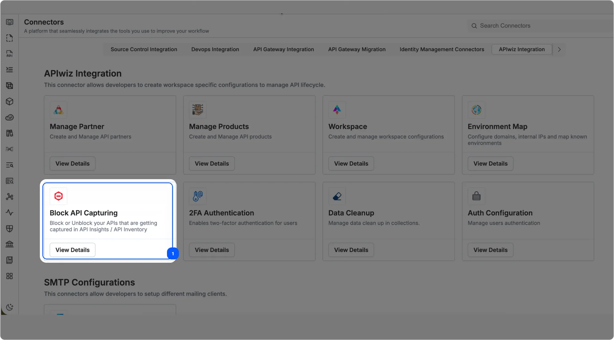

**Step 2: Initiate the connection**

Select **Connect**. If the block API capturing already exists, select **View Details** instead. The configuration panel opens on the right side of the screen.

**Step 3: Create a new block rule**

In the right panel, select **\+ New Request Group**.

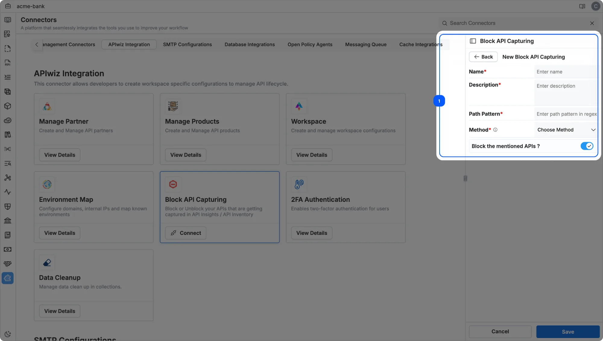

**Step 4: Enter configuration details**

Fill in the following fields:

**Step 5: Save the configuration**

Select **Save**.

The **Connect** button on the Block API Capturing card changes to **View Details**.

**Step 6: Manage the connector**

1. Select **View Details** to review or update existing block rules.
1. Select an action:
  - **Edit**: Update a path pattern or HTTP method.
  - **Delete**: Remove a block rule to resume capturing that API's traffic.

## 2FA Authentication

The 2FA Authentication connector enhances account security by requiring a two-factor authentication \(2FA\) step for users logging into the workspace. It requires an additional layer of verification alongside standard passwords. Administrators can customize the One-Time Password \(OTP\) length, set expiration timeouts, and define retry limits to align with their organization's security compliance policies.

### Prerequisites

Before configuring the 2FA Authentication connector, define the following:

- **OTP lifespan** – Determine how long the OTP remains valid before expiring, for example, 60 or 120 seconds.
- **OTP length** – Define the number of digits the OTP should contain, for example, 6.
- **Retry limit** – Determine the maximum number of failed OTP attempts allowed before a user is locked out.
- **User communication** – Inform your developers and administrators that they will need access to their email or authentication device to receive OTPs upon their next login.

### Configure 2FA Authentication

To configure the 2FA Authentication connector, follow these steps:

**Step 1: Locate the connector**

1. Sign in to your APIwiz workspace.
1. In the left navigation menu, select **Connectors**.
1. Select the **APIwiz Integration** category.
1. Locate the **2FA Authentication** connector card.
  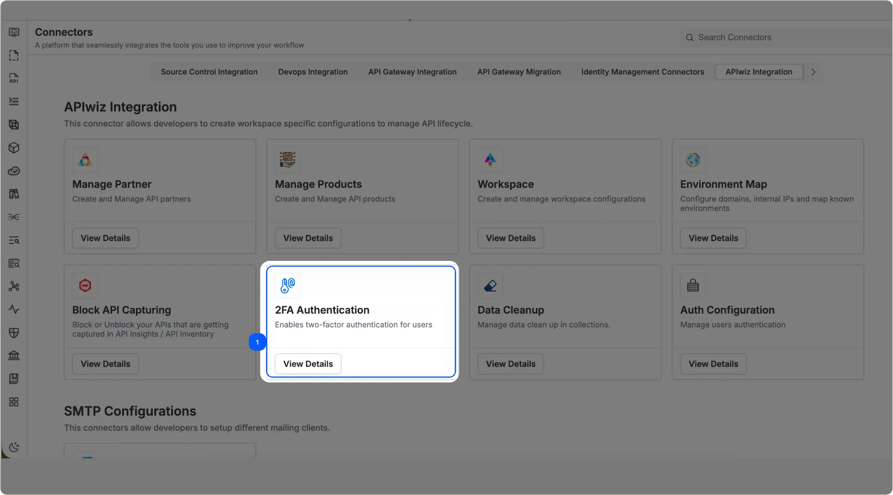

**Step 2: Initiate the configuration**

Select **Connect**. If the block 2FA authentication already exists, select **View Details** instead. The configuration panel opens on the right side of the screen.

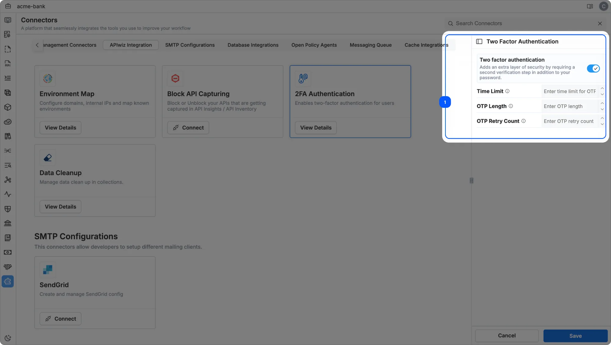

**Step 3: Enter 2FA configuration details**

Fill in the following fields:

**Step 4: Save the configuration**

Select **Save**.

2FA is immediately enabled for the configured users or workspace. The connector card button changes to **View Details**.

**Step 5: Manage the connector**

1. Select **View Details** to review or update the 2FA settings.
1. Select an action:
  - **Edit**: Update OTP length or time limits.
  - **Delete**: Disable the 2FA enforcement.

## Data Cleanup

The Data Cleanup connector automates the removal of outdated and unnecessary data from the APIwiz platform. It helps optimize storage usage, improve platform performance, and maintain database hygiene by periodically deleting expired records from supported modules.

The connector supports cleanup operations for both PostgreSQL and MongoDB databases across the following APIwiz modules: API Security, API Compliance, API Tracing, Transaction Logs, Application Logs, Metrics, API Builder, API Monitoring, and API Sandbox.

**Prerequisite**

Before configuring the Data Cleanup connector, complete the following steps:

- **Understand your data retention policy**: Consult your organization to determine how long each type of data must be retained. Specify how many days the platform retains records before permanently deleting them.
- **Identify the target database and collection:** Determine whether the target collection uses **MongoDB** or **PostgreSQL**.
  - Use **PostgreSQL** for runtime logs.
  - Use **MongoDB** for user-created data.
  - Identify the exact collection name, such as user\_sessions or execution\_logs.
- **Identify the timestamp field:** Identify the date or time field the platform uses to determine when a record expires. For MongoDB collections, use a timestamp field such as created\_at, last\_login\_date, or execution\_time.

### Configure Data Cleanup

To configure the Data Cleanup connector, follow these steps:

**Step 1: Open the Data Cleanup Connector**

To open the connector, follow these steps:

1. Sign in to your APIwiz workspace.
1. In the left navigation menu, select **Connectors**.
1. Go to **APIwiz Integration** \> **Data Cleanup** connector card.

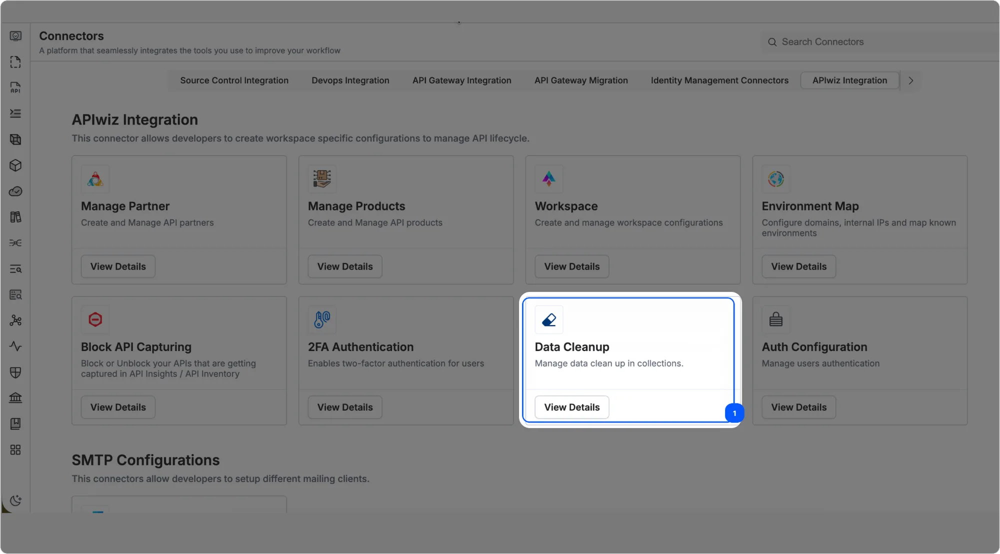

**Step 2: Initiate the Configuration**

To start the configuration, follow these steps:

1. Select **Connect**. If cleanup rules already exist, select **View Details** instead. The configuration panel opens on the right side of the screen.
1. Select **\+** to create a new data cleanup rule. The **Add New** configuration form opens in the Data Cleanup panel.

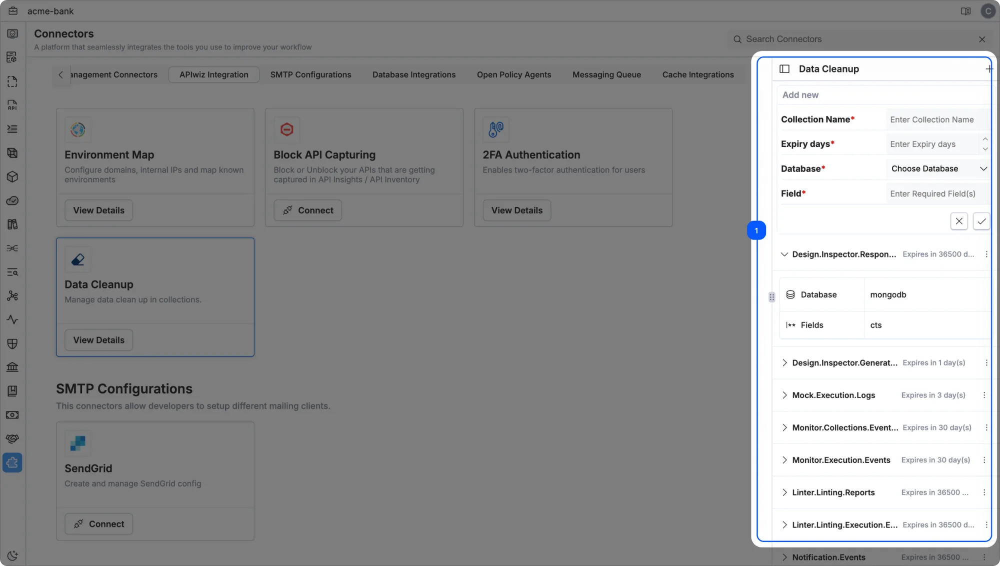

**Step 3: Enter Data Cleanup Details**

Fill in the following fields using the information you gathered in the prerequisites:

**Step 4: Save the Configuration**

To save the configuration, select **Add Collection** \(✅\) to add the collection to the active cleanup configuration.

A confirmation message appears when the configuration is saved successfully. The **Connect** button on the Data Cleanup card changes to **View Details**.

**Step 5: Manage the Connector**

To review or update existing cleanup rules, follow these steps:

1. Select **View Details** on the connector card. The configuration panel opens and displays the current cleanup rules.
1. Select an action:

### Clean up APIwiz modules data

Data cleanup is performed on data stored in **PostgreSQL** and **MongoDB**. You can configure data cleanup for most APIwiz modules, including API Security, API Tracing, API Compliance, Transaction Logs, Application Logs, Metrics, API Builder, API Monitoring, and API Sandbox.

#### PostgresDB tables

The following PostgreSQL tables are used for data cleanup activities.

Each collection stores logs or monitoring data for a specific module. During cleanup configuration, the collection name must be added to the data cleanup collection name field.

**Transaction Logs**

To configure cleanup for Transaction Logs:

1. Fetch the transaction log index name from the API Transaction Logs module.
  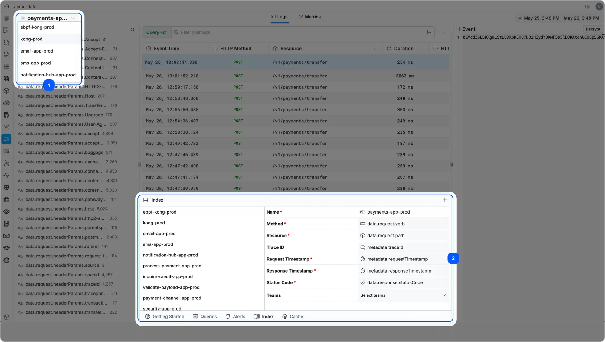
1. Append main to the index name using the following format: \{transactionlog\_index\_name\}\_main.
1. Add the generated collection name to the Data Cleanup Collection Name field.
  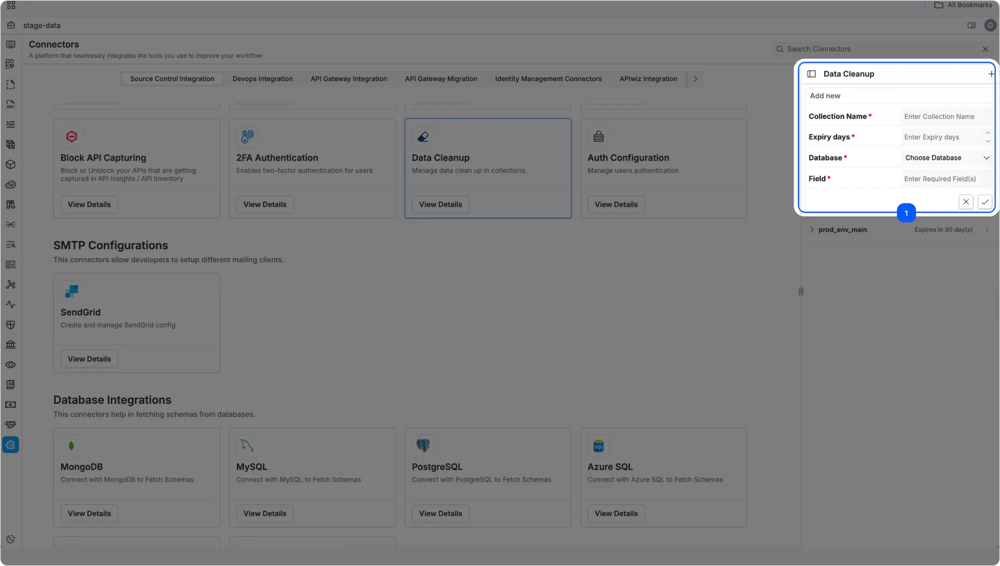

**Application Logs**

To configure cleanup for Application Logs:

1. Fetch the application log index name from the Application Logs module.
  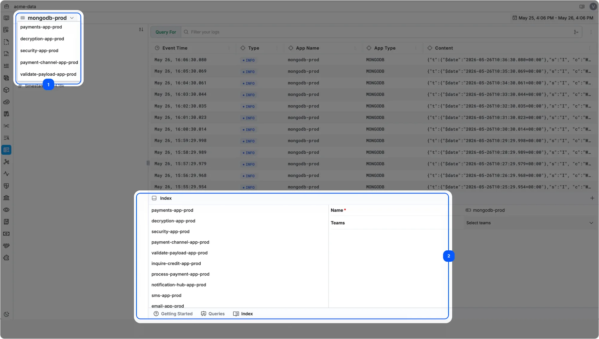
1. Append *main\_*application\_log to the index name using the following format: \{application\_log\_index\_name\}\_main\_application\_log.
1. Add the generated collection name to the Data Cleanup Collection Name field.

**Remaining PostgreSQL collections**

#### MongoDB Collections

The following MongoDB collections are used for data cleanup activities. Each collection uses a timestamp field to identify and remove outdated records.