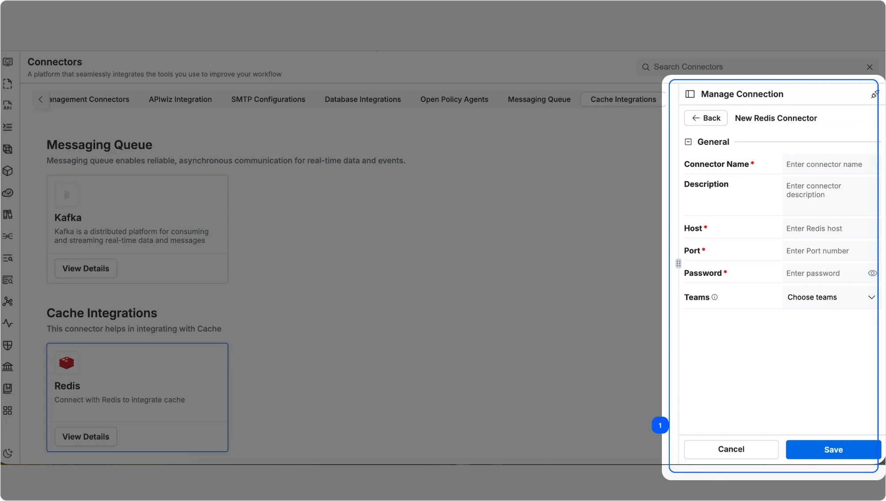

Cache Integration is a critical component of modern API ecosystem management, designed to serve as the integration bridge between your API management platform and external caching systems. In a standard API lifecycle, backend databases and systems can become easily overwhelmed by high volumes of repetitive data requests. Cache Integrations solve this by connecting the platform to in-memory data stores.

By storing and quickly retrieving frequently accessed resources directly from memory, Cache Integrations fundamentally accelerate data access and significantly reduce latency for both APIs and applications. Rather than querying a backend relational or NoSQL database for every single user request, the API can instantly fetch the pre-computed or frequently requested data from the cache. This drastically reduces the load on your primary databases and backend systems, preventing bottlenecks and ensuring that your architecture remains stable under heavy traffic.

Furthermore, these integrations provide highly configurable cache policies, allowing organizations to set specific rules for data expiration and invalidation. This ensures that the data being served remains accurate and up-to-date while still maximizing retrieval speeds. Ultimately, by facilitating extremely fast, in-memory data retrieval, Cache Integrations improve overall API and application performance, ensuring highly scalable application behavior and greatly enhancing the end-user experience with consistently faster response times.

## **Redis**

The Redis Connector integrates your API platform with Redis, which is a powerful, high-performance in-memory data store and cache. It facilitates exceptionally fast read and write operations, enabling your APIs to quickly cache responses, manage user sessions, and handle real-time data with maximum efficiency. By utilizing Redis, organizations can vastly improve their application's performance, significantly reduce the strain on their backend databases, and ensure a highly scalable environment capable of handling heavy traffic loads.

### **Prerequisites**

**Step 1: Ensure to have an Active Redis Instance**

Apart from the steps below, you can also refer to [this](https://redis.io/docs/latest/operate/rc/databases/active-active/create-active-active-database/) documentation for updated content.

1. Decide on your hosting method. You can host Redis locally, via a Docker container, or use a managed cloud service \(such as AWS ElastiCache, Azure Cache for Redis, or Redis Enterprise Cloud\).
1. If using a cloud provider, log into your cloud console, navigate to their respective Redis service, and select "Create" or "Provision" to spin up a new instance.
1. If installing locally or on a Virtual Machine, download Redis from the official website, extract the files, and run the installation/compilation commands \(e.g., make\).
1. Start the Redis server. For local installations, run the redis-server command in your terminal. For cloud services, wait for the status to change to "Available" or "Running".
1. Verify the instance is active by connecting to it and running the redis-cli ping command. If it is active, it will return PONG.

**Step 2: Locate Host Details**

Apart from the steps below, you can also refer to [this](https://redis.io/docs/latest/operate/oss_and_stack/management/config/#:~:text=Redis%20is%20able%20to%20start,JSON%20has%20no%20configuration%20parameters)\) documentation for updated content.

1. If you are using a managed cloud service, go to the instance details or overview page in your provider's dashboard.
1. Look for a field labeled "Endpoint," "Primary Endpoint," or "Hostname" and copy that value.
1. If you are hosting Redis on a local machine, your host detail will simply be localhost or 127.0.0.1.
1. If hosting on a remote Virtual Machine, locate the public or private IP address of that specific VM.
1. Document this exact hostname or IP address to enter into the **Host** field in the APIwiz workspace.

**Step 3: Identify the Port Number**

Apart from the steps below, you can also refer to [this](https://bluevps.com/blog/redis-port-configuration-and-how-does-redis-work#:~:text=How%20to%20Change%20the%20Default,or%20$%20systemctl%20restart%20redis%2Dserver) documentation.

1. Check your Redis server configuration file, typically named redis.conf.
1. Open the file and search for the line starting with the word port.
1. If you have not modified this file, the port will be set to the default value of 6379.
1. If you are using a cloud provider, the port number is usually listed directly next to the Endpoint/Hostname on your dashboard.
1. Document this specific port number to enter into the **Port** field in the APIwiz workspace.

**Step 4: Prepare Authentication Credentials**

Apart from the steps below, you can also refer to [this](https://redis.io/docs/latest/operate/oss_and_stack/management/security/#:~:text=This%20password%20is%20then%20used,TLS%20support) documentation.

1. To ensure your cache is secure, open your redis.conf configuration file.
1. Search for the requirepass directive.
1. If it is commented out \(indicated by a \# at the beginning of the line\), delete the \# and type a secure password next to it \(e.g., requirepass YourStrongPasswordHere\).
1. Save the configuration file and restart your Redis server so the new password takes effect.
1. If you are using a managed cloud service, you typically create this password during the initial setup phase, or you can find/reset it under the "Security" or "Access Keys" section of your dashboard.
1. Copy this password securely, as you will need to provide it in the **Password** field in the APIwiz workspace to authenticate the connection.

### **Connecting Redis in the APIwiz Workspace**

Once you have your prerequisites ready, follow these detailed, step-by-step instructions to establish the connection seamlessly.

**Step 1: Locate the Redis Connector**

1. Log in to your APIwiz workspace dashboard.
1. Navigate to the **Connectors** module from the main menu.
1. Select the **Cache Integrations** category from the available navigation tabs.
1. Locate the **Redis** Connector card within this category.

**Step 2: Initiate the Connection**

1. Click the **Connect** button directly on the Redis Connector card.
1. A configuration panel will slide open on the right-hand side of your screen.

\*\*Step 3: Create a New Connection \*\* Inside the right-hand panel, click on the **\+ New Connection** button to begin defining your Redis environment.

**Step 4: Enter Configuration Details** - Fill out the required fields in the panel using the prerequisite information you gathered:

1. **Connector Name:** Enter a unique, identifiable name for this specific Redis connector \(e.g., *redis-prod-cache*\).
1. **Description:** \(Optional\) Provide a brief description detailing the purpose of this connector to help your team identify it later.
1. **Host:** Enter the exact Redis server hostname or IP address you located during the prerequisite phase.
1. **Port:** Enter the port number on which your Redis server is running \(the default is 6379\).
1. **Password:** If your Redis server requires authentication, enter the secure Redis password here.
1. **Teams \(Optional\):** Click the dropdown to select specific teams to restrict access to this connector. 

**Step 5: Save the Configuration**

1. Once every field is accurately filled out, click the **Save** button located at the bottom of the configuration panel.
1. Look for a success message at the bottom of the screen confirming that the connection has been successfully established.

**Step 6: Verify and Manage the Connector**

1. Observe the Redis Connector card on your dashboard; the button will have automatically changed from "Connect" to **"View Details"**.
1. Whenever you need to manage this integration in the future, click the **View Details** button. This will open a window displaying your current configuration.
1. From this window, you can use the **Edit** function to update your credentials \(e.g., if your Redis password changes\) or use the **Delete** function to remove the connection entirely if it is no longer required.