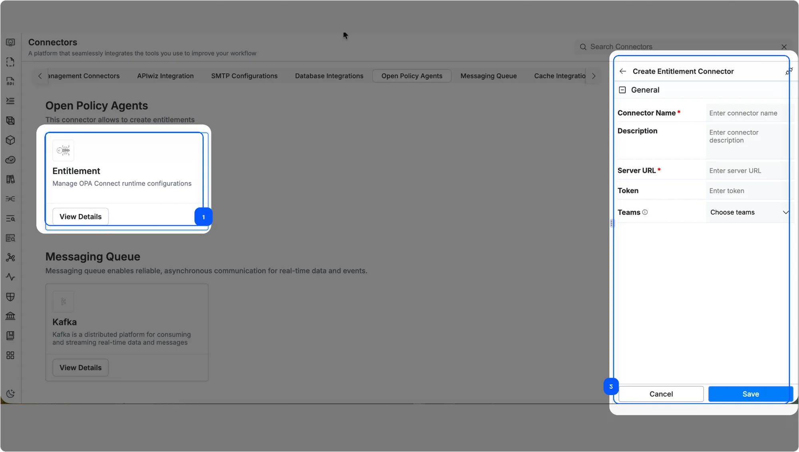
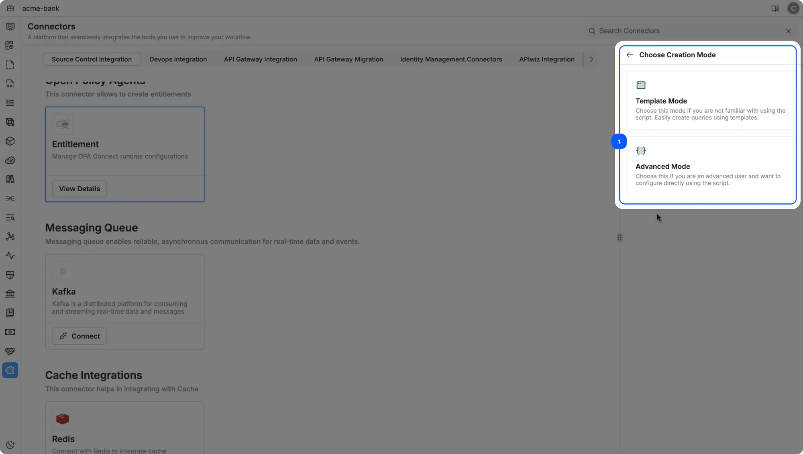
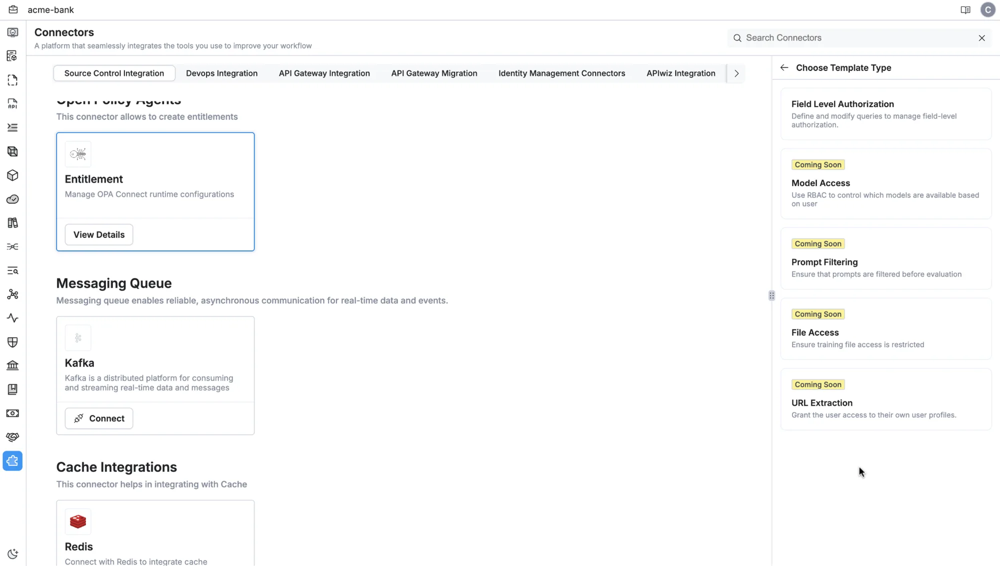
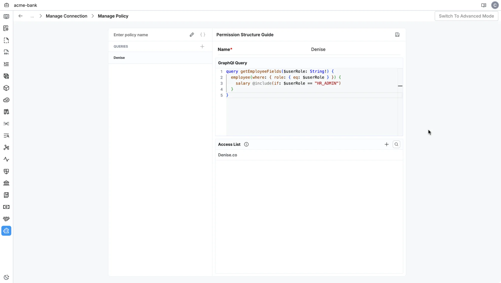

The Open Policy Agent \(OPA\) integration is designed to provide centralized and flexible policy enforcement across your entire API ecosystem and associated workflows. In a modern API landscape, ensuring that the right users and services have the exact appropriate access is paramount. OPA serves as the engine that guarantees these rules are applied consistently.

The core capabilities and benefits of OPA in the APIwiz platform include:

- **Policy-as-Code Setup:** OPA allows organizations to define and manage their access, security, and compliance policies entirely in code. This means security rules can be version-controlled, reviewed, and tested just like standard software development code.
- **Runtime Enforcement:** Rather than checking permissions asynchronously, OPA enforces your defined policies at runtime. This applies to both live API requests and internal platform actions, ensuring immediate compliance.
- **Context-Aware Decisions:** OPA supports dynamic, context-aware authorization decisions. It evaluates the specific context of a request in real-time before granting or denying access.
- **Enhanced Security Posture:** By enforcing strict, code-based rules, integrating with OPA inherently improves an organization's overall security and compliance posture.
- **Fine-Grained Access Control:** It enables granular, fine-grained access control and governance over every asset managed within the workspace.
- **Streamlined Auditing:** Because policies are centralized and defined as code, OPA significantly simplifies the process of performing policy updates and conducting security audits.

## **Entitlement**

The Entitlement Connector integrates Open Policy Agent \(OPA\) policies directly with your workflows to enable fine-grained access control and policy-based authorization. By establishing this connection, your applications are empowered to dynamically query entitlement decisions at runtime. This ensures that all users and services are strictly evaluated, guaranteeing that only explicitly authorized actions are permitted within your environment.

### **Prerequisites**

**Phase 1: Prerequisites \(Preparing your OPA Server\)**

To successfully connect Open Policy Agent \(OPA\) to APIwiz, you must ensure your OPA server is publicly reachable, secured via HTTPS, and properly configured to validate authentication tokens.

**Step 1: Deploy OPA to a Publicly Reachable Environment**

1. APIwiz cannot connect to a private localhost address.
1. You must provision a cloud-based Virtual Machine \(like AWS EC2 or Google Cloud Compute\) or a managed container service with a public IP address.
1. Install the OPA binary or Docker container on this cloud instance so it is reachable over the internet. For a quick deployment, you can use Docker: docker run -d -p 8181:8181 openpolicyagent/opa run --server.

**Step 2: Enable HTTPS \(TLS\) on the OPA Server**

1. To securely transmit your authentication token, the OPA server must run on HTTPS.
1. Generate valid TLS/SSL certificates for your server's domain or IP address.
1. If you do not have a certificate authority, you can generate a self-signed certificate for testing using OpenSSL: openssl req -x509 -newkey rsa:4096 -keyout server.key -out server.crt -days 365 -nodes. For a production environment, you should use a trusted authority like Let's Encrypt.
1. Start your OPA server using the TLS flags to enforce encryption \(e.g., opa run --server --tls-cert-file server.crt --tls-private-key-file server.key\).

**Step 3: Configure Token Authentication and Validation**

OPA needs to be explicitly told to require tokens and needs a policy to validate them.

1. OPA needs to be explicitly told to require tokens and needs a policy to validate them.
1. Create a secure, random alphanumeric string to serve as your Bearer token, such as SecureOpaToken999.
1. Write a base Rego policy inside your OPA instance that explicitly extracts the Authorization: Bearer header from incoming requests and checks if it matches your generated token. Here is a basic Rego snippet to fulfill the requirement. Create a file named auth.rego to validate the token: Start the OPA server with the authentication flag enabled \(e.g., --authentication=token\) so it enforces this policy on all incoming APIwiz queries.

**Step 4: Save your Final Credentials**

Before moving to APIwiz, ensure you have documented:

- **Server URL:** Your reachable, HTTPS-enabled endpoint \(e.g., [https://opa.mycompany.com](https://opa.mycompany.com)\).
- **Token:** Your securely generated Bearer token \(e.g., *SecureOpaToken999*\).

### **Connecting Entitlement in the APIwiz Workspace**

The Entitlement Connector integrates OPA policies directly with your workflows to enable fine-grained access control and policy-based authorization. This allows applications to dynamically query entitlement decisions to ensure only authorized actions are permitted.

**Step 1: Locate the Connector**

1. Log in to your APIwiz workspace dashboard.
1. Navigate to the **Connectors** module and select the **Open Policy Agents** category.
1. Locate the **Entitlement** Connector card.

**Step 2: Initiate the Connection**

1. Click the **Connect** button directly on the connector card.
1. A configuration panel will appear on the right-hand side.
1. Click on the **\+** button on the Entitlement heading.

**Step 3: Enter Configuration Details** Fill out the specific fields in the right-hand panel using your prerequisite data:

1. **Connector Name:** Enter a unique identifier for the connector \(Example: *opa-entitlement-01*\).
1. **Description:** Enter an optional description \(Example: *Entitlement connector for HR policies*\).
1. **Server URL:** Enter the public, HTTPS URL of your OPA server \(Example: [https://opa.example.com](https://opa.example.com)\).
1. **Token:** Enter the authentication token configured for accessing the OPA server \(Example: *opaToken12345*\).
1. **Teams \(Optional\):** Click the dropdown to select specific teams. If no teams are selected, the connector is accessible to all users. If teams are selected, only users in those tagged teams can view and access the connector.

**Step 4: Save the Configuration**

1. Click the **Save** button at the bottom of the panel to establish the connector.
1. The button on your Connector Card will successfully change to "**View Details**"

### **Adding Policies to the Entitlement Connector**

After creating the connection, you must add policies to define your specific authorization rules.

**Step 1: Access Policy Settings**

1. Click on the **View Details** button on the Entitlement Connector Card.
1. Below the connector details, locate the **Policies** bar.
1. Click on the **\+** sign next to the Policies bar.

**Step 2: Choose your Creation Mode**

1. You will be prompted to choose between **Template Mode** and **Advanced Mode**.
1. Select **Template Mode**, which provides pre-defined templates to easily create common policy types.

**Step 3: Select a Policy Template**

Click on the **Field Level Authorization** template. This template allows you to define queries to manage authorization at the field level \(e.g., granting access to specific dataset fields based on user roles\). *\(Note: Other templates like Model Access, Prompt Filtering, and File Access are listed as "Coming Soon"\)*.

**Step 4: Configure the Policy Details** - You will be directed to a new window to build your query.

1. **Enter Policy Name:** Click the pencil icon at the top of the screen to name your policy \(Example: *Policy1234*\).
1. **Add a Query:** Click the **\+** button or the **Add Query** button to create a new query rule.

**Step 5: Populate Query Details** - On the right-hand side panel, fill in the following execution parameters:

1. **Name:** Enter a descriptive name for the Query \(Example: *HR\_Field\_Access\_Policy*\).
1. **GraphQL Query:** Enter your specific GraphQL Query code into the editor block.
1. **Access List:** Click on the **\+** button in the Access List section to add the specific group names you wish to grant policy access to.

**Step 6: Save the Policy**

1. Once you have completed filling out all the fields, click on the **Save** icon.
1. Your new OPA query will be successfully created and enforced.