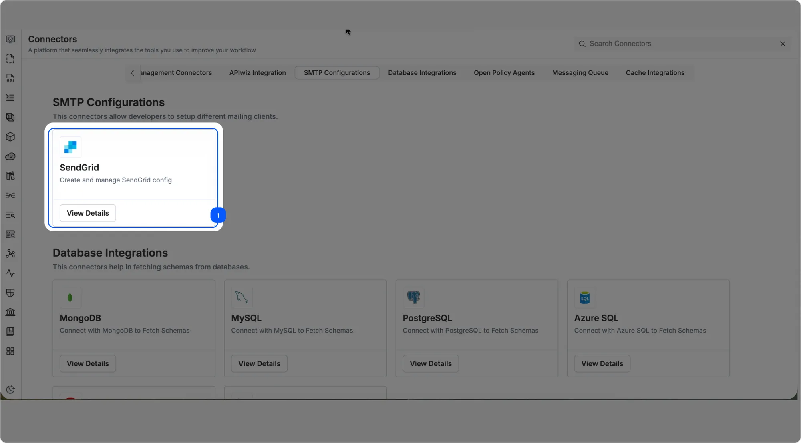
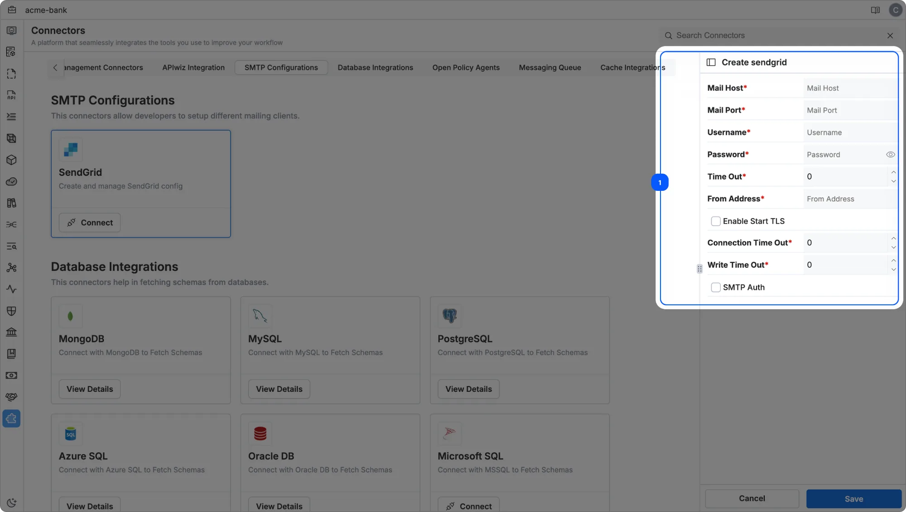

SMTP \(Simple Mail Transfer Protocol\) Configurations serve as the vital communication bridge between an API management platform and external mail servers. In the context of APIwiz, these configurations allow developers and administrators to connect their centralized workspace directly to dedicated SMTP providers. By establishing this connection, the platform gains the ability to dispatch transactional emails, system alerts, and automated messages reliably without requiring users to build custom email-sending microservices from scratch.

Configuring these outgoing mail servers involves securely authenticating the platform with the email provider and defining exact parameters for data transmission, such as designated host addresses, specific port numbers, timeout thresholds, and cryptographic protocols like StartTLS to ensure messages are transmitted securely over the internet.

**Role in API Management**

SMTP configurations play a critical, albeit often behind-the-scenes, role in the overall API lifecycle and governance strategy. Their primary functions include:

- **Automated Alerting and Observability:** In a modern API ecosystem, real-time awareness is crucial. SMTP connectors automate notifications regarding system events, API errors, or workflow updates. If a deployment pipeline fails or an API experiences a sudden spike in traffic, SMTP integrations ensure that the right development and operations teams are immediately alerted, facilitating faster incident response times.
- **Transactional Communication:** Beyond internal alerts, APIs often need to send transactional emails to end-users \(e.g., API key generation confirmations, password resets, or usage quota warnings\). SMTP configurations centralize this outgoing communication.
- **Security and Compliance:** A properly configured SMTP connector enforces secure transmission protocols and supports custom, verified sender addresses. Furthermore, by routing all automated emails through a centralized, managed connector, the platform supports enterprise compliance by maintaining a logged, auditable trail of all notification events.
- **Workflow Transparency:** By keeping teams continuously informed of critical lifecycle events—from initial design changes to production deployments—SMTP connectors heavily enhance overall communication and workflow transparency across the organization.

## **SendGrid**

SendGrid is a powerful, cloud-based SMTP provider designed to deliver transactional and notification emails securely and reliably at scale. Within the APIwiz workspace, the SendGrid connector acts as the dedicated integration point to route the platform's automated system alerts and API event notifications through SendGrid's email infrastructure. It enforces strict security standards by supporting StartTLS encryption and SMTP authentication to ensure high deliverability. By configuring this connector, teams can maintain seamless, uninterrupted email communication regarding their API workflows directly from their centralized management console.

Here are the fully enhanced prerequisite and connection steps for SendGrid, addressing the previous gaps by including official documentation references, safeguarding against third-party UI changes, and detailing the exact platform-side UI steps required for the APIwiz workspace.

### **Prerequisites: Preparing to Connect SendGrid**

**Step 1: Access Your SendGrid Account**

- Open your web browser and navigate to the [official SendGrid website](https://www.twilio.com/en-us/sendgrid).
- Log in to your existing corporate account, or [create a new account](https://support.sendgrid.com/hc/en-us/articles/35394877582235-How-to-Create-a-SendGrid-Account) if your organization does not have one yet.

**Step 2: Verify Your Sender Identity**

- To ensure high deliverability, you must verify the email address you will use to send notifications.
- Refer to SendGrid’s official documentation to complete the "[Single Sender Verification](https://www.twilio.com/docs/sendgrid/ui/sending-email/sender-verification)" or "[Domain Authentication](https://docs.gravitysmtp.com/authenticating-a-domain-in-sendgrid/)" process.
- Securely note this verified email address, as it will be your **From Address**.

**Step 3: Generate an API Key for Authentication**

- It is a strict security best practice to generate an API key specifically for external integrations rather than using standard passwords.
- Within your SendGrid console, generate a new API key with "Mail Send" permissions.
- **Copy this key immediately** and store it securely, as the platform will not display it again once you close the window. This alphanumeric string will act as your **Password** in the APIwiz workspace.
  Note: Refer to [this](https://www.twilio.com/docs/sendgrid/ui/account-and-settings/api-keys) documentation for the latest updates for this step.

**Step 4: Locate Host Details**

To locate host details in SendGrid, navigate to Settings \> Sender Authentication to find DNS CNAME records \(which map to SendGrid hosts\). For API host details, use [https://api.sendgrid.com/v3/](https://api.sendgrid.com/v3/). SMTP relay host settings are typically found under Settings \> Mail Settings. Refer to [this](https://support.sendgrid.com/hc/en-us/articles/9489871931803-Mail-Settings-Guide-within-a-SendGrid-Account) documentation for details.

Here is a breakdown of how to locate specific host-related details:

- DNS Host Records \(Domain Auth\): Go to Settings \> Sender Authentication to find the CNAME records SendGrid generates, which point to their servers.
- API Hostname: The host for Web API v3 requests is [https://api.sendgrid.com/v3/](https://api.sendgrid.com/v3/).
- SMTP Relay Host: The address for SMTP integrations is smtp.sendgrid.net.
- Reverse DNS \(rDNS\): Go to Settings \> Sender Authentication and click "Get Started" in the Reverse DNS section.
- Account/User Details: Click your username in the upper-left corner and select Account Details to view profile information.

Refer to [this](https://support.sendgrid.com/hc/en-us/articles/360041830853-Twilio-SendGrid-Account-Details) documentation for details.

### **Connecting SendGrid in the APIwiz Workspace**

Once you have your verified From Address, API Key, and Host details, follow these exact steps to configure the connector in APIwiz:

**Step 1: Locate the SendGrid Connector**

1. Log in to your APIwiz workspace dashboard.
1. Navigate to the **Connectors** module.
1. Select the **SMTP Configurations** category from the top navigation tabs.
1. Locate the **SendGrid** Connector card.

**Step 2: Initiate the Connection**

1. Click the **Connect** button directly on the SendGrid connector card.
1. A configuration panel will immediately slide open on the right-hand side of your screen.
1. Click on the **\+ New Connection** \(or **\+**\) button inside this right-hand panel to initiate a fresh configuration form.

**Step 3: Enter Configuration Details** - Inside the panel, carefully fill out the following fields using your prerequisite data:

- **Mail Host:** Enter the SendGrid SMTP host \(Example: smtp.sendgrid.net\).
- **Mail Port:** Specify the port number \(Example: 587\).
- **Username:** Enter the SendGrid username required for SMTP authentication \(Example: apikey\).
- **Password:** Paste the secure SendGrid API key you generated in Step 3 of the prerequisites \(Example: SG.XYZ123456TOKEN\).
- **Time Out:** Define the general timeout limit for SMTP requests in milliseconds \(Example: 30000\).
- **From Address:** Enter your officially verified sender email address \(Example: [no-reply@mycompany.com](mailto:no-reply@mycompany.com)\).
- **Enable Start TLS:** Click this checkbox to enable StartTLS for secure, encrypted communication.
- **Connection Time Out:** Specify the maximum wait time for a connection in milliseconds \(Example: 10000\).
- **Write Time Out:** Define the maximum time allowed for write operations in milliseconds \(Example: 5000\).
- **SMTP Auth:** Click this checkbox to enforce SMTP authentication.

**Step 4: Save the Configuration**

1. Once all fields are accurately filled out, click the **Save** button at the bottom of the configuration panel.
1. Look for a success message at the bottom of your screen confirming that the connection has been established.

**Step 5: Verify and Manage the Connector**

1. Observe the SendGrid Connector card on your main dashboard; the button will have changed from "Connect" to **"View Details"**.
1. Whenever you need to manage this integration in the future, simply click **View Details**. A window will open displaying your current configuration.
1. From here, you can seamlessly **edit** your connector details \(e.g., if you generate a new SendGrid API key\) or **Delete** the connection entirely if it is no longer needed.