Source Control Integration \(SCM\) is the foundational connection between your API management platform \(APIwiz\) and your existing software development repositories. It acts as the synchronization engine that bridges the gap between API design/configuration and the underlying code that powers those APIs.

In a modern API lifecycle, assets such as API specifications, proxy configurations, runbooks, and test suites must be versioned and managed just like application source code. This integration ensures that the APIwiz platform does not act as a silo; instead, it reads from and writes to your established repositories. This allows development teams to collaborate effectively while maintaining a single source of truth for their API artifacts.

By connecting to Source Control, organizations ensure that every change to an API—whether it is a policy update, a new endpoint definition, or a documentation tweak—is tracked, auditable, and reversible.

**Core Integration Modes**

To accommodate different security requirements and workflow automation needs, the platform provides three distinct types of Source Control integration. Understanding the difference between these modes is critical for selecting the correct connector for your specific use case.

1. **Proxy Integration**
  - **Purpose:** Secure Configuration Management & Collaboration.
  - **How it works:** The Proxy integration type is designed to manage API proxy configurations directly through source control. It establishes a secure channel between the APIwiz workspace and the repository.
  - **Key Benefit:** This mode prioritizes security. It routes repository operations through a proxy, allowing the platform to interact with the repository \(fetching runbooks, syncing configurations\) without exposing direct repository credentials to the end-users or the browser. It provides a controlled, scalable way to manage source control operations while adhering to strict compliance and security standards.
1. **CI/CD Build Integration**
  - **Purpose:** Automation of Delivery Pipelines.
  - **How it works:** The **CI/CD Build** integration links your build pipelines directly to the repository. It is triggered by source control events \(such as a "commit" or a "merge" request\). When a change is detected, this integration automates the process of fetching code, compiling it, running tests, and managing the deployment workflow.
  - **Key Benefit:** This mode is essential for implementing DevOps practices. It streamlines the "Build" and "Deploy" phases of the API lifecycle, ensuring that consistent, version-controlled builds are delivered faster and with less manual intervention.
1. **CI/CD Proxy Integration**
  - **Purpose:** Secure Pipeline Automation.
  - **How it works:** This is a hybrid approach that combines the automation capabilities of the **CI/CD Build** mode with the security architecture of the **Proxy** mode. It enables CI/CD pipelines to communicate with the repository through a secure proxy.
  - **Key Benefit:** This adds an extra layer of control to automated processes. It ensures that build and deployment workflows can execute complex tasks without exposing direct repository credentials within the pipeline scripts or logs. It represents the intersection of high-velocity automation and high-security governance.

**Key Features and Benefits**

Implementing Source Control Integration provides several strategic advantages to the API Lifecycle Management process:

- **Centralized Collaboration:** Teams can work simultaneously on API development. The integration syncs API artifacts with the repository, preventing overwrite conflicts and ensuring that the latest version is always available to all stakeholders.
- **Version History and Rollback:** Every change made to an API configuration or runbook is versioned. This provides a complete audit trail of who changed what and when. Crucially, it supports immediate rollback to previous versions if a new deployment introduces errors.
- **Automated Workflows:** By linking with DevOps tools, the platform automates the heavy lifting of deployment and testing. This reduces the manual effort required to move an API from a "Design" state to a "Running" state.
- **Security Compliance:** Through the use of Proxy and CI/CD Proxy modes, organizations can enforce strict authentication policies \(such as Two-Factor Authentication or Personal Access Tokens\) and ensure that sensitive repository credentials remain protected.

**Supported Ecosystem**

The platform supports integration with the industry's most widely used source control systems, ensuring compatibility with your current toolset. Separate connectors are provided for each tool to support the specific authentication mechanisms \(Basic Auth, OAuth, Personal Access Tokens, or App Passwords\) required by that provider.

**Supported Providers include:**

- **AWS Code Coomit** \(Supports Proxy, CI/CD Build, and CI/CD Proxy\).
- **Github** \(Supports Proxy, CI/CD Build, and CI/CD Proxy\).
- **GitLab** \(Supports Proxy, CI/CD Build, and CI/CD Proxy\).
- **Bitbucket** \(Supports Proxy, CI/CD Build, and CI/CD Proxy\).
- **Azure Devops**\(Supports Proxy, CI/CD Build, and CI/CD Proxy\).

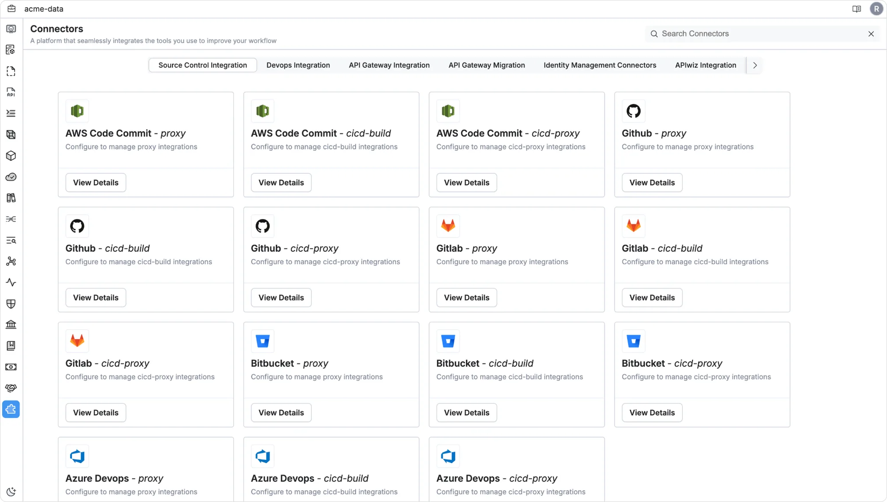

## **AWS CodeCommit - proxy**

This connector enables secure proxy-based communication between your API platform and AWS CodeCommit repositories. By configuring this integration, you can manage source control operations without exposing direct repository credentials, providing a controlled and scalable way to interact with repositories while maintaining security.

### Prerequisites: IAM Permissions

Ensure the IAM user whose credentials you are using has the necessary permissions to perform actions on the repository. At a minimum, the user requires the following AWS managed policy \(or an equivalent inline policy\):

• **AWSCodeCommitPowerUser:** This provides full access to CodeCommit functionality but creates a restriction preventing the deletion of repositories \(recommended for standard integrations\).

• Alternatively, for read-only access \(if configuring a connector only for fetching runbooks\), you can assign **AWSCodeCommitReadOnly**.

### Configuring AWS CodeCommit

**Step 1**: **Log in to AWS** - Navigate to the AWS Console and log in to AWS CodeCommit. You can access the service here: [https://aws.amazon.com/codecommit/](https://aws.amazon.com/codecommit/).

**Step 2**: **Initiate Repository Creation** - Click on the Create Repository \(if not done yet\) located in the top-right corner of the AWS CodeCommit dashboard.

**Step 3**: **Complete Registration** - Follow the on-screen instructions to complete the registration process.

**Step 4: Generate HTTPS Git Credentials** - AWS CodeCommit does not use your standard AWS Console login \(email and password\) for external integrations. You must generate specific Git credentials within the IAM console.

- **Navigate to IAM:** In the AWS Console, search for and select **IAM** \(Identity and Access Management\).
- S**elect User:** On the left menu, click **Users** and select the IAM user you intend to use for this integration \(e.g., apiwiz-service-user\).
- **Security Credentials:** Click on the **Security credentials** tab.
- **Generate Credentials:** Scroll down to the section titled **HTTPS Git credentials for AWS CodeCommit**. Click the **Generate credentials** button.
- **Save Credentials:** A pop-up will display a **User Name** and **Password**.
  ◦ **Important:** Click **Download credentials** to save them as a CSV file. You will not be able to view this password again once you close the window.

  ◦ These are the specific credentials you will enter into the APIwiz connector configuration panel.

**Step 5: Locate Repository Details** - To successfully connect, you need the specific location of your repository.

1. **Identify Region:** Note the AWS Region where your repository is hosted \(e.g., us-east-1 or ap-south-1\). This is visible in the top-right corner of the AWS Console navigation bar.
1. **Get Clone URL:**

### Configuring AWS Code Commit - proxy in the APIwiz Workspace

**Step 1:** **Locate the Connector** - Navigate to the Connectors module and select the Source Control Integration category. Locate the required AWS Code Commit card \(Proxy\).

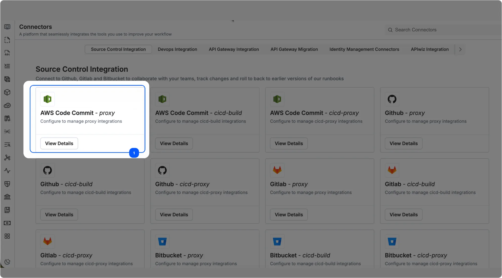

**Step 2:** **Initiate Connection** - Press the Connect button on the connector card.

**Step 3:** **Enter Configuration Details** - A configuration panel will appear. Enter the details you gathered in the Prerequisites section:

• **Username**: Enter the *Git Username* generated in IAM \(Step 4 above\).

• **Password**: Enter the *Git Password* generated in IAM \(Step 4 above\).

• **Git URL**: Paste the *Clone HTTPS URL* of your repository \(Step 5 above\).

• **Region**: Enter the AWS Region code \(e.g., us-east-1\).

**Step 4**: **Save Configuration** - Click the Save button. You will receive a success message, and the button on the card will change to "View Details."

**Step 5**: **Verify Connection** - Once the connection is successful, the button on the Connector Card will change from "Connect" to "View Details".

**Step 6**: **Manage Connector** - If you click on View Details, a window will open displaying the current configuration of the connector. You can use this window to edit the connector details if credentials change in the future.

## **AWS CodeCommit - cicd-build**

This connector automates continuous integration and delivery \(CI/CD\) workflows using repositories hosted in AWS CodeCommit. By linking your build pipelines, it streamlines code compilation, testing, and deployment processes. It ensures faster delivery cycles with consistent, version-controlled builds directly from the source.

### Prerequisites: IAM Permissions

Ensure the IAM user whose credentials you are using has the necessary permissions to perform actions on the repository. At a minimum, the user requires the following AWS managed policy \(or an equivalent inline policy\):

• **AWSCodeCommitPowerUser:** This provides full access to CodeCommit functionality but creates a restriction preventing the deletion of repositories \(recommended for standard integrations\).

• Alternatively, for read-only access \(if configuring a connector only for fetching runbooks\), you can assign **AWSCodeCommitReadOnly**.

### Configuring AWS CodeCommit

To access this connector in APIwiz, you must have an active AWS CodeCommit account. The credentials created during this process will be used to configure the connector in the APIwiz workspace.

**Step 1**: **Log in to AWS** - Navigate to the AWS Console and log in to AWS CodeCommit. You can access the service here: [https://aws.amazon.com/codecommit/](https://aws.amazon.com/codecommit/).

**Step 2**: **Initiate Repository Creation** - Click on Create Repository \(if not done yet\) located in the top-right corner of the dashboard.

**Step 3**: **Complete Registration** - Follow the on-screen instructions to complete the registration process.

**Step 4: Generate HTTPS Git Credentials** - AWS CodeCommit does not use your standard AWS Console login \(email and password\) for external integrations. You must generate specific Git credentials within the IAM console.

- **Navigate to IAM:** In the AWS Console, search for and select **IAM** \(Identity and Access Management\).
- **Select User:** On the left menu, click **Users** and select the IAM user you intend to use for this integration \(e.g., apiwiz-service-user\).
- **Security Credentials:** Click on the **Security credentials** tab.
- **Generate Credentials:** Scroll down to the section titled **HTTPS Git credentials for AWS CodeCommit**. Click the **Generate credentials** button.
- **Save Credentials:** A pop-up will display a **User Name** and **Password**.
  ◦ **Important:** Click **Download credentials** to save them as a CSV file. You will not be able to view this password again once you close the window.

  ◦ These are the specific credentials you will enter into the APIwiz connector configuration panel.

**Step 5: Locate Repository Details** - To successfully connect, you need the specific location of your repository.

1. **Identify Region**: Note the AWS Region where your repository is hosted \(e.g., us-east-1 or ap-south-1\). This is visible in the top-right corner of the AWS Console navigation bar.
1. **Get Clone URL**:

### **Configuring AWS Code Commit - cicd-build in the APIwiz Workspace**

**Step 1: Locate the Connector** - Navigate to the Connectors module and select the Source Control Integration category. Locate the required AWS Code Commit card \(CI/CD Build\).

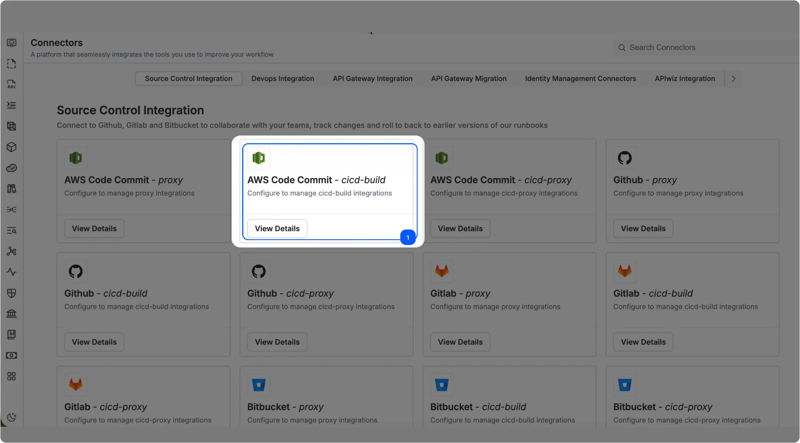

**Step 2: Initiate Connection** - Press the Connect button on the connector card.

**Step 3: Enter Configuration Details** - A configuration panel will appear. Enter the details you gathered in the Prerequisites section:

• **Username:** Enter the *Git Username* generated in IAM \(Step 4 above\).

• **Password:** Enter the *Git Password* generated in IAM \(Step 4 above\).

• **Git URL:** Paste the *Clone HTTPS URL* of your repository \(Step 5 above\).

• **Region:** Enter the AWS Region code \(e.g., us-east-1\).

**Step 4: Save Configuration** - Click the **Save** button. You will receive a success message, and the button on the card will change to "View Details."

## **AWS CodeCommit - cicd-proxy**

This connector enables CI/CD pipelines to communicate with AWS CodeCommit through a secure proxy. It helps you run build and deployment workflows without exposing direct repository credentials. The proxy adds an extra layer of control, making CI/CD automation both secure and manageable.

### **Prerequisites: IAM Permissions**

Ensure the IAM user whose credentials you are using has the necessary permissions to perform actions on the repository. At a minimum, the user requires the following AWS managed policy \(or an equivalent inline policy\):

• **AWSCodeCommitPowerUser:** This provides full access to CodeCommit functionality but creates a restriction preventing the deletion of repositories \(recommended for standard integrations\).

• Alternatively, for read-only access \(if configuring a connector only for fetching runbooks\), you can assign **AWSCodeCommitReadOnly**.

### **Configuring AWS Code Commit**

To access this connector in APIwiz, you must have an active AWS CodeCommit account. The credentials created during this process will be used to configure the connector in the APIwiz workspace.

**Step 1**: **Log in to AWS** - Navigate to the AWS Console and log in to AWS CodeCommit. You can access the service here: [https://aws.amazon.com/codecommit/](https://aws.amazon.com/codecommit/).

**Step 2**: **Initiate Repository Creation** - Click on Create Repository \(if not done yet\) located in the top-right corner of the dashboard.

**Step 3**: **Complete Registration** - Follow the on-screen instructions to complete the registration process.

**Step 4: Generate HTTPS Git Credentials** - AWS CodeCommit does not use your standard AWS Console login \(email and password\) for external integrations. You must generate specific Git credentials within the IAM console.

- **Navigate to IAM:** In the AWS Console, search for and select **IAM** \(Identity and Access Management\).
- S**elect User:** On the left menu, click **Users** and select the IAM user you intend to use for this integration \(e.g., apiwiz-service-user\).
- **Security Credentials:** Click on the **Security credentials** tab.
- **Generate Credentials:** Scroll down to the section titled **HTTPS Git credentials for AWS CodeCommit**. Click the **Generate credentials** button.
- **Save Credentials:** A pop-up will display a **User Name** and **Password**.
  ◦ **Important:** Click **Download credentials** to save them as a CSV file. You will not be able to view this password again once you close the window.

  ◦ These are the specific credentials you will enter into the APIwiz connector configuration panel.

**Step 5: Locate Repository Details** To successfully connect, you need the specific location of your repository.

1. **Identify Region:** Note the AWS Region where your repository is hosted \(e.g., us-east-1 or ap-south-1\). This is visible in the top-right corner of the AWS Console navigation bar.
1. **Get Clone URL:**

### Configuring AWS Code Commit - cicd-proxy in the APIwiz Workspace

**Step 1: Locate the Connector** - Navigate to the **Connectors** module and select the **Source Control Integration** category. Locate the required AWS Code Commit card \(CI/CD Proxy\).

**Step 2: Initiate Connection** - Press the **Connect** button on the connector card.

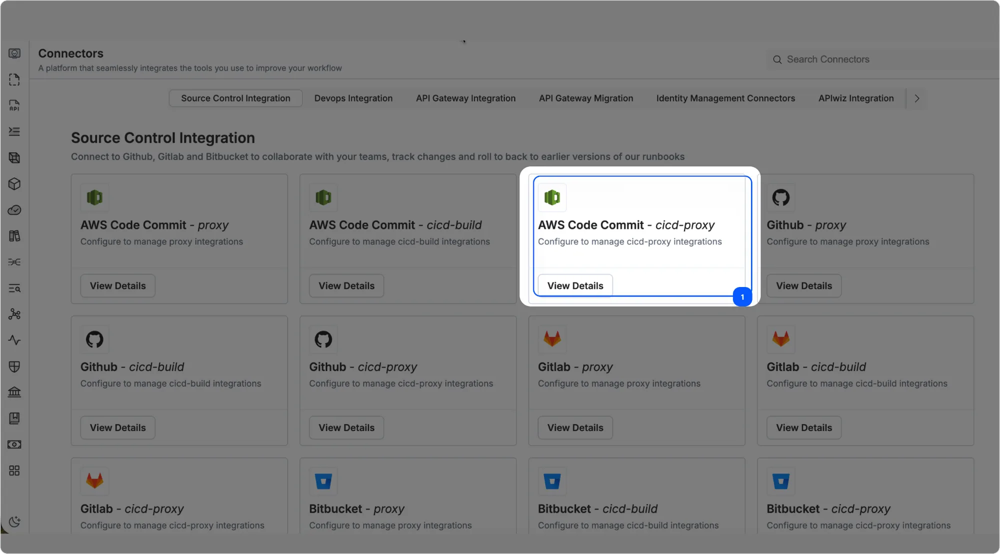

**Step 3: Enter Configuration Details** - A configuration panel will appear. Enter the details you gathered in the Prerequisites section:

• **Username:** Enter the *Git Username* generated in IAM \(Step 4 above\).

• **Password:** Enter the *Git Password* generated in IAM \(Step 4 above\).

• **Git URL:** Paste the *Clone HTTPS URL* of your repository \(Step 5 above\).

• **Region:** Enter the AWS Region code \(e.g., us-east-1\).

**Step 4: Save Configuration -** Click the **Save** button. You will receive a success message, and the button on the card will change to "View Details."

## **GitHub - proxy**

This connector allows your API platform to interact with GitHub repositories through a secure proxy. It ensures repository operations are routed safely without exposing direct GitHub credentials. The proxy integration provides controlled access for managing code while maintaining compliance and security standards.

### **Configuring Github**

To access this connector in APIwiz, you must have an active GitHub account. The credentials created during this process will be used to configure the connector in the APIwiz workspace.

**Step 1: Create an Account** - Go to [https://github.com/](https://github.com/) and create an account if you do not already have one.

**Step 2: Complete Registration** - Follow the on-screen instructions to complete the registration process.

**Step 3: Prepare Credentials** - Once registered, ensure you have your username and password ready. Alternatively, if your organization uses Two-Factor Authentication \(2FA\) or requires higher security, you may need to [generate a Personal Access Token \(PAT\)](https://docs.github.com/en/authentication/keeping-your-account-and-data-secure/managing-your-personal-access-tokens) to use in place of a password.

### **Connecting to the GitHub - proxy Connector in the APIwiz Workspace**

This connector supports two methods of authentication: Basic \(Username/Password\) or Token \(Personal Access Token\). Follow the steps below to complete the configuration.

**Step 1: Locate the Connector** - Navigate to the Connectors module and select the Source Control Integration category. Locate the GitHub - proxy Connector card.

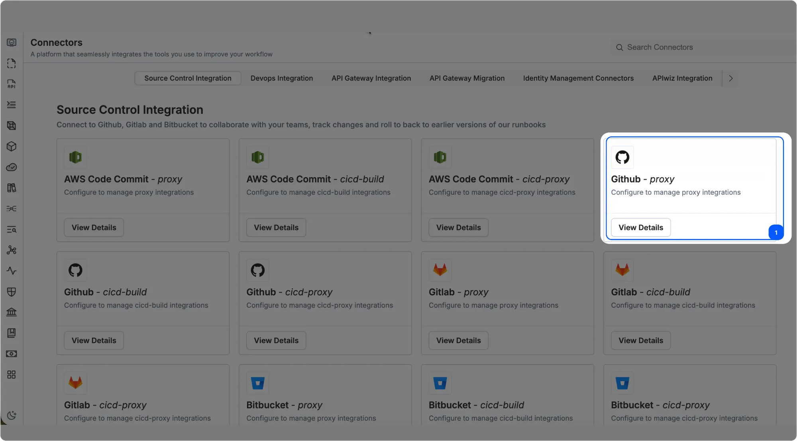

**Step 2: Initiate Connection** - Press the Connect button on the connector card.

**Step 3: Select Authentication Type** - A configuration panel will appear on the right-hand side. Select either Basic or Token depending on your preference: 

- If selecting BASIC:
  - Username: Enter the GitHub username for the proxy connection \(e.g., gh-basic-user\).
  - Password: Enter the password or personal access token linked to the GitHub account \(e.g., GhBasic@123\!\).
  - Git URL: Enter the repository URL to connect through the proxy \(e.g., [https://github.com/org/repo.git](https://github.com/org/repo.git)\).

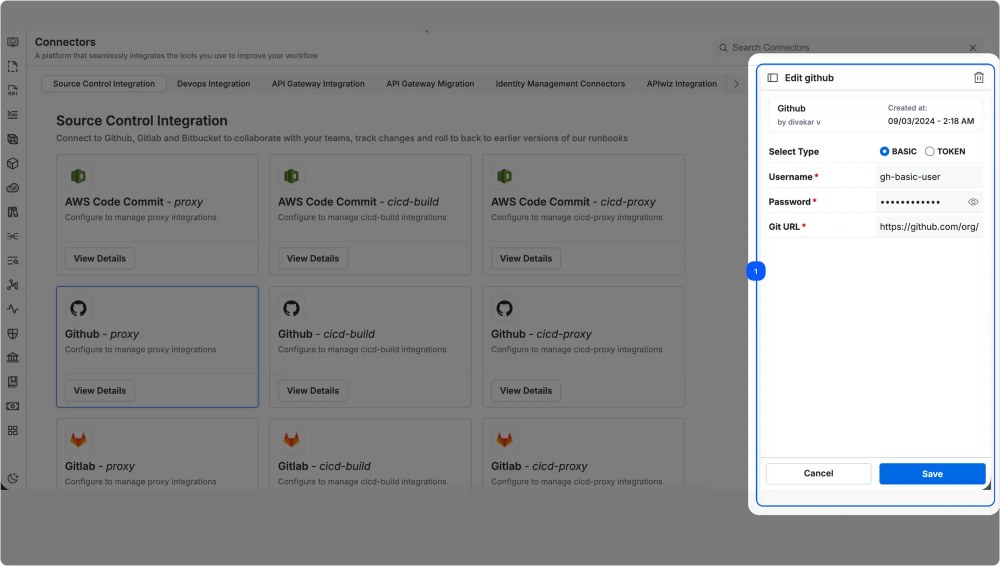

- If selecting TOKEN:
  - Token Number: Enter the GitHub personal access token \(PAT\) used for authentication \(e.g., ghp\_xxX123Token456yyY\).

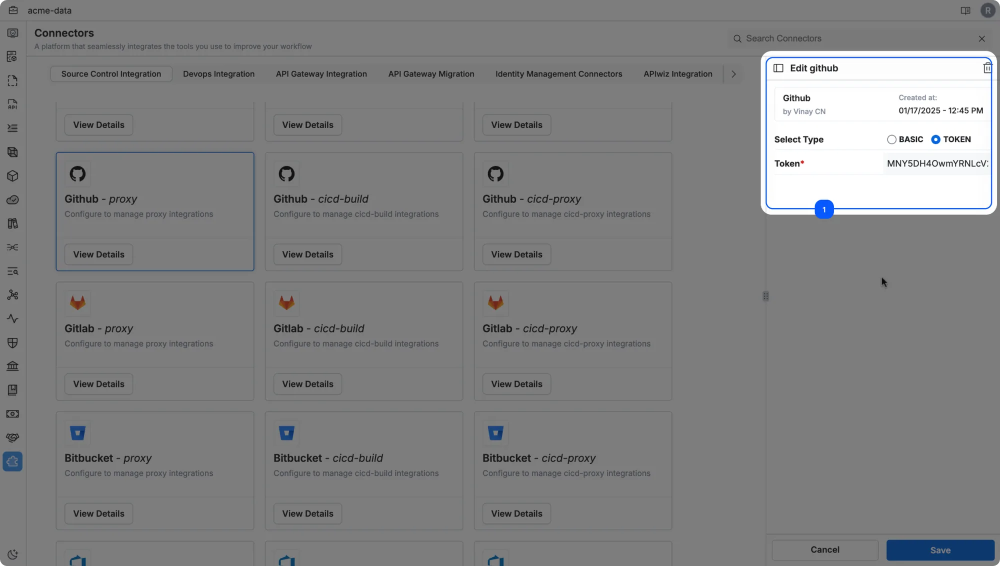

**Step 4: Save Configuration** - After entering the details, click on the Save button at the bottom of the panel. You will receive a success message at the bottom of the screen indicating the connection has been established.

**Step 5: Verify Connection** - Once the connection is successful, the button on the Connector Card will change from "Connect" to "View Details".

**Step 6: Manage Connector** - If you click on View Details, a window will open displaying the current configuration of the connector. You can use this window to edit the connector details or Delete the connection if necessary.

## **GitHub - cicd-build**

This connector links your CI/CD pipelines with GitHub repositories to automate build and deployment processes. It allows you to fetch code, trigger builds, and manage deployment workflows directly from source control, ensuring streamlined and reliable delivery cycles.

### **Configuring Github**

To access this connector in APIwiz, you must have an active GitHub account and the necessary credentials.

**Step 1: Create an Account** - If you do not have an account, navigate to [https://github.com/](https://github.com/) and create one.

**Step 2: Generate a Personal Access Token \(PAT\)** - If you choose to use a Token for authentication \(recommended for CI/CD\), you need to generate one in GitHub.

- How to generate a token: [Creating a personal access token](https://docs.github.com/en/authentication/keeping-your-account-and-data-secure/managing-your-personal-access-tokens).

### Connecting to Github - cicd-build in the APIwiz Workspace

This connector functions similarly to the Github - proxy connector. You can choose between Basic authentication or Token authentication.

**Step 1: Locate the Connector** - Navigate to the Connectors module and select the Source Control Integration category. Locate the Github - cicd-build Connector card.

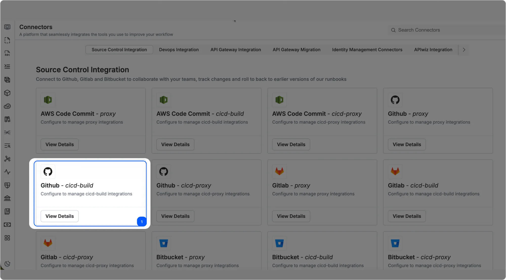

**Step 2: Initiate Connection** - Press the Connect button on the connector card.

**Step 3: Select Authentication Type** - A configuration panel will appear on the right-hand side. Select either Basic or Token and enter the following details:

- If selecting BASIC:
  - Username: Enter the GitHub username used for CI/CD build operations \(e.g., gh-cicd-user\).
  - Password: Enter the GitHub account password or a personal access token \(e.g., GhCicd@123\!\).
  - Git URL: Enter the repository URL for the build source \(e.g., [https://github.com/org/build-repo.git](https://github.com/org/build-repo.git)\).

- If selecting TOKEN:
  - Token Number: Paste the GitHub personal access token \(PAT\) generated in the previous section \(e.g., ghp\_CiCdToken789XyZ\).

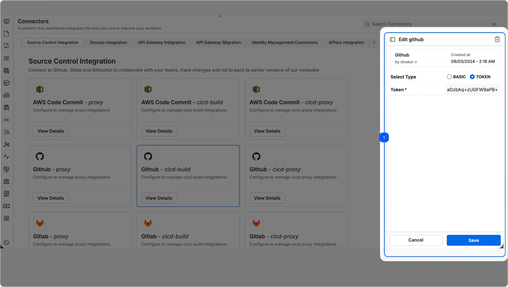

**Step 4: Save Configuration** - After entering the details, click on the Save button at the bottom of the panel. You will receive a success message at the bottom of the screen indicating the connection has been established.

**Step 5: Verify Connection** - Once the connection is successful, the button on the Connector Card will change from "Connect" to "View Details".

**Step 6: Manage Connector** - If you click on View Details, a window will open displaying the current configuration of the connector. You can use this window to edit the connector details or Delete the connection if necessary.

## **GitHub – CICD Proxy**

This connector enables CI/CD pipelines to access GitHub repositories securely through a proxy. It ensures build and deployment workflows can run without exposing direct repository credentials, adding an extra layer of security and control for automated processes.

### **Configuring GitHub**

To access this connector in APIwiz, you must have an active GitHub account. The credentials created during this process will be used to configure the connector in the APIwiz workspace.

**Step 1: Create an Account** - Navigate to [https://github.com/](https://github.com/) and create an account if you do not already have one. You can refer to the [official GitHub documentation](https://docs.github.com/en) for a step-by-step guide on creating an account.

**Step 2: Generate a Personal Access Token \(PAT\)** - If you are using Token based authentication \(recommended for CI/CD pipelines to restrict scope\), you must generate a token in GitHub before configuring the connector.

- How to generate a token: [Creating a personal access token](https://docs.github.com/en/authentication/keeping-your-account-and-data-secure/managing-your-personal-access-tokens).
- Once created, ensure you copy the token immediately, as you will not be able to see it again.

### **Connecting to the GitHub – CICD Proxy in the APIwiz Workspace**

The GitHub – CICD Proxy connector works similarly to the standard GitHub proxy connector. Follow the steps below to configure it within the platform.

**Step 1: Locate the Connector** - Navigate to the Connectors module and select the Source Control Integration category. Locate the GitHub – CICD Proxy Connector card.

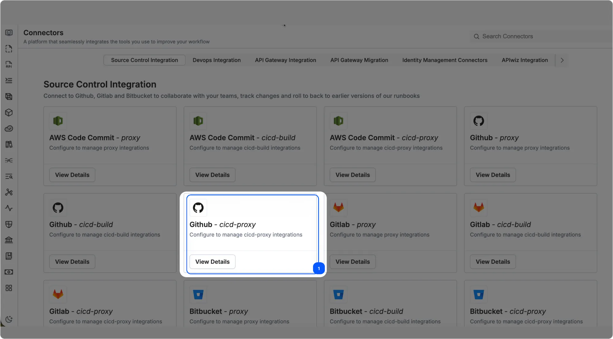

**Step 2: Initiate Connection** - Press the Connect button on the connector card.

**Step 3: Select Authentication Type** - A configuration panel will appear on the right-hand side. You can choose to authenticate using Basic credentials or a Token. Fill in the details corresponding to your selection:

- If selecting BASIC:
  - Username: Enter the GitHub username configured for CI/CD proxy access \(e.g., gh-cicd-proxy-user\).
  - Password: Enter the password or Personal Access Token \(PAT\) linked to the proxy user \(e.g., GhCicdProxy@123\!\).
  - Git URL: Enter the repository URL used in your CI/CD pipelines \(e.g., [https://github.com/org/proxy-repo.git](https://github.com/org/proxy-repo.git)\).

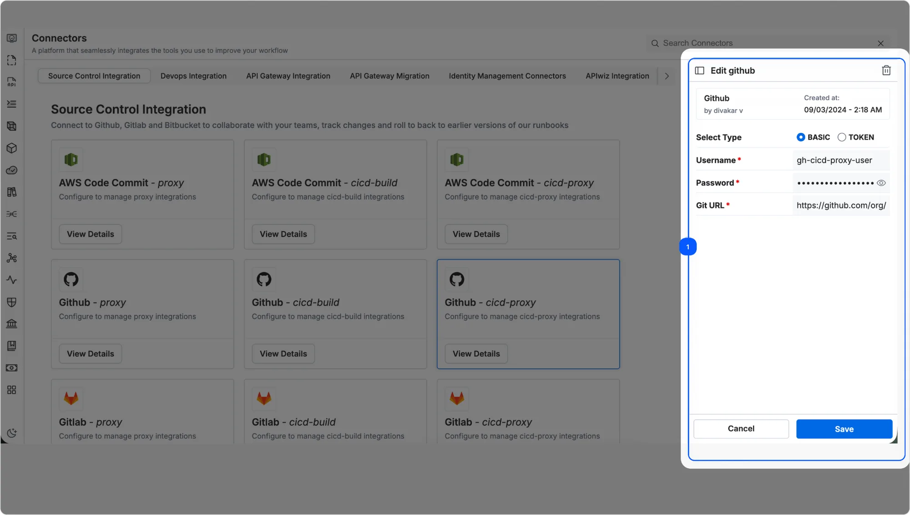

- If selecting TOKEN:
  - Token Number: Paste the GitHub personal access token \(PAT\) you generated in the previous section \(e.g., ghp\_ProxyCiCdToken456XyZ\).

**Step 4: Save Configuration** - After entering the details, click on the Save button at the bottom of the panel. You will receive a success message at the bottom of the screen indicating the connection has been established.

**Step 5: Verify Connection** - Once the connection is successful, the button on the Connector Card will change from "Connect" to "View Details".

**Step 6: Manage Connector** - If you click on View Details, a window will open displaying the current configuration of the connector. You can use this window to edit the connector details or Delete the connection if necessary.

## **Gitlab - proxy**

This connector enables secure communication between your API platform and GitLab repositories through a proxy. By routing repository operations through a proxy, you ensure that code management tasks—such as fetching runbooks or syncing configurations—are performed safely without exposing direct repository credentials. This approach provides controlled access while maintaining strict security and compliance standards.

### **Configuring GitLab**

Before configuring the connector in the APIwiz workspace, you must ensure you have an active GitLab account and the necessary credentials.

**Step 1: Create a GitLab Account** - If you do not have an account, navigate to the GitLab sign-up page.

- Website: [https://gitlab.com/users/sign\_up](https://gitlab.com/users/sign_up)
- Follow the on-screen instructions to complete the registration process.

**Step 2: Prepare Credentials** - You will need credentials to authenticate the connection. You can use either Basic Authentication \(Username and Password\) or a Personal Access Token \(PAT\).

- Recommendation: using a Personal Access Token is often more secure for integrations as it allows you to scope permissions specifically for this connection.
- How to generate a token: [Create a personal access token in GitLab](https://docs.gitlab.com/ee/user/profile/personal_access_tokens.html) .
- Note: When generating the token, ensure you grant the necessary scopes \(e.g., read\_repository or api\) required for the connector to function.

### **Connecting to Gitlab - proxy in the APIwiz Workspace**

Follow the steps below to establish the connection.

**Step 1: Locate the Connector** - Navigate to the Connectors module and select the Source Control Integration category. Locate the Gitlab - proxy Connector card.

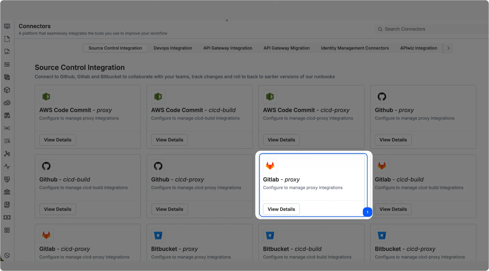

**Step 2: Initiate Connection** - Click the Connect button on the connector card.

**Step 3: Select Authentication Type** - A configuration panel will open on the right-hand side. You must choose between BASIC or TOKEN authentication.

**Option A: Basic Authentication** - Use this method if you prefer using your standard GitLab login credentials.

- Username: Enter the GitLab username used for proxy authentication \(e.g., gl-proxy-user\).
- Password: Enter the password or personal access token linked to the GitLab account \(e.g., GlProxy@123\!\).
- Git URL: Enter the full URL of the repository you wish to connect through the proxy \(e.g., [https://gitlab.com/org/repo.git](https://gitlab.com/org/repo.git)\).

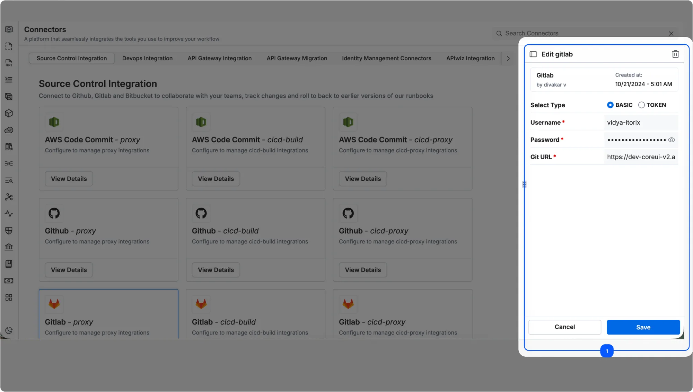

**Option B: Token Authentication** - Use this method for token-based access, which is often preferred for automated integrations.

- Token Number: Paste the GitLab personal access token \(PAT\) you generated in the "Prerequisites" section \(e.g., glp\_xxx123Token456\).

**Step 4: Save Configuration** - After entering the required details, click on the Save button at the bottom of the panel. You will receive a success message at the bottom of the screen confirming the connection.

**Step 5: Verify Status** - Once the connection is established, the button on the Connector Card will update from "Connect" to "View Details".

**Step 6: Manage Connector** - To review or update your settings, click on View Details. This will open the connector details window where you can:

- Edit the configuration \(e.g., update an expired token\).
- Delete the connector if it is no longer needed.

## **Gitlab - cicd-build**

This connector integrates your CI/CD pipelines with GitLab repositories to automate builds, tests, and deployments. It enables seamless code retrieval and pipeline execution directly from source control, ensuring faster and consistent delivery cycles.

### **Configuring GitLab**

To use this connector, you must have a valid GitLab account and the appropriate credentials to authorize build operations.

**Step 1: Log in to GitLab** - If you do not have an account, navigate to GitLab and complete the registration process.

- Website: [https://gitlab.com](https://gitlab.com/)

**Step 2: Generate Credentials** - You will need credentials to authenticate the connection. You can use:

- Basic Credentials: Your GitLab username and password.
- Personal Access Token \(Recommended\): A token is often preferred for CI/CD tools to limit access scope.
  - How to generate: [Create a personal access token](https://docs.gitlab.com/ee/user/profile/personal_access_tokens.html).

### **Connecting to Gitlab - cicd-build in the APIwiz Workspace**

Follow the steps below to configure the connector.

**Step 1: Locate the Connector** - Navigate to the Connectors module and select the Source Control Integration category. Locate the Gitlab - cicd-build Connector card.

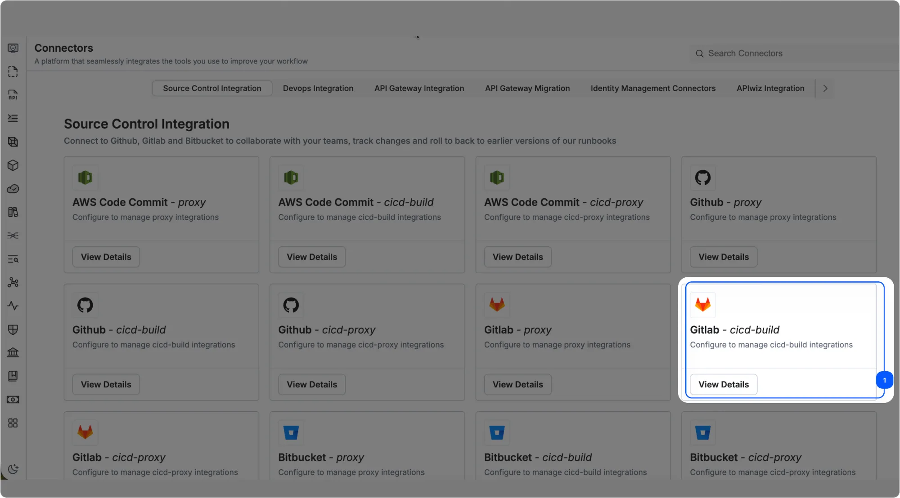

**Step 2: Initiate Connection** - Press the Connect button on the connector card.

**Step 3: Select Authentication Type** - A configuration panel will appear on the right-hand side. You can authenticate using Basic or Token.

**Option A: Basic Authentication**

- **Username**: Enter the GitLab username used for CI/CD build operations \(e.g., gl-cicd-user\).
- **Password**: Enter the password or personal access token associated with the build user \(e.g., GlCicd@123\!\).
- **Git URL**: Enter the repository URL used as the build source \(e.g., [https://gitlab.com/org/build-repo.git](https://gitlab.com/org/build-repo.git)\).

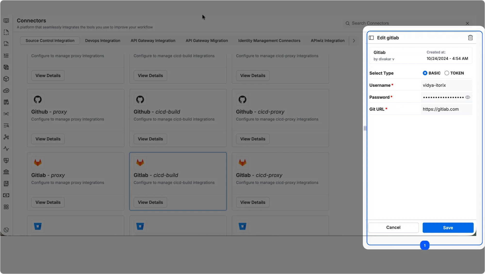

**Option B: Token Authentication**

- **Token Number**: Paste the GitLab personal access token \(PAT\) you generated in the prerequisites section \(e.g., glp\_CiCdToken789\).

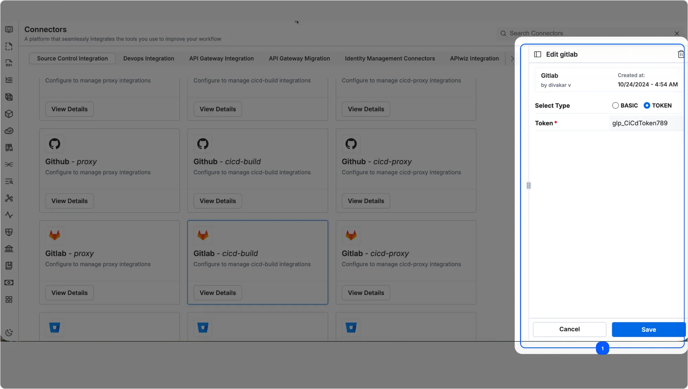

**Step 4: Save Configuration** - After entering the details, click on the Save button at the bottom of the panel. You will receive a success message at the bottom of the screen indicating the connection has been established.

**Step 5: Verify Connection** - Once successful, the button on the Connector Card will change from "Connect" to "View Details".

**Step 6: Manage Connector** - If you click on View Details, a window will open displaying the current configuration. You can use this window to edit the connector details or Delete the connection if necessary.

## **Gitlab - cicd-proxy**

This connector allows CI/CD pipelines to securely interact with GitLab repositories through a proxy. It ensures that build and deployment workflows can run without exposing direct repository credentials, providing an extra layer of security and controlled access for automated processes.

### **Configuring GitLab**

To access this connector in APIwiz, you must have an active GitLab account. Additionally, if you plan to use token-based authentication \(which is recommended for CI/CD pipelines\), you must generate a Personal Access Token \(PAT\).

**Step 1: Create a GitLab Account** - If you do not have an account, navigate to the GitLab website and complete the registration process.

- Website: [https://gitlab.com](https://gitlab.com/)
- Follow the on-screen instructions to set up your account.

**Step 2: Generate Credentials \(Token\)** - For secure CI/CD operations, it is best practice to use a Personal Access Token rather than a standard password.

- How to generate a token: [Create a personal access token in GitLab](https://docs.gitlab.com/ee/user/profile/personal_access_tokens.html).
- Note: When generating the token, ensure you select the appropriate scopes \(such as read\_repository or api\) required for your proxy pipeline to function correctly.

### **Connecting to Gitlab - cicd-proxy in the APIwiz Workspace**

Follow the steps below to configure the connector within the platform.

**Step 1: Locate the Connector** - Navigate to the Connectors module and select the Source Control Integration category. Locate the Gitlab - cicd-proxy Connector card.

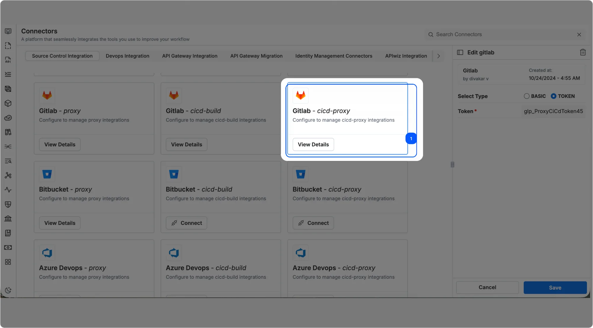

**Step 2: Initiate Connection** - Press the Connect button on the connector card.

**Step 3: Select Authentication Type** - A configuration panel will appear on the right-hand side. You can authenticate using Basic credentials or a Token. Select the tab or radio button corresponding to your preferred method.

**Option A: Basic Authentication **- Use this method if you are using a service account username and password/token combination.

- **Username**: Enter the GitLab username configured for CI/CD proxy access \(e.g., gl-cicd-proxy-user\).
- **Password**: Enter the password or personal access token linked to the proxy user \(e.g., GlCicdProxy@123\!\).
- **Git URL**: Enter the specific repository URL used in your CI/CD pipelines \(e.g., [https://gitlab.com/org/proxy-repo.git](https://gitlab.com/org/proxy-repo.git)\).

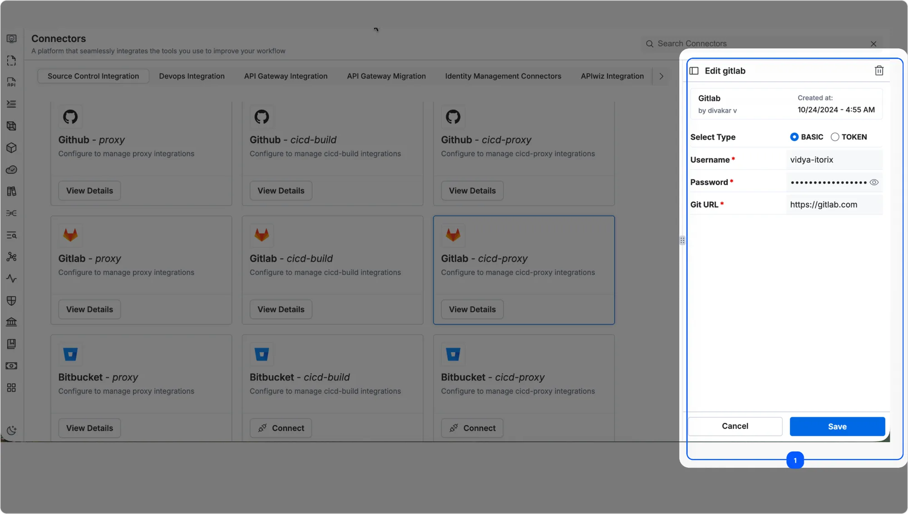

Option B: Token Authentication - Use this method for direct token-based authentication.

- Token Number: Paste the GitLab personal access token \(PAT\) you generated in the prerequisites section \(e.g., glp\_ProxyCiCdToken456\).

**Step 4: Save Configuration** - After entering the details, click on the Save button at the bottom of the panel. You will receive a success message at the bottom of the screen indicating the connection has been established.

**Step 5: Verify Connection** - Once the connection is successful, the button on the Connector Card will change from "Connect" to "View Details".

**Step 6: Manage Connector** - If you click on View Details, a window will open displaying the current configuration of the connector. You can use this window to edit the connector details \(for example, if a token expires\) or Delete the connection if it is no longer required.

## **Bitbucket - proxy**

This connector enables secure communication with Bitbucket repositories through a proxy. It ensures repository operations are executed safely without exposing direct credentials, providing controlled access for managing code in a compliant and secure way.

### **Configuring Bitbucket**

To access this connector in APIwiz, you must have an active Bitbucket account and workspace.

**Step 1: Create an Account and Workspace** - If you do not have an account, navigate to Bitbucket to register and create or join a workspace.

- Website: [https://bitbucket.org](https://bitbucket.org/)
- Guide: [How to create an account](https://support.atlassian.com/bitbucket-cloud/docs/create-an-account/)

**Step 2: Generate Credentials \(App Password\)** - While standard passwords may work for some integrations, it is highly recommended \(and often required\) to use an App Password for third-party integrations like APIwiz.

- How to generate an App Password: [Create an App Password in Bitbucket](https://support.atlassian.com/bitbucket-cloud/docs/create-an-app-password/).
- Ensure you grant the necessary permissions \(scopes\) such as Repositories:Read or Repositories:Write depending on your needs.

### **Connecting to Bitbucket - proxy in the APIwiz Workspace**

Follow the steps below to configure the connector within the platform.

**Step 1: Locate the Connector** - Navigate to the Connectors module and select the Source Control Integration category. Locate the Bitbucket - proxy Connector card.

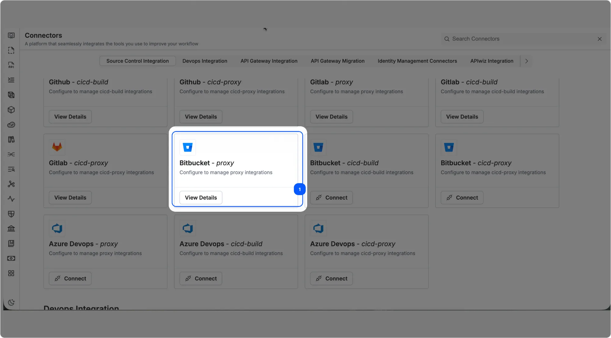

**Step 2: Initiate Connection** - Press the Connect button on the connector card.

**Step 3: Select Authentication Type** - A configuration panel will appear on the right-hand side. You can authenticate using Basic or Token. Select the radio button corresponding to your preferred method.

Option A: Basic Authentication

- Username: Enter the Bitbucket username used for proxy authentication \(e.g., bb-proxy-user\).
- Password: Enter the login password or the App Password linked to the Bitbucket account \(e.g., BbProxy@123\!\).
- Git URL: Enter the full URL of the repository you wish to connect through the proxy \(e.g., [https://bitbucket.org/org/repo.git](https://bitbucket.org/org/repo.git)\).

Option B: Token Authentication

- Username: Enter the Bitbucket username used for proxy authentication \(e.g., bb-proxy-user\).
- Token Number: Enter the Bitbucket App Password or personal access token \(PAT\) \(e.g., bbp\_xxx123Token456\).

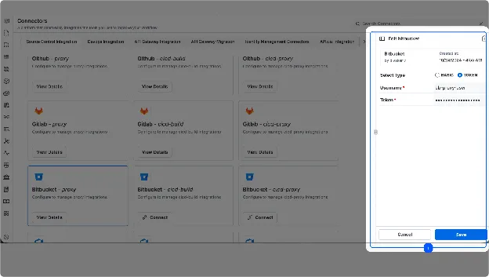

**Step 4: Save Configuration** - After entering the details, click on the Save button at the bottom of the panel. You will receive a success message at the bottom of the screen indicating the connection has been established.

**Step 5: Verify Connection** - Once the connection is successful, the button on the Connector Card will change from "Connect" to "View Details".

**Step 6: Manage Connector** - If you click on View Details, a window will open displaying the current configuration of the connector. You can use this window to edit the connector details or Delete the connection if necessary.

## **Bitbucket – cicd-build**

This connector links your CI/CD pipelines with Bitbucket repositories to automate builds, tests, and deployments. It allows pipelines to fetch code, trigger builds, and manage deployment workflows directly from source control, ensuring faster and consistent delivery cycles.

### **Configuring Bitbucket**

To access this connector in APIwiz, you must have an active Bitbucket account and the necessary credentials to authorize build operations.

**Step 1: Create an Account and Workspace** - If you do not have an account, navigate to Bitbucket to register and create or join a workspace.

- Website: [https://bitbucket.org](https://bitbucket.org/)
- Guide: [How to create an account](https://support.atlassian.com/bitbucket-cloud/docs/create-an-account/)

**Step 2: Generate Credentials \(App Password\)** - For CI/CD integrations, it is best practice to use an App Password rather than your primary account password. This allows you to restrict permissions specifically for build operations \(e.g., Repositories:Read\).

- How to generate an App Password: [Create an App Password in Bitbucket](https://support.atlassian.com/bitbucket-cloud/docs/create-an-app-password/).

### **Connecting to Bitbucket - cicd-build in the APIwiz Workspace**

Follow the steps below to configure the connector.

**Step 1: Locate the Connector** - Navigate to the Connectors module and select the Source Control Integration category. Locate the Bitbucket - cicd-build Connector card.

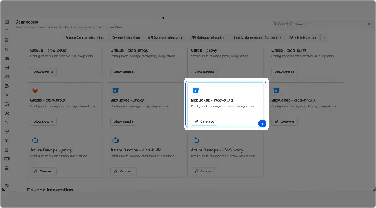

**Step 2: Initiate Connection** - Press the Connect button on the connector card.

**Step 3: Select Authentication Type** - A configuration panel will appear on the right-hand side. You can authenticate using Basic or Token. Select the tab or radio button corresponding to your preferred method.

Option A: Basic Authentication

- Username: Enter the Bitbucket username used for CI/CD build operations \(e.g., bb-cicd-user\).
- Password: Enter the login password or App Password associated with the build user \(e.g., BbCicd@123\!\).
- Git URL: Enter the repository URL used as the build source \(e.g., [https://bitbucket.org/org/build-repo.git](https://bitbucket.org/org/build-repo.git)\).

Option B: Token Authentication

- Username: Enter the Bitbucket username used for CI/CD build operations \(e.g., bb-cicd-user\).
- Token Number: Enter the Bitbucket App Password or personal access token \(PAT\) generated for authentication \(e.g., bbp\_CiCdToken789\).

**Step 4: Save Configuration** - After entering the details, click on the Save button at the bottom of the panel. You will receive a success message at the bottom of the screen indicating the connection has been established.

**Step 5: Verify Connection** - Once the connection is successful, the button on the Connector Card will change from "Connect" to "View Details".

**Step 6: Manage Connector** - If you click on View Details, a window will open displaying the current configuration of the connector. You can use this window to edit the connector details or Delete the connection if necessary.

## **Bitbucket - cicd-proxy**

This connector allows CI/CD pipelines to securely access Bitbucket repositories through a proxy. It ensures that build and deployment workflows run without exposing direct repository credentials, adding an extra layer of security and controlled access for automated processes.

### **Configuring Bitbucket**

To access this connector in APIwiz, you must have an active Bitbucket account and the necessary credentials to authorize proxy operations.

**Step 1: Create an Account and Workspace** - If you do not have an account, navigate to Bitbucket to register and create or join a workspace.

- Website: [https://bitbucket.org](https://bitbucket.org/)
- Guide: [How to create an account](https://support.atlassian.com/bitbucket-cloud/docs/create-an-account/)

**Step 2: Generate Credentials \(App Password\)** - For secure proxy and CI/CD operations, it is recommended to use an App Password instead of your personal login password. This allows you to control the specific permissions \(scopes\) granted to the proxy connection.

- How to generate an App Password: [Create an App Password in Bitbucket](https://support.atlassian.com/bitbucket-cloud/docs/create-an-app-password/).

### **Connecting to Bitbucket - cicd-proxy in the APIwiz Workspace**

Follow the steps below to configure the connector.

**Step 1: Locate the Connector** - Navigate to the Connectors module and select the Source Control Integration category. Locate the Bitbucket - cicd-proxy Connector card.

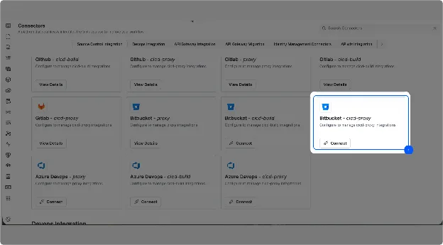

**Step 2: Initiate Connection** - Press the Connect button on the connector card.

**Step 3: Select Authentication Type** - A configuration panel will appear on the right-hand side. You can authenticate using Basic or Token. Select the tab or radio button corresponding to your preferred method.

Option A: Basic Authentication

- Username: Enter the Bitbucket username configured for CI/CD proxy access \(e.g., bb-cicd-proxy-user\).
- Password: Enter the password or App Password linked to the proxy user \(e.g., BbCicdProxy@123\!\).
- Git URL: Enter the repository URL used in CI/CD pipelines \(e.g., [https://bitbucket.org/org/proxy-repo.git](https://bitbucket.org/org/proxy-repo.git)\).

Option B: Token Authentication

- Username: Enter the Bitbucket username configured for CI/CD proxy access \(e.g., bb-cicd-proxy-user\).
- Token Number: Enter the Bitbucket App Password or personal access token \(PAT\) for authentication \(e.g., bbp\_ProxyCiCdToken456\).

**Step 4: Save Configuration** - After entering the details, click on the Save button at the bottom of the panel. You will receive a success message at the bottom of the screen indicating the connection has been established.

**Step 5: Verify Connection** - Once the connection is successful, the button on the Connector Card will change from "Connect" to "View Details".

**Step 6: Manage Connector** - If you click on View Details, a window will open displaying the current configuration of the connector. You can use this window to edit the connector details or Delete the connection if necessary.

## **Azure Devops - proxy**

This connector enables secure communication with Azure DevOps repositories through a proxy. It ensures repository operations are performed safely without exposing direct credentials, providing controlled access for managing code in a compliant and secure manner.

### **Configuring Azure DevOps**

To access this connector in APIwiz, you must have an active Azure DevOps account. Additionally, you will likely need to generate a Personal Access Token \(PAT\) if your organization enforces strict security policies or Two-Factor Authentication \(2FA\).

**Step 1: Create an Account** - If you do not have an account, navigate to the Azure DevOps portal to register.

- Website: [https://azure.microsoft.com/en-us/products/devops/](https://azure.microsoft.com/en-us/products/devops/)
- Follow the on-screen instructions to complete the registration process.

**Step 2: Generate Credentials \(PAT\)** - To authenticate securely, it is recommended to create a Personal Access Token \(PAT\).

- How to generate a token: [Use personal access tokens to authenticate](https://learn.microsoft.com/en-us/azure/devops/organizations/accounts/use-personal-access-tokens-to-authenticate).
- Note: When generating the token, ensure you select the appropriate scopes \(such as Code \(Read & Write\)\) required for the proxy to function.

### **Connecting to Azure Devops - proxy in the APIwiz Workspace**

Follow the steps below to configure the connector within the platform.

**Step 1: Locate the Connector** - Navigate to the Connectors module and select the Source Control Integration category. Locate the Azure Devops - proxy Connector card.

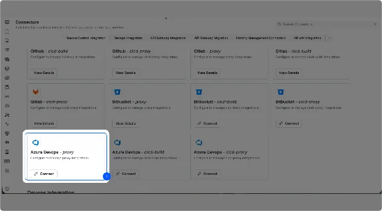

**Step 2: Initiate Connection** - Press the Connect button on the connector card.

**Step 3: Authentication** - A configuration panel will appear on the right-hand side. You can authenticate by filling in the username and password.

- Username: Enter the Azure DevOps username used for proxy authentication \(e.g., ado-proxy-user\).
- Password: Enter the login password or the Personal Access Token \(PAT\) linked to the Azure DevOps account \(e.g., AdoProxy@123\!\).

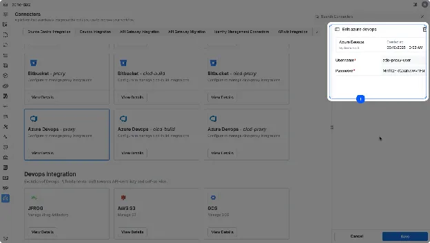

**Step 4: Save Configuration** - After entering the details, click on the Save button at the bottom of the panel. You will receive a success message at the bottom of the screen indicating the connection has been established.

**Step 5: Verify Connection** - Once the connection is successful, the button on the Connector Card will change from "Connect" to "View Details".

**Step 6: Manage Connector** - If you click on View Details, a window will open displaying the current configuration of the connector. You can use this window to edit the connector details or Delete the connection if necessary.

## **Azure Devops - cicd-build**

This connector integrates CI/CD pipelines with Azure DevOps repositories to automate builds, tests, and deployments. It allows pipelines to fetch code, trigger builds, and manage deployment workflows directly from source control, ensuring faster and reliable delivery cycles.

### **Configuring Azure DevOps**

To access this connector in APIwiz, you must have an active Azure DevOps account and the necessary credentials to authorize build operations.

**Step 1: Create an Account** - If you do not have an account, navigate to the Azure DevOps portal to register.

- Website: [https://azure.microsoft.com/en-us/products/devops/](https://azure.microsoft.com/en-us/products/devops/)
- Follow the on-screen instructions to complete the registration process.

**Step 2: Generate Credentials \(PAT\)** - For CI/CD integrations, it is highly recommended to use a Personal Access Token \(PAT\). This allows you to restrict permissions specifically for build and release pipelines.

- How to generate a token: [Use personal access tokens to authenticate](https://learn.microsoft.com/en-us/azure/devops/organizations/accounts/use-personal-access-tokens-to-authenticate).
- Note: When generating the token, ensure you grant the appropriate scopes \(e.g., Build \(Read & Execute\) or Code \(Read\)\) required for the connector to function.

### **Connecting to Azure Devops - cicd-build in the APIwiz Workspace**

Follow the steps below to configure the connector within the platform.

**Step 1: Locate the Connector -** Navigate to the Connectors module and select the Source Control Integration category. Locate the Azure Devops - cicd-build Connector card.

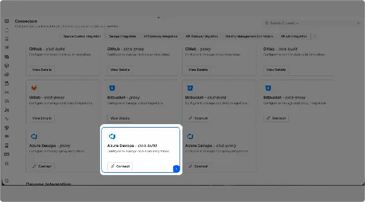

**Step 2: Initiate Connection** - Press the Connect button on the connector card.

**Step 3: Authentication** - A configuration panel will appear on the right-hand side. You can authenticate by filling in the username and password.

- Username: Enter the Azure DevOps username used for CI/CD build operations \(e.g., ado-cicd-user\).
- Password: Enter the login password or the Personal Access Token \(PAT\) linked to the build user \(e.g., AdoCicd@123\!\).

**Step 4: Save Configuration** - After entering the details, click on the Save button at the bottom of the panel. You will receive a success message at the bottom of the screen indicating the connection has been established.

**Step 5: Verify Connection** - Once the connection is successful, the button on the Connector Card will change from "Connect" to "View Details".

**Step 6: Manage Connector** - If you click on View Details, a window will open displaying the current configuration of the connector. You can use this window to edit the connector details or Delete the connection if necessary.

## **Azure Devops - cicd-proxy**

This connector allows CI/CD pipelines to securely interact with Azure DevOps repositories through a proxy. It ensures that build and deployment workflows can run without exposing direct repository credentials, providing an extra layer of security and controlled access for automated processes.

### **Configuring Azure DevOps**

To access this connector in APIwiz, you must have an active Azure DevOps account and the necessary credentials to authorize proxy operations.

**Step 1: Create an Account** - If you do not have an account, navigate to the Azure DevOps portal to register.

- Website: [https://azure.microsoft.com/en-us/products/devops/](https://azure.microsoft.com/en-us/products/devops/)
- Follow the on-screen instructions to complete the registration process.

**Step 2: Generate Credentials \(PAT\)** - For secure proxy and CI/CD operations, it is recommended to use a Personal Access Token \(PAT\). This allows you to restrict permissions specifically for the proxy connection.

- How to generate a token: [Use personal access tokens to authenticate](https://learn.microsoft.com/en-us/azure/devops/organizations/accounts/use-personal-access-tokens-to-authenticate).
- Note: When generating the token, ensure you grant the appropriate scopes required for the proxy to function.

### **Connecting to Azure Devops - cicd-proxy in the APIwiz Workspace**

Follow the steps below to configure the connector within the platform.

**Step 1: Locate the Connector** - Navigate to the Connectors module and select the Source Control Integration category. Locate the Azure Devops - cicd-proxy Connector card.

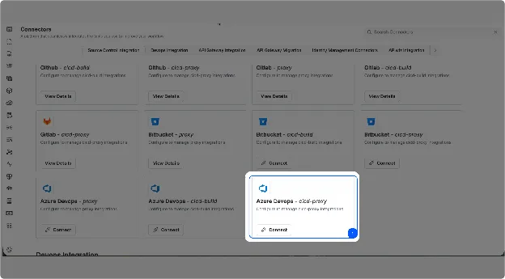

**Step 2: Initiate Connection** - Press the Connect button on the connector card.

**Step 3: Authentication** - A configuration panel will appear on the right-hand side. You can authenticate by filling in the username and password.

- Username: Enter the Azure DevOps username configured for CI/CD proxy access \(e.g., ado-cicd-proxy-user\).
- Password: Enter the password or Personal Access Token \(PAT\) linked to the proxy user \(e.g., AdoCicdProxy@123\!\).

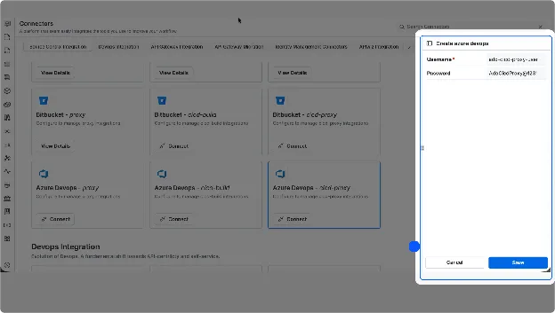

**Step 4: Save Configuration** - After entering the details, click on the Save button at the bottom of the panel. You will receive a success message at the bottom of the screen indicating the connection has been established.

**Step 5: Verify Connection** - Once the connection is successful, the button on the Connector Card will change from "Connect" to "View Details".

**Step 6: Manage Connector** - If you click on View Details, a window will open displaying the current configuration of the connector. You can use this window to edit the connector details or Delete the connection if necessary.