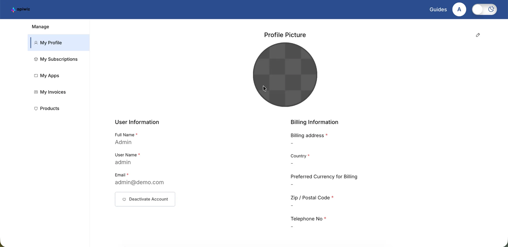

My Profile manages your login details and personal information. It displays your profile picture, contact details, and billing information.

Select **Deactivate Account** at the bottom to permanently deactivate your account.

## Update profile information and password

1. Select the pencil icon to edit your profile information.
1. Update the required details.
1. Select **Save**.