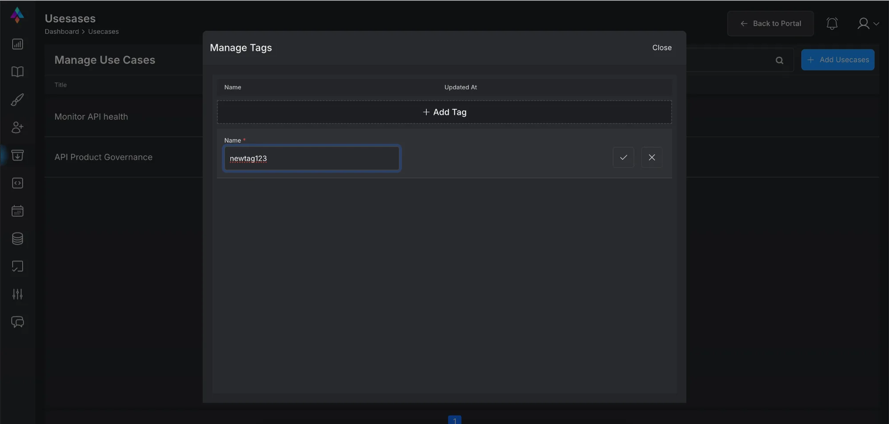
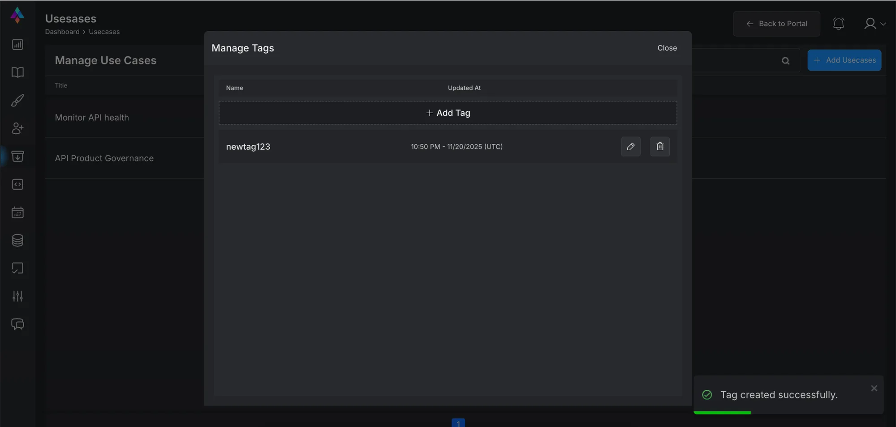
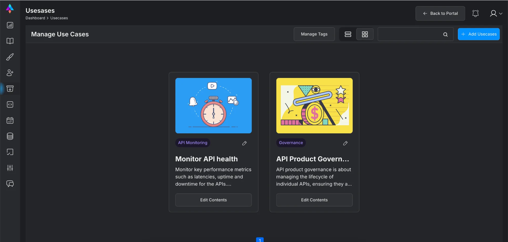
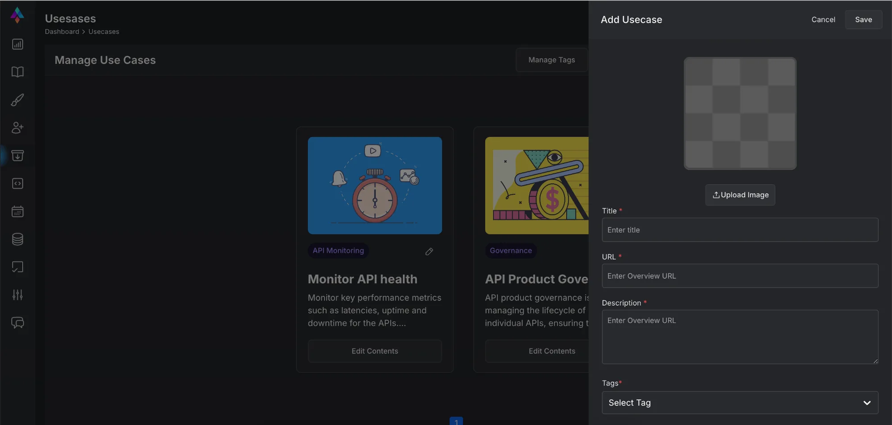

The Use Cases section provides a centralized repository for documenting and managing the diverse use cases associated with your applications. It helps organize essential information about how your APIs can be applied to address specific user needs and scenarios.

The Use Cases interface includes the following:

- **Fields** : Displays a sortable and filterable list of use cases with **Title** and **Tag Name** columns.
- **Display Options** : Use cases can be displayed in **List View** or **Card View**.

### Manage tags

1. Select **Manage Tags**.
1. Select **\+ Add Tag** to create a new tag.
1. Select the checkmark to save the tag.

To modify or remove an existing tag, select **Edit** or **Delete** next to the tag.

### Add a use case

1. Select **\+ Add Use Case**.
  
1. Enter the following details:
  **Image**: An image representing the use case.

  **Title**: A descriptive title for the use case.

  **URL**: A link to related documentation or a live example.

  **Description**: A concise description of the use case.

  **Tag**: Select one or more relevant tags from the dropdown.
1. Select **Save**.
  