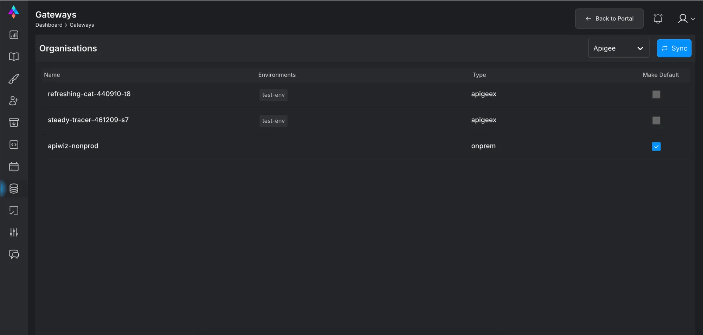
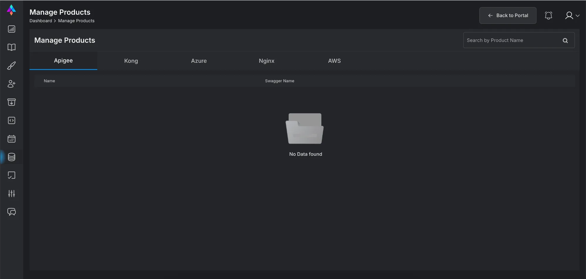

An API Gateway is the single entry point for all API requests. It provides traffic management, security enforcement, and request routing to backend services.

Key features of an API Gateway include:

- **Traffic Management** : Controls and optimizes API request flow, preventing overload and ensuring performance.
- **Security** : Implements authentication, authorization, and encryption to protect APIs from unauthorized access and malicious attacks.
- **Routing** : Directs incoming API calls to the correct backend services based on defined rules and configurations.
- **Additional Features** : Includes rate limiting, caching, and API usage monitoring for performance optimization and resource management.

Manage Gateways includes three sections: **Gateway Details**, **Associate Users for Gateways**, and **Manage Products**.

# Gateway Details

Gateway Details provides information about configured API Gateways. API Gateways act as intermediaries between API consumers and backend API servers. The Dev Portal supports the following gateways: **Apigee**, **Kong**, **Azure**, **Nginx**, and **AWS**.

- **Services** : Group related APIs and provide the gateway with the necessary configuration for request handling.
- **Products** : Created from services and expose APIs to developers for application development.

The Gateway Details screen includes the following elements:

- **Gateways \(Dropdown\)** : Select from Apigee, Kong, Azure, Nginx, and AWS.
- **Sync** : Synchronizes data from the workspace to the Dev Portal. Select **Sync** to reflect the latest configurations.
- **Fields** : Displays configuration parameters specific to the selected gateway type. A common field for all gateways is the **Make Default** checkbox.
- **Records** : Displays a list of configured gateway instances with their runtime status and configuration details.

# Associate Users for Gateways

Associate Users for Gateways allows you to associate specific Dev Portal users with particular gateway organizations. This controls which gateway resources each user can access.

The Associate Users screen displays the following columns:

- **Name** : The full name of the user.
- **User Name**: The username of the user.
- **Organisations** : The gateway organization\(s\) the user is associated with.
- **Registered** : The date and time the user registered.

### Associate a user with a gateway organization

1. Select the pencil icon next to the user you want to update.
1. The **Update User** panel opens on the right.
1. Under **Apigee Organizations**, select the organization\(s\) you want to associate with the user.
1. Select **Save**.

# Manage Products

Products are groups of APIs created and approved in the workspace, then made available in the Dev Portal for developers to integrate into their applications.

The Manage Products screen includes the following elements:

- **Gateways \(Dropdown\)** : Select from Apigee, Kong, Azure, Nginx, and AWS.
- **Fields** : Displays the **Product Name** and associated **Swagger Name**.
- **Records** : Lists all available products and their details.

