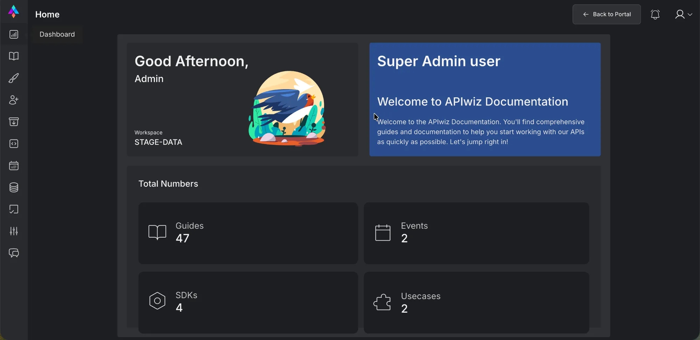
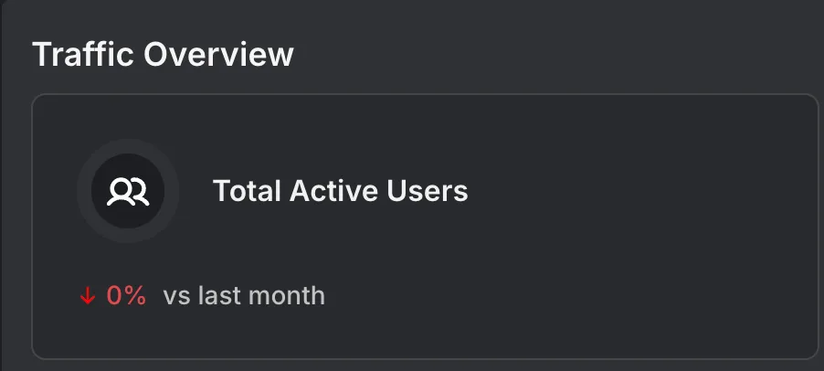
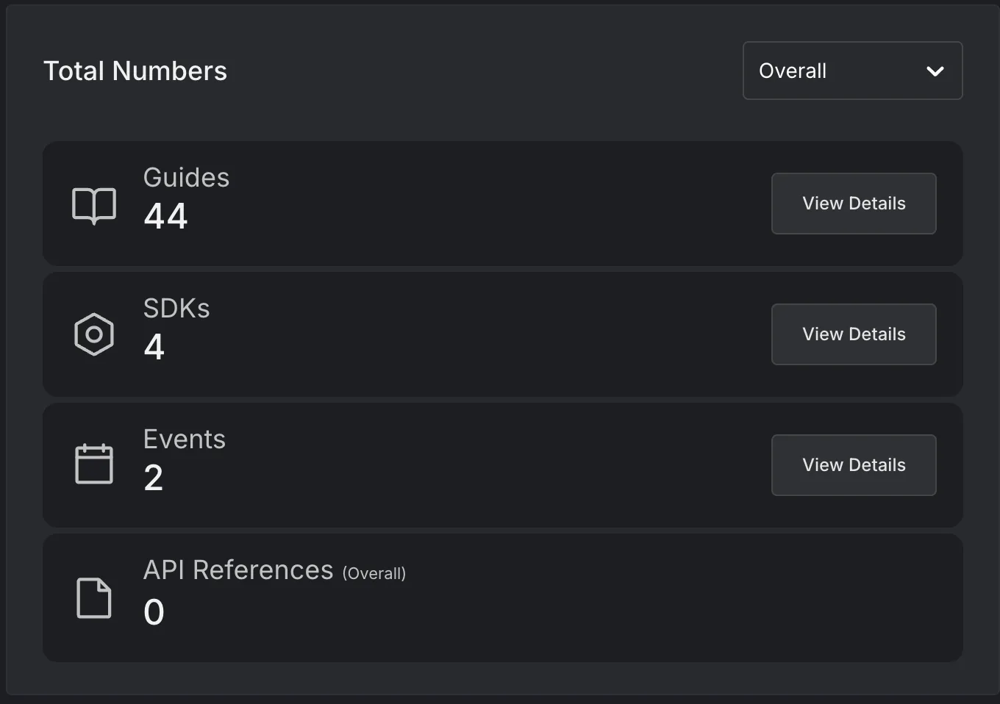
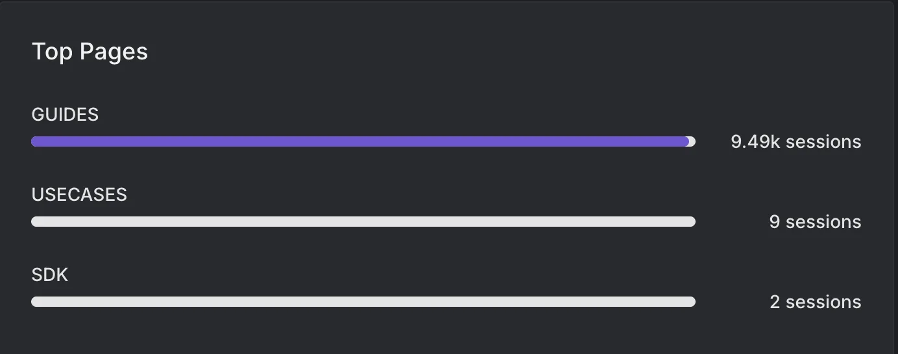
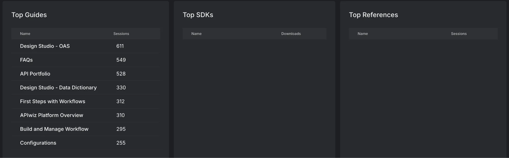
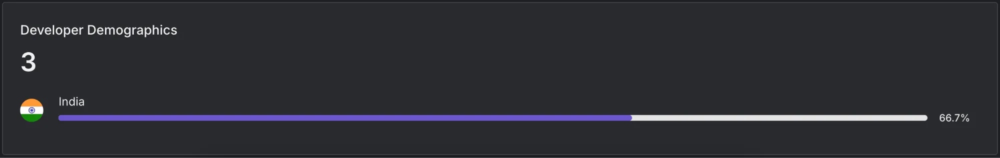

The Dashboard gives you a real-time overview of your portal's activity and usage metrics. Select the first icon in the left navigation panel to open it.

## Traffic Overview

This section presents a high-level summary of developer activity. It includes the following:

- **Total Active Users**: The number of users who have actively used the Dev Portal within the current month.
- **Month-over-Month Change**: The percentage increase or decrease in active users compared to the previous month. This provides a quick indication of growth or decline in developer engagement.

## Total Numbers

This section displays aggregated counts for various features and entities within the Dev Portal, such as Guides, SDKs, Events, and API References.

- **Summary Metrics**: Shows the total number of items for a selected feature. For example, there are 44 Guides.
- **Detailed View**: Select **View Details** to get a more granular breakdown of the selected feature's data, including filtering and sorting options.
- **Date Range Filtering**: Use the date range dropdown to filter the displayed data by a specific date range. Expanding the dropdown gives you different time-based filters.

## Top Pages

This section ranks the most frequently accessed pages or features within the Dev Portal based on the number of user sessions. It provides insights into which resources are most valuable to developers.

- **Ranking**: Pages are displayed in descending order, from the most frequently visited to the least.
- **Session Count**: Each page listing includes the number of sessions recorded for that resource.

For example, Guides, Use Cases, and SDK pages are typically the most frequently accessed, indicating strong developer interest in these resources.

## Top Guides, Top SDKs, and Top References

These sections highlight the most popular resources within the Dev Portal, located below the Total Numbers and Top Pages sections.

- **Prioritization** : Displays the most widely used modules or categories within the respective sections.
- **Usage Metrics** : Includes the number of sessions or downloads for each item, providing a quantitative measure of popularity.
- **Ordering** : Lists are ordered in descending order based on usage, with the most popular items appearing first.

## Developer Demographics

This section presents a breakdown of Dev Portal users by country.

- **Country-Based Analysis** : Provides a geographical representation of your developer base.
- **Usage Ranking** : Countries are listed in descending order based on the number of developers or their API usage, indicating key regions of developer activity.

