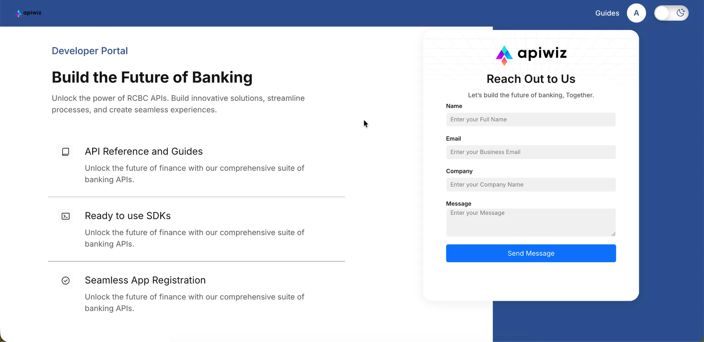
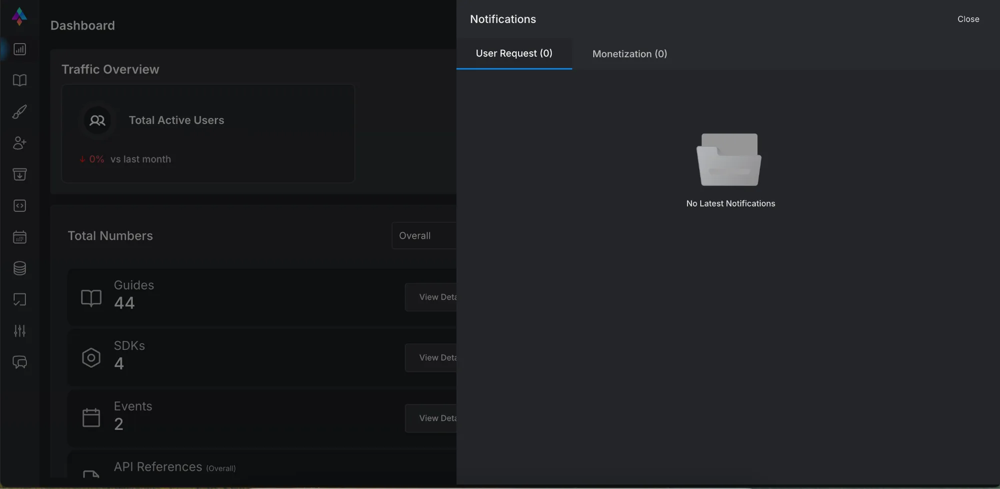

Contact Us allows your customers to reach out to your team with queries or concerns about the product.

**To send a message:**

1. Select **Contact Us** from the dropdown on the landing page.
1. Fill in all the required fields.
1. Select **Send Message**.

# Enquiries

The Enquiries section provides a centralized place for managing customer inquiries submitted through the contact form on the Consumer Side.

The Enquiries screen displays a list of all received inquiries. To view the details of a specific inquiry, select the eye icon under the **Action** column.

The inquiry details include the following:

- **Full Name**
- **Job Title**
- **Company**
- **Business Email**
- **Message**

Use the provided email address to contact the customer directly and address their query.

# Notifications

The Notifications button is located on the top-right corner and is to the right of the Back to Portal button. If you click on it, you will get two options: User Request and Monetization

# **User Request**

In this tab, you will see all the requests from people requesting to become users.

### **Accepting User Requests**

You can review the requests in this tab and accept their submission.

## **Monetization**  

In this tab, you will see the monetization requests from everyone. The screenshot below shows all the requests that are read and hence, marked as read.

