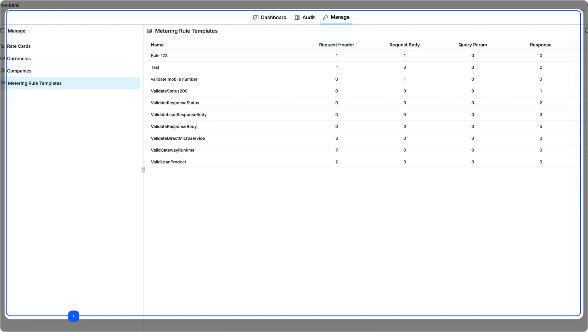
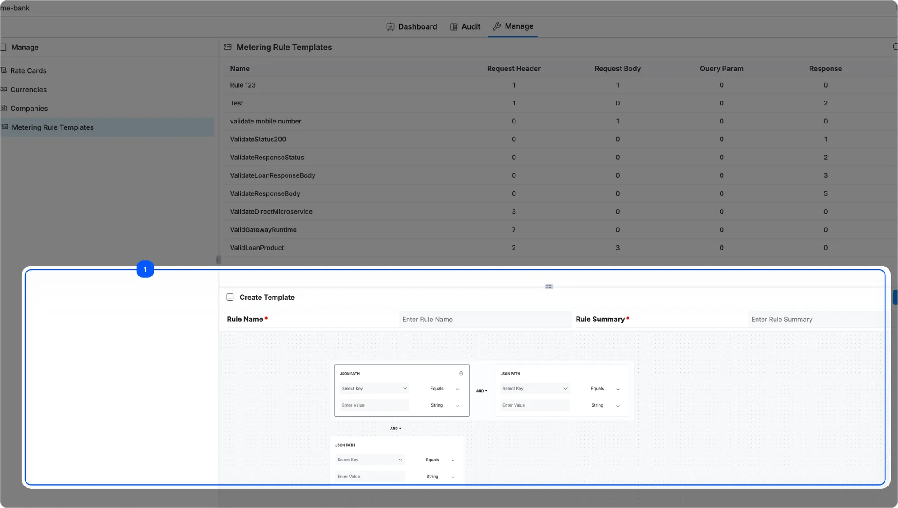

Metering Rule Templates are a foundational configuration that defines exactly when a consumer is charged for calling an API. Rather than charging a flat or unit fee for every request, including failed or invalid ones, metering rules set the precise criteria that qualify a transaction as billable. Configuring these as reusable templates lets providers define criteria once and apply them across multiple monetization packages.

### Key capabilities and logic

### How templates fit into the monetization lifecycle

1. **Create the template** in the global **Manage Configs** tab.
1. **Bind the template to a package** during the package creation wizard, reusing a pre-configured template, such as "success 2xx," instead of writing rules from scratch.
1. **Map the template to a rate card**, such as graduated pricing, so the engine automatically applies the correct pricing when a transaction matches the template's criteria.

The **Metering Rule Templates** tab is the fourth tab under **Manage**. You can use a metering rule template during package creation.

## Creating a metering rule template

To create a metering rule template:

1. Select **Manage \> Metering Rule Templates**.
1. In the top-right corner of the **Metering Rule Templates** tab, select **\+**. A panel opens at the bottom of the screen.
  
1. In the panel, enter the following details: 
  - In **Rule Name**, enter a unique name for the template. 
  - In **Rule Summary**, enter a brief description of the rule's purpose.
1. Add a node to define a rule condition. Perform the following steps for each node: 
  - From the **Key** dropdown, select a rule source, such as **Request Header**, **Request Body**, **Query Params**, or **Response**. 
  - From the operator dropdown, select an operator, such as **Equals**. 
  - In the value field, enter the value to evaluate.
1. To add more conditions, select **AND** or **OR** to combine additional nodes.
1. Select **Save**.

The application displays a confirmation message at the bottom of the screen, and the new metering rule template appears in the **Metering Rule Templates** list.

## Managing metering rule templates

You can search, edit, and delete metering rule templates. 

Enter the template name in the **Search** bar to filter the **Metering Rule Templates** list

Select **More options** \(⋮\) next to a template and select **Edit** to update it or **Delete** to remove it.