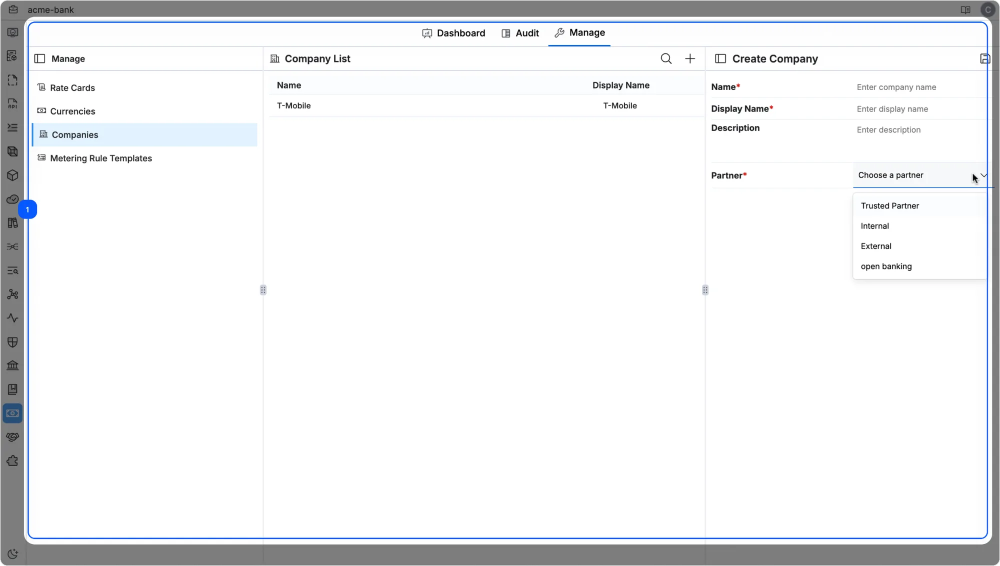

Companies is a configuration dependency that supports corporate billing as an alternative to individual consumer billing.

### Billing models

## Add a company

To add a company:

1. Select **Manage \> Companies**.
1. In the **Companies** section, select **\+**. The **Create Company** panel opens on the right.
  
1. Enter the following details:

1. Select the **Save** icon.

The new company is added to the **Company List** and becomes available for further configuration.

### Managing companies

Locate a company and select the **More options** \(⋮\) menu to edit or delete it. 

Select **Edit** to update the company details, or select **Delete** to remove the company from the system.