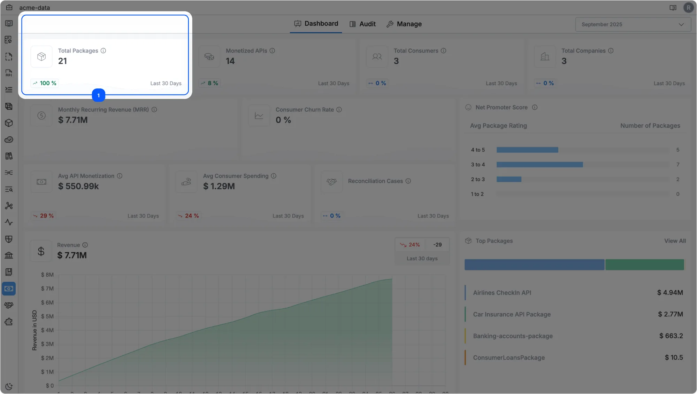
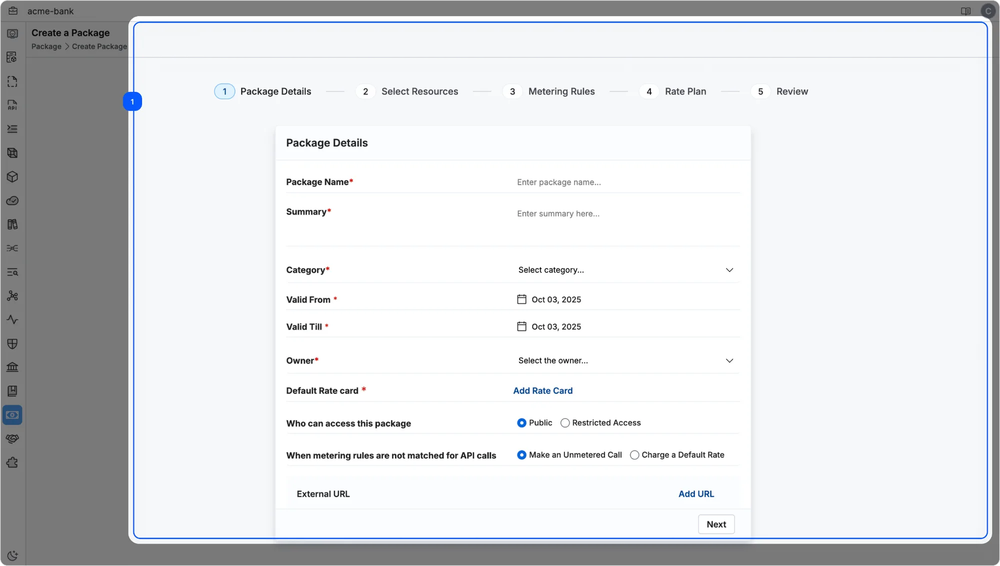
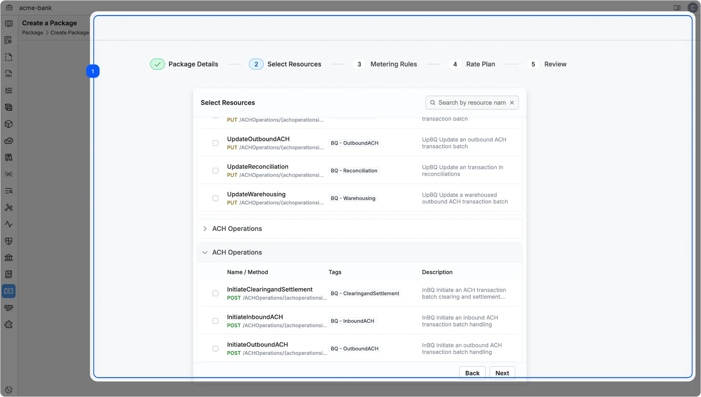
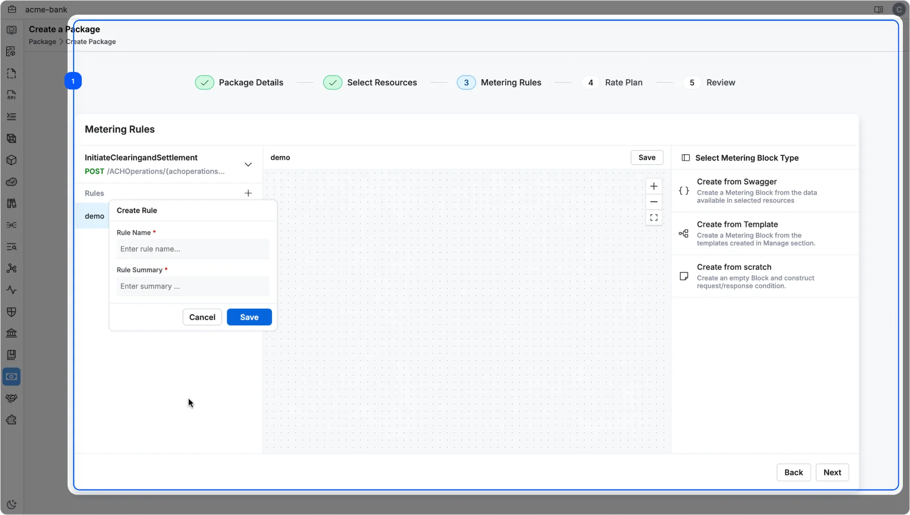
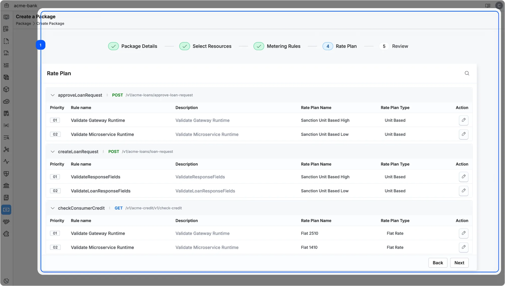
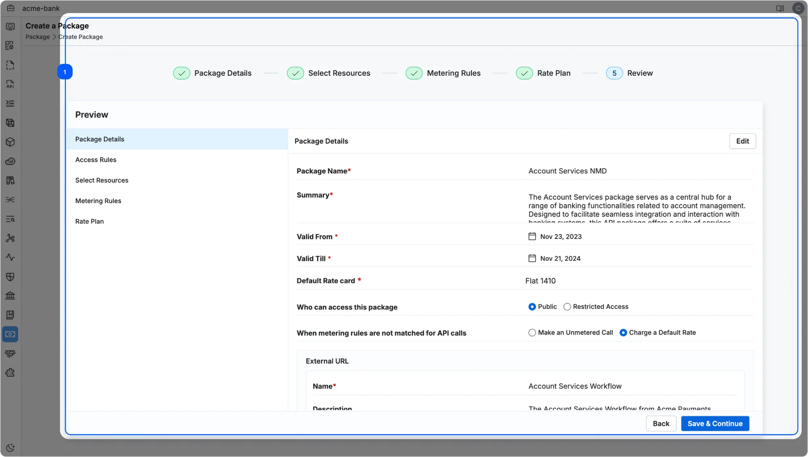

API packages help you organize and manage APIs along with their associated resources. Packages allow you to bundle APIs and apply customized metering rules to monitor and control usage.

After configuring currencies, rate cards, companies, metering rule templates, and package categories, the next step is to create a package.

# Access the Package List

To view all available packages, select **API Monetization \> Dashboard**, then select the **Total Packages** card.

The **Total Packages** card displays the total number of API packages available in the system. The indicator below the count shows the percentage change in the number of packages compared to the previous 30 days.

To view all available packages, select the **\>** icon on the **Total Packages** card.

The **Package List** window opens, displaying all available packages organized by their current status: **Draft**, **Published**, or **Retired**.

# Package creation

To create a new monetization package, select **\+ Add Package** in the top-right corner.

The **Create Package** workflow opens and guides you through the following steps.

## Step 1: Configure package details

Use the **Package Details** page to define the general information, access settings, pricing behavior, and additional information for the package.

Enter the following details:

**Configure the default rate card**

When incoming API traffic doesn't match any configured metering rule, you must define a billing behavior for the unmatched transaction. You also control which audiences can view and subscribe to the package.

To configure the default rate card, do the following:

1. Select **Add Rate Card**. The **Select Rate Card** panel opens.
1. Select a pre-configured rate card, such as **Flat Rate**, **Tiered Rate**, or **Volume Pricing**, to act as the billing fallback.
1. Review the rate card details, including the charging model, pricing type, and fee information.
1. Select **Save**.

**Configure package access**

Use **Who Can Access This Package** to control package visibility.

**Configure unmatched API call behavior**

Use **When Metering Rules Are Not Matched for API Calls** to specify how the system handles API requests that do not satisfy any configured metering rule.

**Add external references**

Use **External URL** to provide links to additional documentation or reference material related to the package.

To add an external link, do the following:

1. Select **Add URL**.
1. Enter the following details:

1. Repeat to add additional links if required.

**Allow consumers to view metering rules**

Select **Allow Consumers to View Metering Rules on Product Page** to display the package's metering rules on the product page. Enable this option to let consumers understand how API usage is measured and billed.

After completing all required fields, select **Next** to proceed to the **Select Resources** step.

## Step 2: Configuring access rules \(Optional\)

This step is available only if you selected **Restricted Access** under **Who Can Access This Package** in the previous step. Use this page to control which partners, companies, and developers can access the package.

Configure the following:

After configuring the access rules, select **Next** to proceed to the **Select Resources** step.

## Step 3: Select resources

Use the **Select Resources** page to select the API resources to include in the package. Only resources from approved or published OAS specifications are available for selection.

Resources are organized into expandable groups based on their category. Expand a resource group to view the available API resources.

Each resource displays the following information:

To select resources:

1. Use the **Search** box to find resources by name or HTTP method.
1. Select the checkbox next to each API resource to include in the package. You can select one or multiple resources based on your package requirements.
1. Select **Next** to proceed to the **Metering Rules** step.

## Step 4: Define metering rules

Use the **Metering Rules** page to define the rules that determine how API usage is tracked and charged within the package. Metering rules specify the conditions used to measure API requests or responses for usage tracking and billing.

The **Metering Rules** page consists of the following sections.

**Resource panel**

The **Resource** panel on the left side of the page displays the API resources selected in the previous step. Select a resource to view or manage its metering rules. Each resource contains a **Rules** section where you can create and manage one or more rules.

**Create a rule **

To create a rule, do the following:

1. Select **\+** next to **Rules**. 
  
1. Enter the following details:

1. Select **Save**.

The new rule appears under the selected resource.

**Rule Builder**

The **Rule Builder** occupies the center of the page. When you create a new rule, the builder is initially empty. After you select a metering block type, the builder displays the corresponding configuration where you define the conditions used to evaluate API requests and responses.

Depending on the selected metering block type, you can configure request and response fields, JSON paths, comparison operators, data types, and comparison values.

**Select a metering block type**

The **Select Metering Block Type** panel appears on the right side of the page after you create a rule. Select one of the following options to define how you want to build the metering rule.

### Create from Swagger

Use this option to generate a metering block directly from the selected API specification, instead of creating it manually.

To create a metering block from Swagger, do the following:

1. Select **Create from Swagger**.
1. The **Select a Swagger Field** panel opens. The system reads the request and response fields available in the selected API resource.
1. Expand a section such as **Request Headers**, **Request Parameters**, **Request Body**, or **Response Body**.
1. Select **\+ Rule** next to the field you want to use.
  

The selected field is added to the **Rule Builder**, where you can configure the comparison operator and comparison value.

### Create from Template

Use this option to create a metering rule from an existing template. Templates help you apply standardized metering rules across multiple API resources and reduce repetitive configuration.

To create a metering block from a template, do the following:

1. Select **Create from Template**.
1. The **Select a Template** panel opens, displaying all templates created in the **Manage** section.
1. Select **\+** next to the required template.
  

The template is added to the **Rule Builder**.

### Create from Scratch

Use this option when the required rule cannot be created from the API specification or an existing template, or when you need complete control over the rule logic.

To create a metering block from scratch, do the following:

1. Select **Create from Scratch**.
1. An empty metering block is added to the **Rule Builder**, allowing you to define custom conditions for evaluating API requests and responses.
  

**Configure a condition**

To define a condition in the Rule Builder, do the following:

1. In the **Select Key** list, select the part of the API request or response to evaluate.

1. After you select a key, the Rule Builder displays the corresponding JSON path.
1. Configure the following fields for the selected JSON path:

**Combine multiple conditions**

You can create multiple conditions within the same metering rule and connect them using **AND** or **OR**.

#### Save the rule

After configuring all required conditions using any of the metering block types, select **Save**.

The rule is saved and associated with the selected API resource. It is available for further editing or reuse.

### Manage metering rules

Each rule includes a **More Options** \(⋮\) menu with the following actions.

After configuring all required metering rules and saving your changes, select **Next** to proceed to the **Rate Plan** page, where you assign a pricing plan to each metering rule.

## Step 5: Configure the rate plan

Use the **Rate Plan** page to assign a rate plan to each metering rule. A rate plan determines how API usage is billed when a request matches the corresponding metering rule. The **Rate Plan** page groups metering rules by API resource, allowing you to review and assign pricing for each resource.

The **Rate Plan** page contains the following sections.

#### Resource section

The **Resource** section displays each API resource selected during package creation. Expand a resource to view all associated metering rules. Each resource lists the rules in the order they are evaluated.

#### Rate plan table

The **Rate Plan** table displays the metering rules associated with the selected resource. Each row represents a metering rule and its assigned pricing information.

To update a rate plan, locate the metering rule, select **Edit** \(pencil\) in the **Action** column, update the rate plan, and select **Save**. Repeat for each metering rule until all rules have an associated rate plan.

After reviewing the assigned rate plans, select **Next** to proceed to the **Review** page, where you can verify the complete package configuration before creating the package.

## Step 6: Review and save

Use the **Review** page to review the consolidated summary of all package configurations before creating the package. Verify all details configured in the previous steps.

The review is organized into the following sections.

Review each section to confirm the configuration is correct.

### Editing a section

Each section includes an **Edit** option in the upper-right corner. Select **Edit** to return to the corresponding step, update the configuration, and return to the **Review** page.

## Package details page

After you save a package, it appears in the **Package List**. Select the package to open the **Package Details** page, where you can review package information, monitor API usage, and analyze revenue for the package and its API resources.

### Package information

The left panel displays the package details.

### Usage and revenue metrics

The upper section displays usage and revenue metrics for the selected reporting period.

### API resources

The lower section lists the API resources included in the package and their metering details.