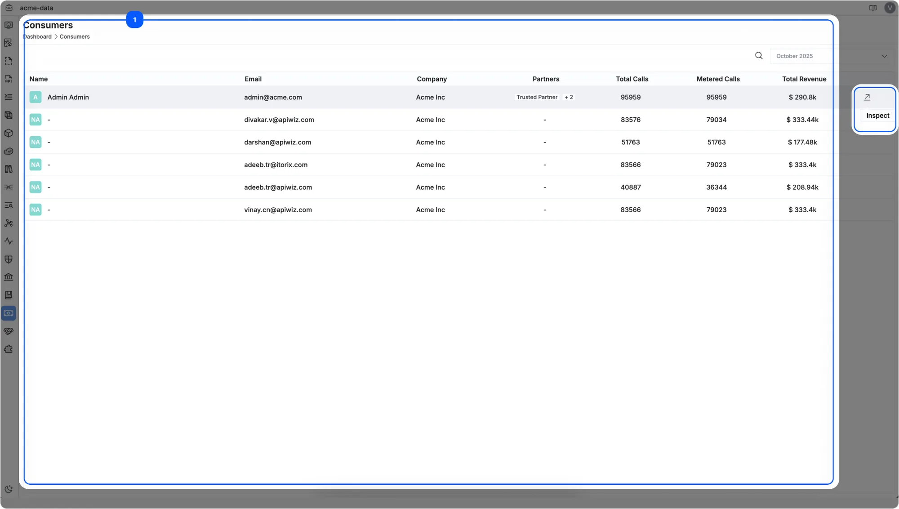
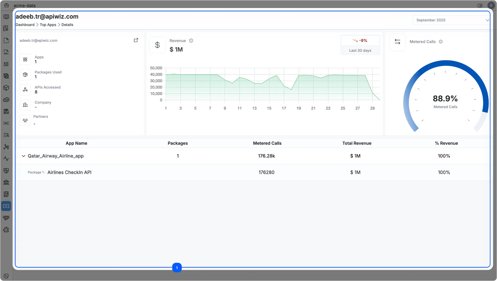

The **Total Consumers** card displays the total number of consumers who subscribed to and used API packages during the selected reporting period. Use this card to monitor consumer adoption and analyze API consumption across your monetized packages.

To view detailed consumer insights, select the **View Details** \(\>\) icon. The **Consumers** page opens.

## Reviewing consumers

Use the **Consumers** page to review consumer information, API usage, and revenue generated by each consumer. Search for a specific consumer by name or email address, and filter the data by the required reporting period.

For each consumer, you can review the following information.

To review detailed information for a specific consumer, select the **Inspect** \(↗\) icon for the corresponding consumer. The **Consumer Details** page opens.

Use this page to analyze the consumer's API usage, applications, subscribed packages, monetization metrics, and revenue contribution.