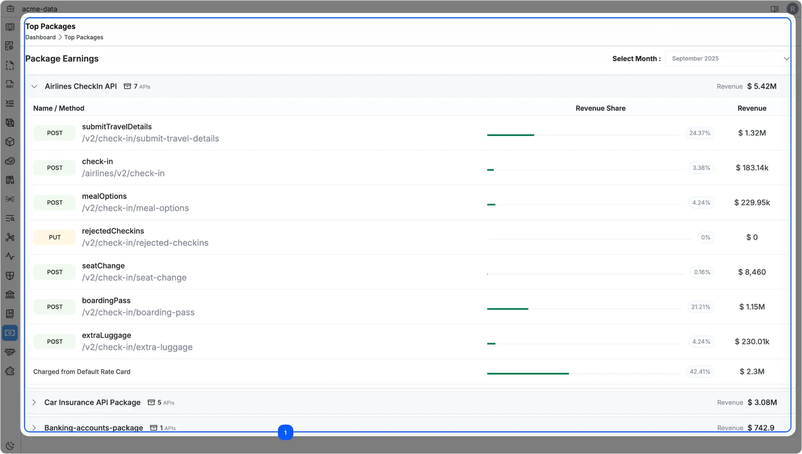
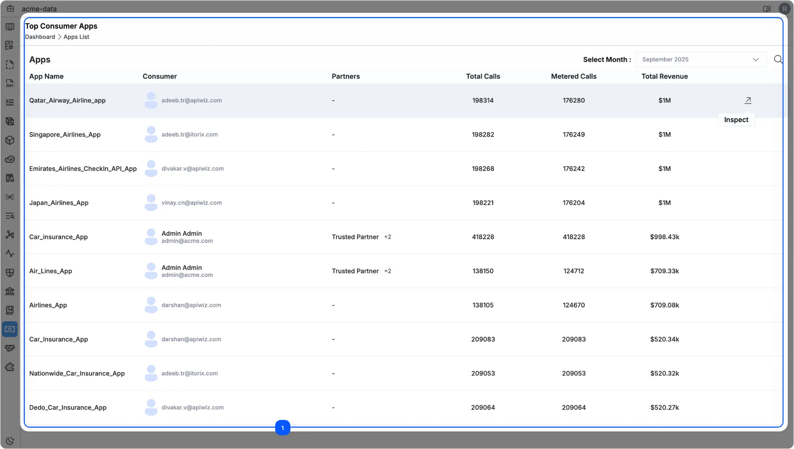
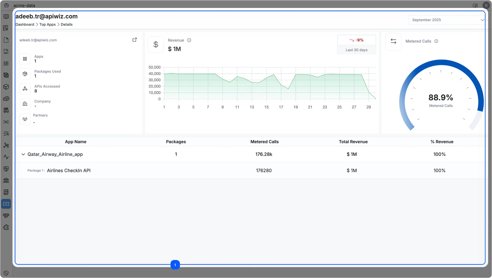
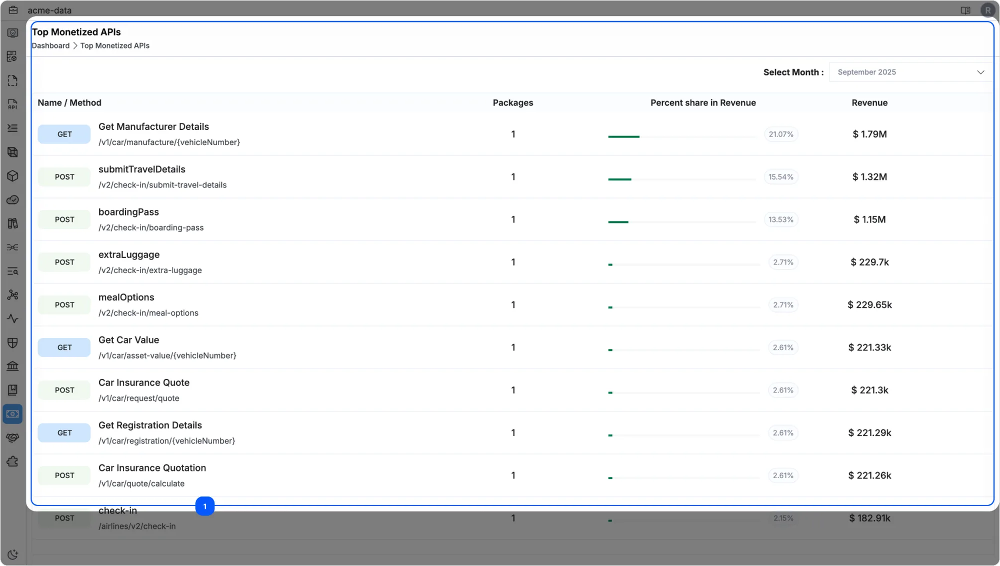

The **Dashboard Insights** section provides a comprehensive view of your API monetization performance, revenue trends, API usage, package performance, and consumer activity. Use these insights to monitor business performance, identify high-performing APIs and packages, analyze consumer behavior, and track monetization trends over the selected reporting period.

The **Dashboard Insights** section includes the following cards.

### Revenue

The **Revenue** chart displays the total revenue generated during the selected reporting period. Use this chart to monitor revenue trends, compare revenue with previous periods, and identify daily revenue fluctuations.

Hover over a data point to view the revenue generated on a specific day.

### Top Packages

The **Top Packages** card highlights the API packages that generated the highest revenue during the selected reporting period.

Select **View All** to open the **Top Packages** page, where you can review package-level revenue, associated APIs, and revenue contribution for each package.

### Top Consumer Apps

The **Top Consumer Apps** card displays the applications that generated the highest API consumption and revenue during the selected reporting period.

Select **View All** to open the **Top Consumer Apps** page, where you can review API usage, metered calls, and revenue generated by each application.

To review detailed information for a specific application, select the **Inspect** \(↗\) icon. The **Consumer Details** page opens. For more information, see [Analyze consumer details](/marketplace-and-monetization/api-monetization/provider-side-analytics/viewing-monetized-apis/).

### Consumer Apps

The **Consumer Apps** chart displays the total number of consumer applications that accessed APIs during the selected reporting period. Use this chart to monitor application adoption and analyze usage trends over time.

### Usage

The **Usage** chart displays the total number of API calls during the selected reporting period. Use this chart to monitor API traffic, compare metered and unmetered API calls, and analyze usage trends over time.

### Top APIs

The **Top APIs** card highlights the APIs that generated the highest revenue during the selected reporting period.

Select **View All** to open the **Top Monetized APIs** page and review monetization metrics for all APIs. For more information, see [View monetized APIs](/marketplace-and-monetization/api-monetization/provider-side-analytics/viewing-monetized-apis/).

