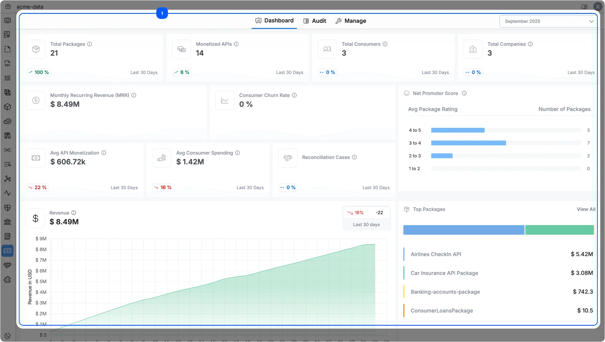

The **Dashboard** provides insights into API monetization, usage, subscriptions, and revenue. The information displayed depends on whether you're signed in as an **API Provider** or **API Consumer**.

## Viewing provider insights

As an **API Provider**, use the dashboard to monitor the overall performance of your API monetization program.

Use the dashboard to:

- Monitor the total number of active packages and consumer subscriptions.
- Track developer onboarding and consumer churn trends.
- Analyze revenue growth over time.
- Review overall API consumption across developer applications.
- Filter data by month to analyze historical trends.

When you filter the dashboard for a specific period, you can:

- Review the performance of individual API packages.
- Analyze revenue and usage for specific API operations.
- Identify the metering rules and rate plans that generated charges.
- View the consumers associated with API usage.
- Review draft invoices generated for consumers before billing.

## Viewing consumer insights

As an **API Consumer**, use the dashboard to monitor the usage and cost of your subscribed APIs.

Use the dashboard to:

- Track API usage across your registered applications.
- Monitor API consumption for each active subscription.
- Review usage trends and accumulated costs for subscribed packages.

The dashboard helps you understand how your applications consume APIs and how that usage contributes to your billing.

## Accessing the Dashboard tab

To view producer-side analytics, select **API Monetization \> Dashboard**.

The **Dashboard** tab displays running metrics and transactional data, varying by **API Provider** or **API Consumer** perspective.