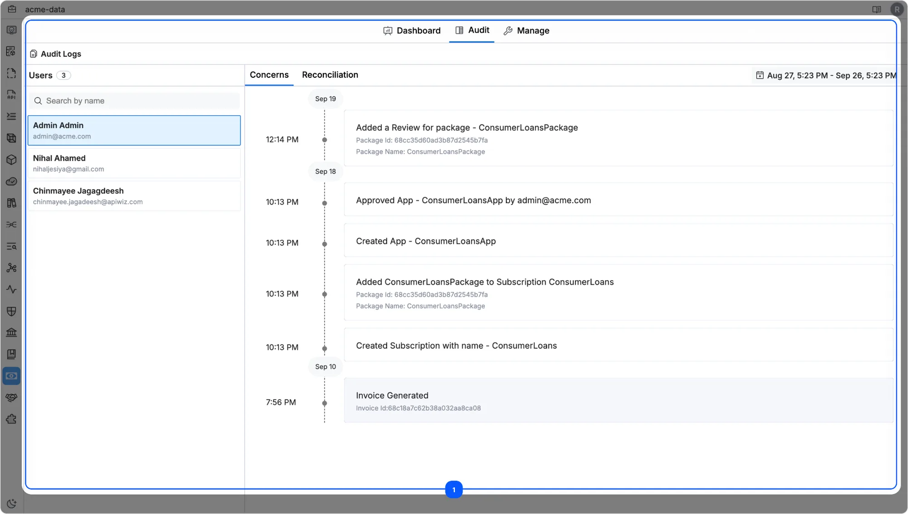

The **Audit** tab helps you investigate billing issues and monitor activities related to API monetization. It provides a complete history of monetization events and actions, helping you validate invoices and financial transactions, investigate disputes, and maintain compliance.

Use the Audit tab to:

- Review billing disputes and concerns raised by API consumers.
- Monitor and validate reconciliation activities for invoices and payments.
- Investigate discrepancies between API usage and generated invoices.
- Track activities performed by users throughout the monetization lifecycle.
- Access historical records for auditing, compliance, and financial reporting.
- Analyze historical events to improve operational processes.

The Audit tab categorizes activities into **Concerns** and **Reconciliation**.

# How the Audit tab supports reconciliation

The Audit tab works together with the **Reconciliation** feature to resolve billing discrepancies. When a consumer reports an issue with an invoice, the system records the request, allowing administrators to investigate the reported usage, verify billing information, and complete the reconciliation process.

During an investigation, you can review audit records to identify events that may have affected billing, such as:

- Package creation or updates.
- Subscription creation or modifications.
- Metering or pricing configuration changes.
- Other monetization-related activities.

By reviewing these records alongside invoice and usage information, you can determine the cause of a billing discrepancy and take the appropriate action.

# Reviewing audit activities

Use the Audit tab to review activities for a specific consumer or user.

To review audit activities:

1. Search for and select the required user.
1. Review the activity history associated with the user.
1. If necessary, filter the results by date or time range.
1. Select the required activity to review additional details.

# Prerequisites

- Monetization packages and rate plans are created.
- Consumers have subscribed to packages and generated usage.
- Billing or reconciliation activities are available for review.

# Accessing the Audit tab

To access the reconciliation and dispute management workflow, select **API Monetization \> Audit**.

The **Audit** tab opens, displaying the reconciliation and dispute management interface.