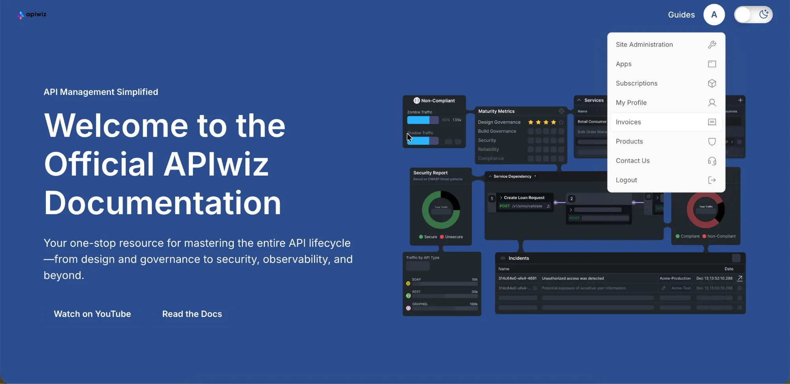
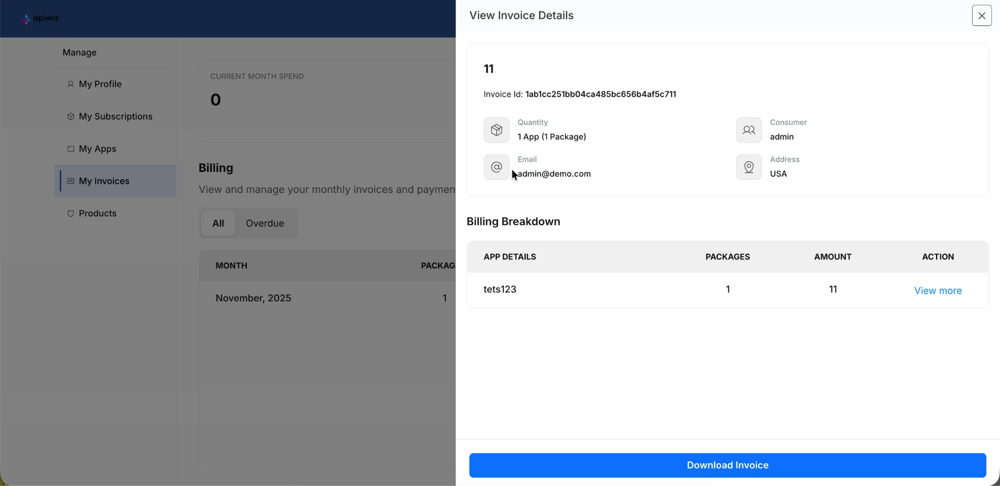
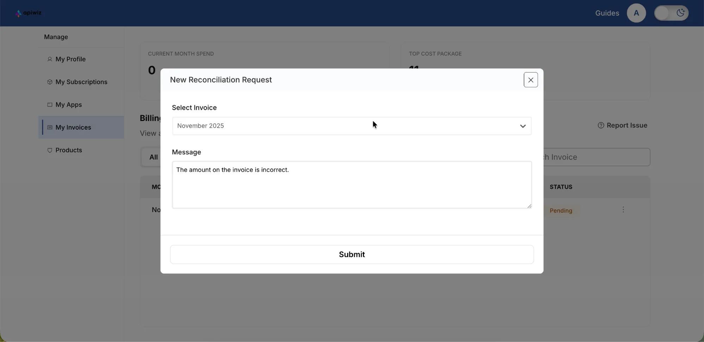

Invoices display your monthly API usage charges. For a detailed explanation, see the API Monetization Module documentation.

## View an invoice

1. Select the dropdown in the top-right corner of the landing page.
1. Select **Invoices**.
  
1. Review the invoice list organized by **Month**, **Packages**, **Apps**, **Amount**, and **Status**.
1. Select the three dots at the end of an invoice row to view its full details.
  
1. Select **Download Invoice** to save the invoice as a PDF.

## Report an invoice issue

1. Select the dropdown in the top-right corner of the landing page.
1. Select **Invoices**.
1. Select **Report Issue**.
1. Select the invoice from the dropdown and enter your message.
  
1. Select **Submit**.

A success message confirms your request was submitted.