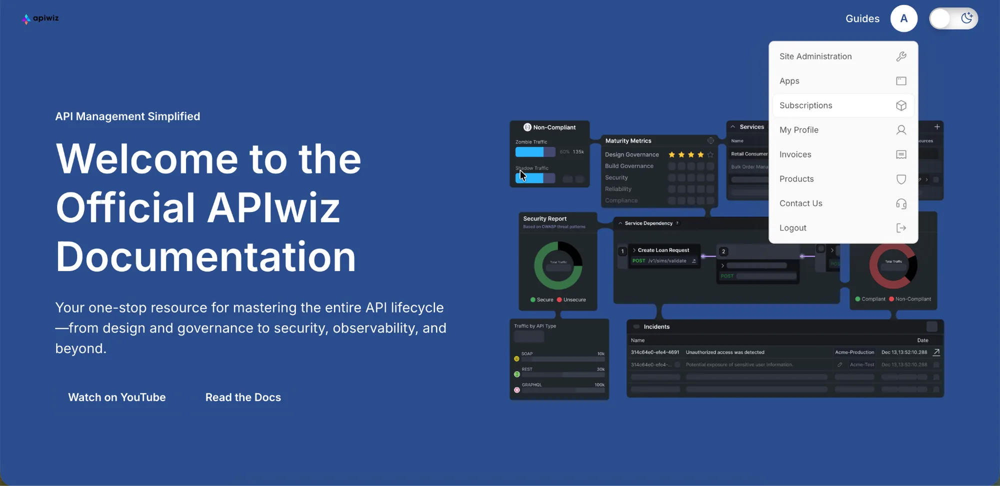
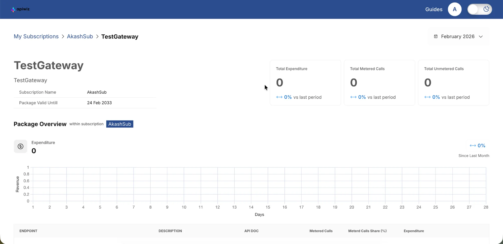

Subscriptions group the packages you have subscribed to. Use this tab to view all your active subscriptions and the packages under each one.

## View subscriptions and packages

1. Select **Subscriptions** from the landing page.
  
1. Review the list of available subscriptions.
1. Select a subscription to view all packages under it.
1. Select a package card to view its full details, including the number of associated APIs.

Use the date filter dropdown in the top-right corner to filter the data by date.

## Delete a subscription

You can delete a subscription you no longer need. This option is available only if your role has the **Delete** permission for the **subscription** feature. For more information, see Access Control List.

1. Select **Subscriptions**, then select the subscription.
1. In the upper-right corner, select the three-dot menu \> **Delete Subscription**.