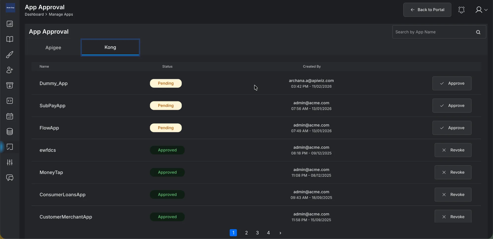
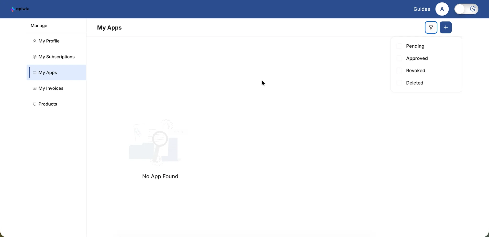

Apps connect consumers to API products through subscriptions. Use this tab to create and manage your applications.

## Creating an app

To create a new app:

1. On the **Apps** page, select the **\+** icon. The **Create Apps** panel opens, showing three steps: **App Details & Mode**, **Add subscription/products**, and **Review Details**.
1. Under **General Details**, enter the following:

1. Under **App Registration**, select how you want to register the app:

1. Select **Next**.
  
1. Depending on the option selected in step 3:
  - **If Choose Subscription:** Use **Search Subscription** to find and select a subscription. The **Packages** panel on the right displays the API resources included in the selected subscription.

  

  - **If Choose Product\(s\):** Use **Search Products** to find and select one or more products using the checkboxes. The **API Resources** panel on the right displays the endpoints mapped to the selected product\(s\).

  
1. Select **Next**.
1. On the **Review Details** step, verify the following before saving:
  - **General Details**: Name and Description \(select **Edit** to make changes\)
  - **Registration Details**: Subscription Details \(Subscription Name, Description, and ID\) or Package Details \(select **Edit** to make changes\)
1. Select **Save**. A success message confirms the app has been created. The app appears on the **Apps** page in a **Pending** state until it is approved.

## Viewing app details

All created apps are listed on the **Apps** dashboard. Select an app to view its details.

- **App summary**: Status \(for example, **Approved**\) and Created On date.
- **Usage metrics**: Packages, App Expenditure, App Metered Calls, and App Unmetered Calls, each shown with percentage change vs. the last period.
- **Overview tab**: Displays:
  - **App Credentials**: Consumer Key, Consumer Secret, and App Id \(select the eye icon to reveal, or the copy icon to copy\).
  - **Subscription Details**: Linked subscription name, description, and creation date.
  - **Package Details**: Linked package name, description, and Package ID \(select **View** to open\).
- **Analytics tab**: Displays usage analytics for the app.
- **Package Details:** Lists the packages used to create the app. For each package it shows the **Package ID**, its status \(for example, **Deleted** or **Expired**\), and a **View** link

## Deleting an app

To delete an app:

1. On the **Apps** page, select the app you want to delete.
1. Select the **three-dot menu** in the top-right corner of the app card.
1. Select **Delete**.
1. The app is deleted and no longer appears on the **Apps** dashboard.

## Approve an app

Approve or revoke products in an app

App Approval lists apps by gateway. For each app, you can approve or revoke access to individual products. Product-level approval is available only when the API Gateway is enabled.

1. On the Consumer Side, select the company icon \> **Site Administration** \> **App Approval**.
1. Select the gateway tab: **Apigee**, **Kong**, **Azure**, **NginX**, or **AWS**.
1. Select the app. The **Credentials** panel opens. It shows the consumer key, the consumer secret, and the app’s products with their status.
1. Next to a product, select **Approve** or **Revoke**.

The product status changes to **Approved** or **Revoked**.

## Approval types

When creating a product, you select one of the following approval types:

- **Automatic** : The product appears as **Active** immediately after creation.
- **Manual** : The product appears as **Pending** until an admin approves it under App Approval.

## Filter apps

Select the filter icon to filter apps by status: **Pending**, **Approved**, **Revoked**, or **Deleted**.

