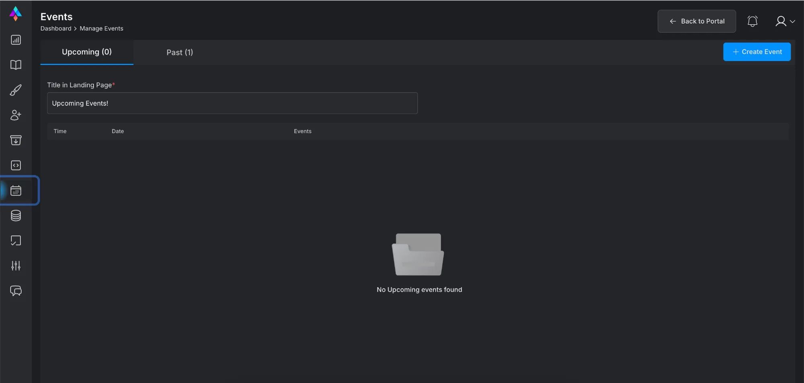
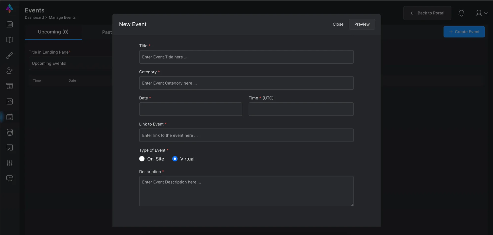

The Events section allows you to manage and showcase upcoming and past events; both online and offline; to your customers. Use it to provide detailed information about events hosted by your company, including the date, time, venue, and other relevant details.

The Events tab includes the following elements:

- **\+ Create Event** : Opens the New Event window to define the event's attributes.
- **Upcoming/Past tabs**: Filter events by upcoming or past.
- **Show in Landing Page** : Select this checkbox to display the event on the landing page. If not selected, the event is only accessible via the Events tab.
- **Title** : The event title as it appears on the landing page.
- **Fields \(Time, Date, Events\)** : Column headers for the event records table.
- **Event Records** : A list of all created events displaying the title, date, and time.

#### Create an event

1. Select the **Events** icon in the left navigation panel.
1. Select **\+ Create Event** to open the New Event window.
1. Select the type of event:
  - **On-Site** : A physical event at a specific location. Enter the event address.
  - **Virtual** : An online event. Enter a description.
1. Fill in all required details.
1. Select **Preview** to verify the event information.
1. Select **Save** to create the event.

Use the **Upcoming/Past** tabs to filter events. Select **Show in Landing Page** to display the event on the landing page.