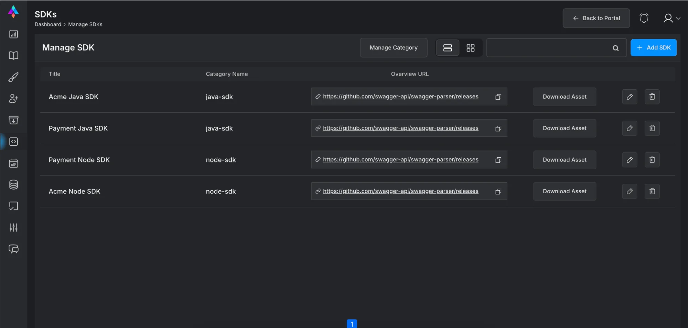
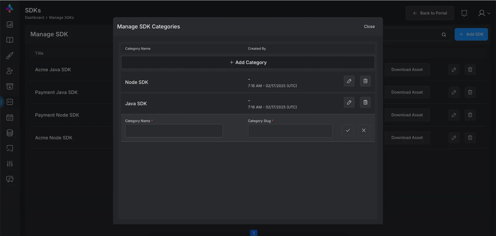
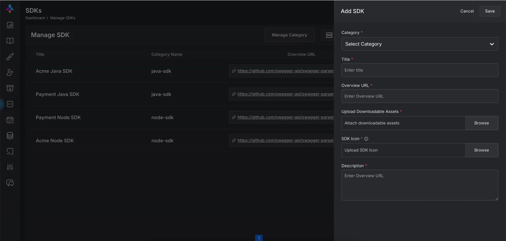

The SDKs section provides a centralized repository for Software Development Kits. It offers a curated collection of pre-built components, libraries, and resources that help developers accelerate their coding efforts and reduce time-to-market.

#### Manage categories

Select **Manage Category** to create, edit, or delete SDK categories.

**To add a category:**

1. Select **\+ Add Category**.
1. Enter the following details:
  - **Category Name** : The user-friendly name of the category \(for example, "Node SDK"\).
  - **Category Slug** : The URL-friendly name of the category, typically lowercase and with hyphens \(for example, "node-sdk"\).
1. Select **Save**.
  

To modify or remove an existing category, select **Edit** or **Delete** next to the category.

#### Add an SDK

1. Select **\+ Add SDK**.
1. Enter the following details:
  - **Title** : The name of the SDK.
  - **Category** : The category the SDK belongs to.
  - **Overview URL** : A link to the SDK's documentation or website.
  - **Upload Downloadable Assets** : Upload files in any format.
  - **SDK Icon** : Upload an image in .jpeg, .jpg, or .png format.
  - **Description** : A brief description of the SDK.
1. Select **Save**.

Use the search bar to find SDKs by keyword. Select **Edit** or **Delete** to modify or remove individual SDK records.

