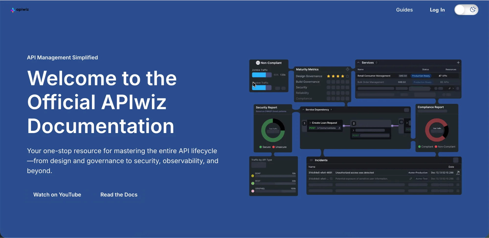

# Access the Dev Portal

If you are a new user, see **Sign up**. If you already have an account, see **Log in**.

## Sign up

Open the Dev Portal URL provided by your DevOps team. Each customer receives a unique URL.

1. Enter your **Full Name**, **Username**, **Email**, and **Country**, then select **Next**.
1. Enter a password, confirm it, and select **Register**.

Your request goes to the admin team for approval. Once approved, you receive a verification email. Select the link in the email to verify your address. Your permissions depend on the role the admin assigns.

## Log in

1. Open the Dev Portal URL.
1. Select **Log In** in the top-right corner.

1. Enter your username and password.

You can also log in using **SSO** or **APIwiz** credentials.

If you don't have an account yet, sign up first. Logging in takes you to the Consumer Side by default.

