Manage Portal allows you to modify the Dev Portal's front-end UI. Select the third icon in the left navigation panel to access it.

Manage Portal includes three sections: **Sections**, **Promotions**, and **Themes**.

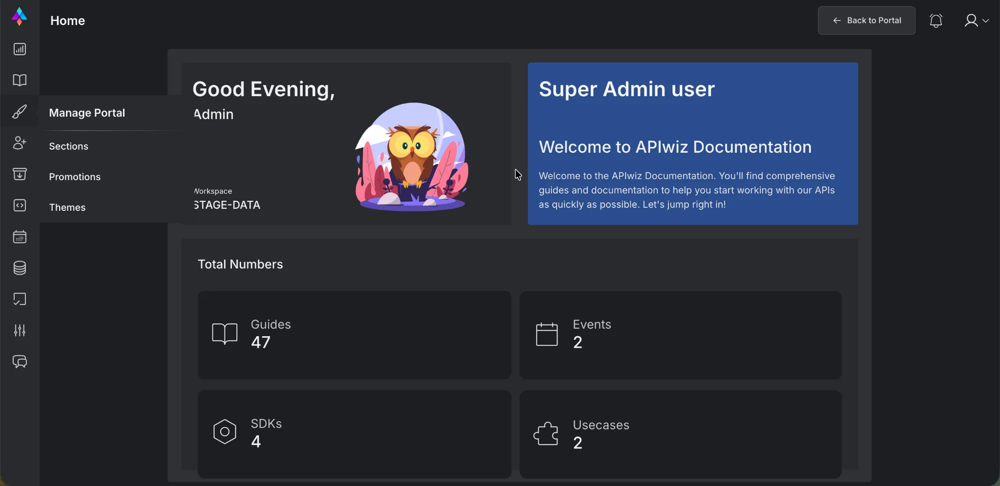

# Sections

The **Sections** tab allows you to organize and manage the UI sections displayed on the front end of the Dev Portal. Use it to rearrange the order of sections, add new sections, remove existing ones, and customize the content within each section.

The left panel displays a list of all front-end headers in the same order they appear to consumers on the landing page. You can rearrange, reorder, edit, and configure these headers directly from this panel.

Selecting the **\>** icon next to a header name expands a configuration panel on the right side.

For every header you create, you can edit its **alignment** and **background**. For example, you can position a header to the right with a background applied, or center it without a background.

#### Add a header

1. Select **\+ Add Items** to the right of **Header Content**.
1. Enter the following details:
  - **Header Name** : The title for the header. For example, "Guides."
  - **URL** : The URL of the header. For example, "/api-guides."
  - **URL Type** : Select **Internal** or **External**.
  - **Permission Role** : Select the role that can see the header from the dropdown. For example, selecting **Super Admin** hides the header from users with a Guest role.
  - **User Group** : Select the user group\(s\) to associate with the header. For example, "openbanking" or "test."
  - **Visible to non logged-in users** : Select this checkbox if non-logged-in users should see the header.
    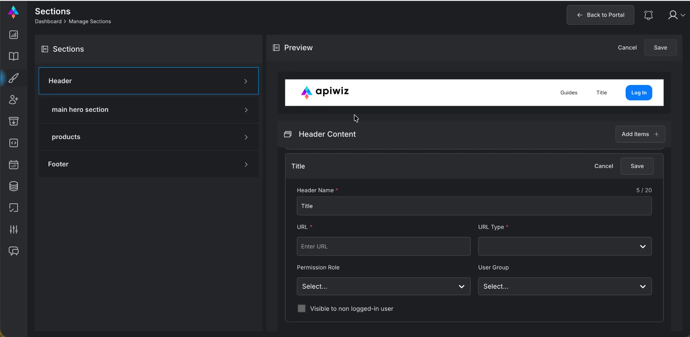
1. Select **Save**.

The new header appears in the list of headers.

#### Edit a header

1. Select the pencil icon next to the header name.
1. Update the required details.
1. Select **Save**.

#### Delete a header

Select the delete icon next to the header name. The header is deleted.

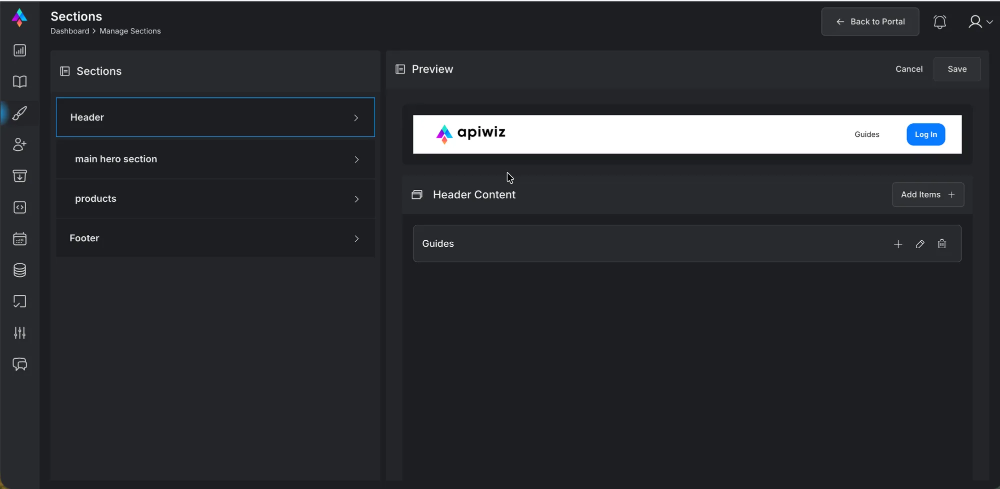

# Promotions

The **Promotions** section controls promotional content displayed to users on the landing page, typically within the Packages tab. Use it to highlight specific offerings, services, or packages to encourage adoption and engagement.

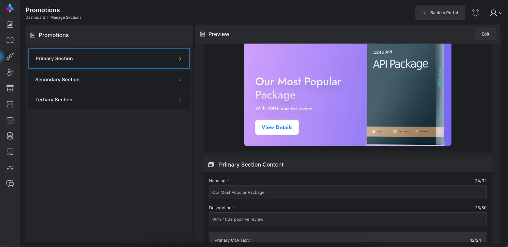

Promotions are organized into three tiers:

- **Primary** : The most prominent area, used to showcase the most popular or newest offering.
- **Secondary** : A secondary area for showcasing additional products or information.
- **Tertiary** : An area for other relevant products or offers not featured in the Primary or Secondary sections.

For example, a bank could feature its newest credit card in the Primary section, other featured cards in the Secondary section, and remaining offers in the Tertiary section.

Each tier can be edited individually. Select the **\>** icon to the right of a tier name to expand its configuration.

#### Primary section

Select **Edit** to open the configuration panel and enter the following details:

- **Image** : Upload or select an image for the promotional card. There is no size specification.
- **Heading** : The main heading text displayed in bold on the card.
- **Description** : A brief description or tagline displayed below the heading.
- **Primary CTA Text** : The text displayed on the call-to-action button.

Select **Save** to apply the changes.

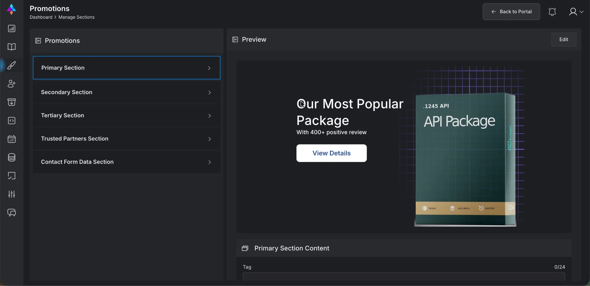

#### Secondary section

The Secondary section follows a similar structure to the Primary section. Enter the following details:

- **Heading**: The primary heading text.
- **Description**: The descriptive text.
- **Image**: Select **\+ Change Image** to upload a new image.

Select **Save** to apply the changes.

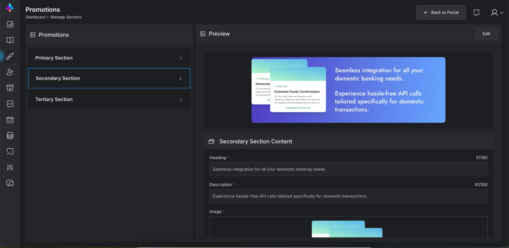

#### Tertiary section

Enter the following details:

- **Image**: The image for the card.
- **Tag**: A smaller text label displayed above the heading.
- **Heading**: The main heading text.
- **Description**: The descriptive text.

Select **Save** to apply the changes.

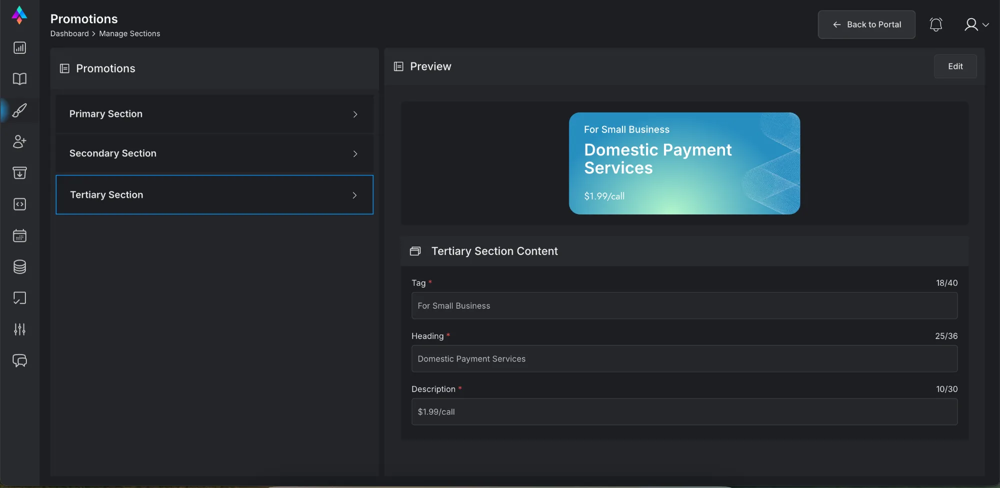

### Trusted Partners

The Trusted Partners section allows you to add company logos of your trusted partners to the **Contact Us** page.

#### Add a logo

1. Select **Edit** on the preview tab.
1. Select **\+ Add Logo**.
  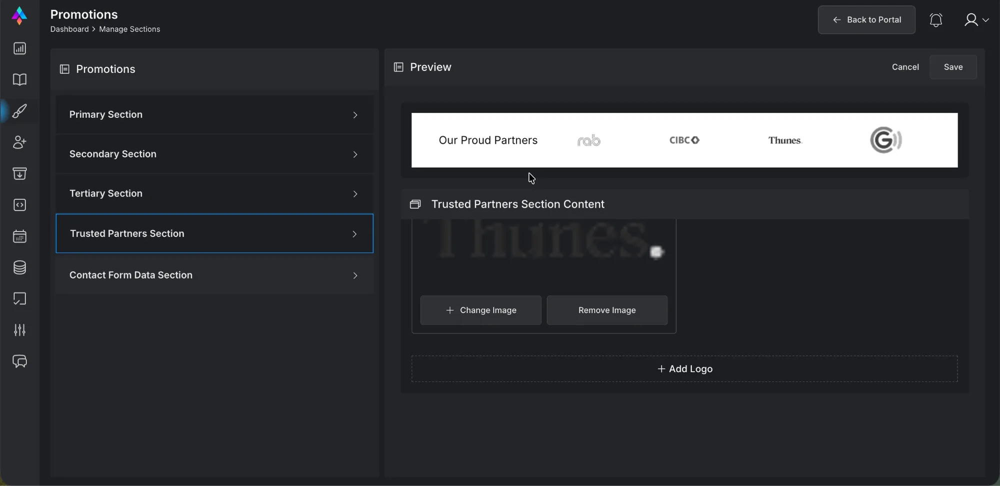
1. A placeholder image is generated. Select **\+ Change Image** to upload your partner's logo, or select **Remove Image** to remove an existing logo.
1. Select **Save**.

To hide the Trusted Partners section, remove all logos and select **Save**. The section no longer appears on the **Contact Us** page.

### Contact Form Data

The **Contact Form Data** section allows you to configure the contact form displayed on the landing page, enabling consumers to reach out to your team directly with queries or concerns.

#### Configure the contact form

1. Select **Edit**.
1. Enter the required details for your contact form. Scroll down to view and fill in all available fields.
1. Scroll up to preview the changes.
1. Select **Save**.

Select **Edit** again at any time to update the information.

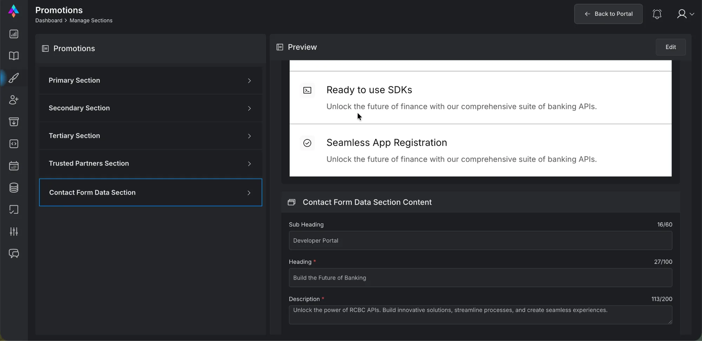

# Themes

The **Themes** section allows you to customize the visual identity of the Dev Portal, including logo selection and color scheme adjustments.

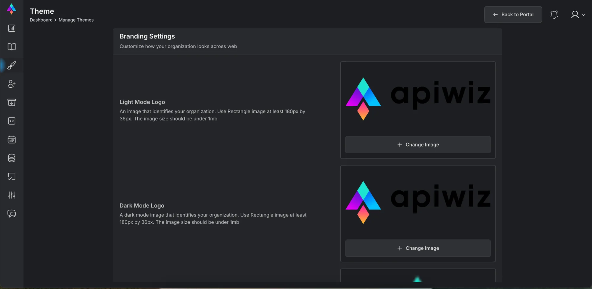

#### Branding settings

Branding settings allow you to customize the portal logo for both light and dark modes. Separate logo options for each mode ensure the logo remains clear and visually appealing regardless of the background color or ambient lighting conditions.

#### Color settings

Color settings allow you to personalize the visual appearance of the portal by selecting primary and secondary colors. The selected colors are applied throughout the portal's interface, helping you align the portal's appearance with your brand identity.

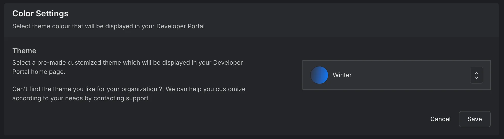