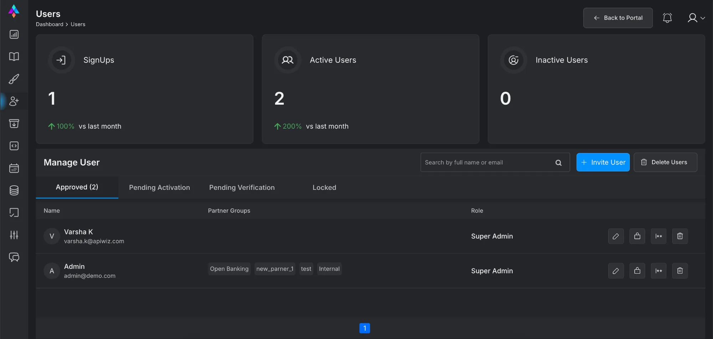
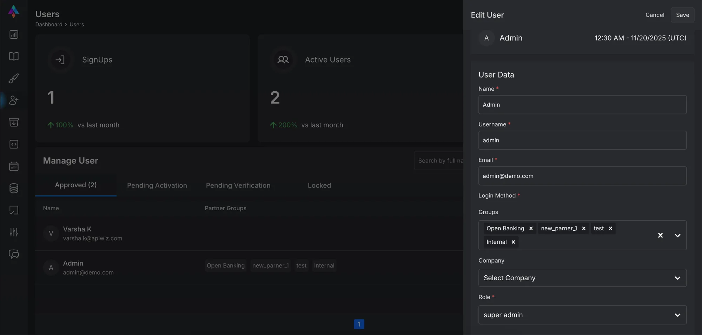
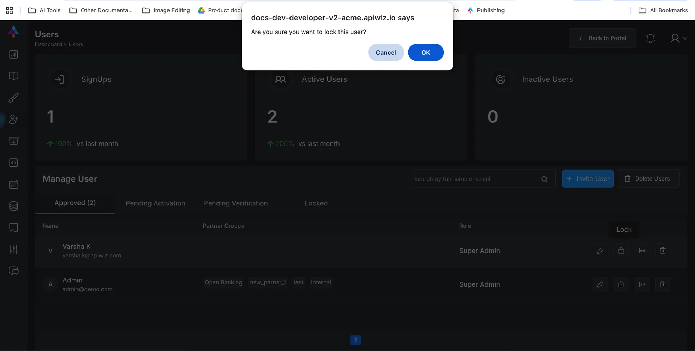
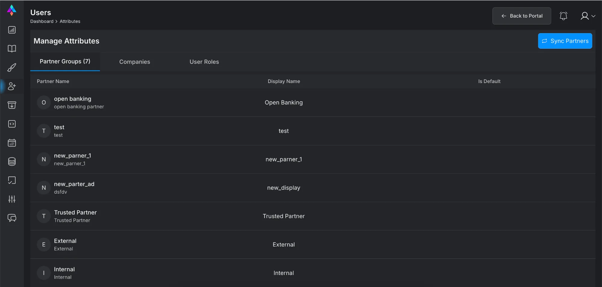
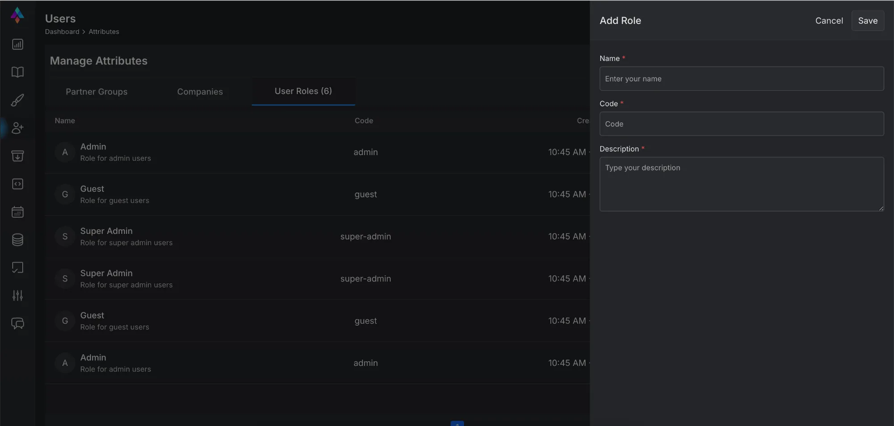

The Users module allows administrators to manage Dev Portal users, including creating accounts, removing accounts, modifying user credentials, and managing roles and permissions.

Select the **Users** icon to access three options: **Manage Users**, **Manage Attributes**, and **Access Control List**.

# Manage Users

Manage Users allows you to manage users within your organization by granting them access and specific permissions.

The Manage Users panel displays the following:

- **SignUps** : The number of users who have signed up in the portal for the current month.
- **Active Users** :The number of active users, along with the percentage increase or decrease from the previous month.
- **Inactive Users** :The number of inactive users. A user becomes inactive if they do not log in for 90 days.
- **Invite User** and **Delete Users** :Use these buttons to add new users to or remove existing users from the portal.

### Invite a user

1. Select **\+ Invite User**.
1. Enter the email address of the user you want to add.
1. Select **Save**.

The user receives an invite email and signs in by selecting the link in the email.

### Delete users

1. Select **Delete Users**.
1. A list of email addresses and their statuses appears.
1. Select the checkbox next to the user you want to remove.
1. Select **Submit**.

### Manage User tabs

The Manage User panel includes four tabs. Each tab displays **Name**, **Partner Groups**, and **Role** fields.

- **Approved** :Lists all approved users. User roles can be created as per your requirement.
- **Pending Activation** :Lists users awaiting activation.
- **Pending Verification** :Lists users awaiting verification. Select **Edit** to update permissions for a user, then select **Save**. A success message confirms the update.
- **Locked** :Lists users whose accounts are locked.

### User action icons

Each approved user has four action icons on the right side:

**1. Edit**

Select **Edit** to update the following user details:

- **Name** :Name of the user.
- **Username** :Username for the user.
- **Email** :Email address of the user.
- **Groups** :Select a group from the dropdown.
- **Company** :Select a company from the dropdown.
- **Role** :Select a role from the dropdown.
  

Select **Save** to apply the changes.

**2. Lock User**

Locking a user freezes their account and moves their profile to the **Locked** tab.

1. Select **Lock User**.
1. A prompt appears. Select **OK** to confirm.

To unlock a user, select the **Unlock User** button.

**3. Reset Password**

Select **Reset Password** to send the user an email with a link to change their password.

**4. Delete User**

Permanently removes the user from the Dev Portal.

1. Select the delete icon.
1. A prompt appears. Select **OK** to confirm.
  

The user is deleted.

# Manage Attributes

Attributes are user-defined key-value pairs that add context and metadata to APIs and developer resources. They allow you to categorize, filter, and search for relevant information based on organizational criteria such as department, project, or usage level.

Manage Attributes includes three tabs: **Partner Groups**, **Companies**, and **User Roles**.

### Partner Groups

Partner Groups is selected by default when you open Manage Attributes. Use this tab to manage and modify partner group attributes, and synchronize new partners from the workspace into the portal.

### Companies

The Companies tab displays company records with **Company Name** and **Display Name** fields.

**To sync companies:**

Select **Sync Companies** to pull corresponding company records from the workspace. The synced companies appear in the list.

### User Roles

The User Roles tab displays existing roles in your organization. By default, three roles are available: **Guest**, **Admin**, and **Super Admin**.

**To add a role:**

1. Select **\+ Add Roles**.
1. Enter the following details:
  **Name**: Enter the name of the role.

  **Code**: Enter a code for the role. For example, "admins."

  **Description**: Enter a brief one-line description of the role.
1. Select **Save**.

The new role is added to the list of existing roles.

# Access Control List

The Access Control List \(ACL\) is a rule-based authorization system that determines which users or system processes can access specific resources. Use it to assign permissions to each role, ensuring users only have access to the tools and data necessary for their responsibilities.

The ACL interface allows you to assign specific features and attributes to predefined roles such as **Super Admin**, **Admin**, and **Guest**, giving you granular control over what each role can access and modify.

Select the edit icon next to the search bar to modify permissions for any role.

#### Show or hide guides and references for a role

Guides and references are the entry points from the Dev Portal to Docuwiz. In the Access Control List, the **guides** and **references** features control whether their icons appear for a role. Hiding an icon removes only the entry point. Users who have the direct URL can still open the content.

1. Select **Users** \> **Access Control List**.
1. In the **Role** panel, select the role \(for example, **Admin**, **Guest**, or **Super Admin**\).
1. Next to the search bar, select **Edit**.
1. In the search bar, enter **guides** or **references**.
1. In the **Read** column, select the checkbox to show the icon, or clear it to hide the icon.
1. Select **Save**.

The icon is shown or hidden for all users with that role.

For each feature, you can grant the following permissions: **Sync**, **List**, **Create**, **Read**, **Delete**, and **Update**. For example, to let a role delete subscriptions, grant the **Delete** permission for the **subscription** feature.

