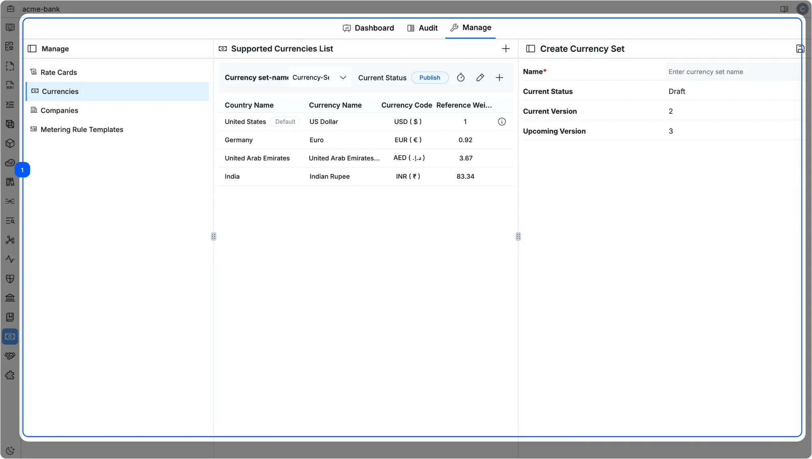
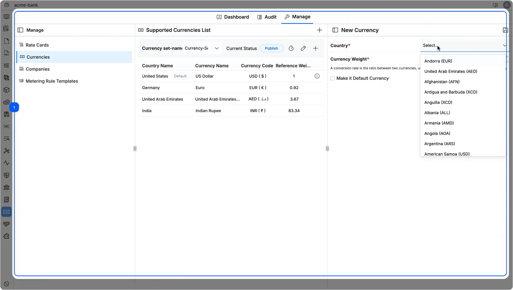
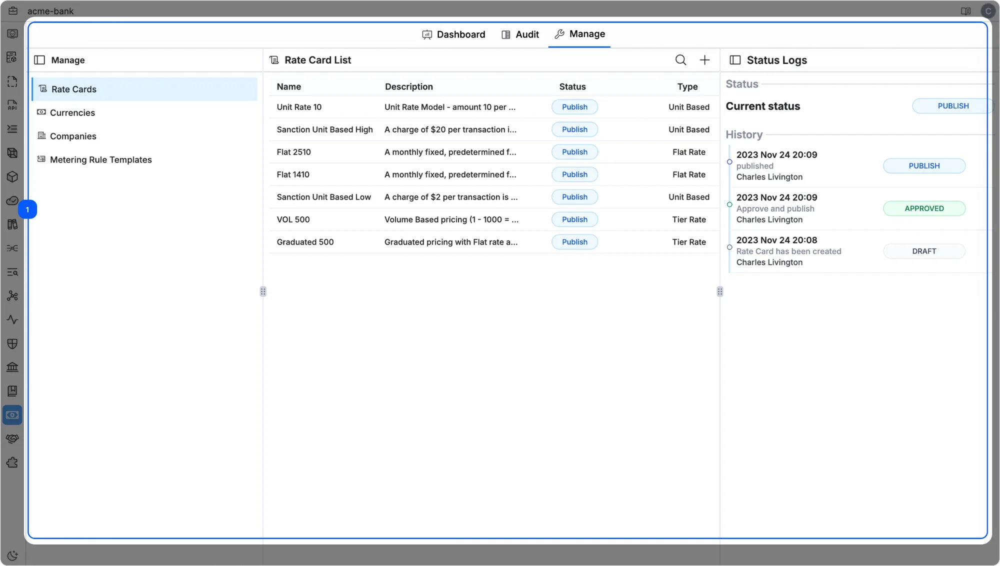

In APIwiz, you manage currencies through currency sets, which let global API providers operating in different regions, such as the US, India, or the Middle East, define the specific currencies they transact in and use to publish their packages. This supports international consumers who prefer to pay in their local currency rather than a standard default like USD, or who require localized pricing.

### Key concepts

### Creating a currency set

The **Manage** tab is the starting point for configuring API Monetization in APIwiz. It contains four sub-tabs: **Rate Cards**, **Currencies**, **Companies**, and **Metering Rule Templates**.

To create a currency set:

1. Select **Manage \> Currencies**.
1. In the top-right corner of the **Currencies** page, select **\+**.
  
1. Enter the following details:

1. Select **Save**.

The newly created currency set appears in the **Supported Currencies List**.

### Adding a currency

1. Select the **\+** icon on the **Currencies** page. 
  
1. Enter the following details:

1. Select **Save**.

The newly added currency appears in the **Supported Currencies List**.

After you create a currency set and add currencies, the header displays the **Currency Set Name** and its **Current Status**.

The **Supported Currencies List** displays all currency sets configured in the system. Each row represents a currency and its associated attributes used for billing and conversion.

### Viewing the status log

1. Select the **Status Log** icon \(clock icon\) for the currency set you want to review.
  

The **Status Logs** panel opens, displaying the following details:

### Editing a currency set

1. Select **Edit** for the currency set.
1. Update the name, status, version, or commit description.
1. Select **Save**.

The changes appear in the **Supported Currencies List**. For status options, see [Status values](#bookmark-cf24df43-d9f7-4163-8167-e755cd22d998).

#### Status values

The **Current Status** field supports the following values: