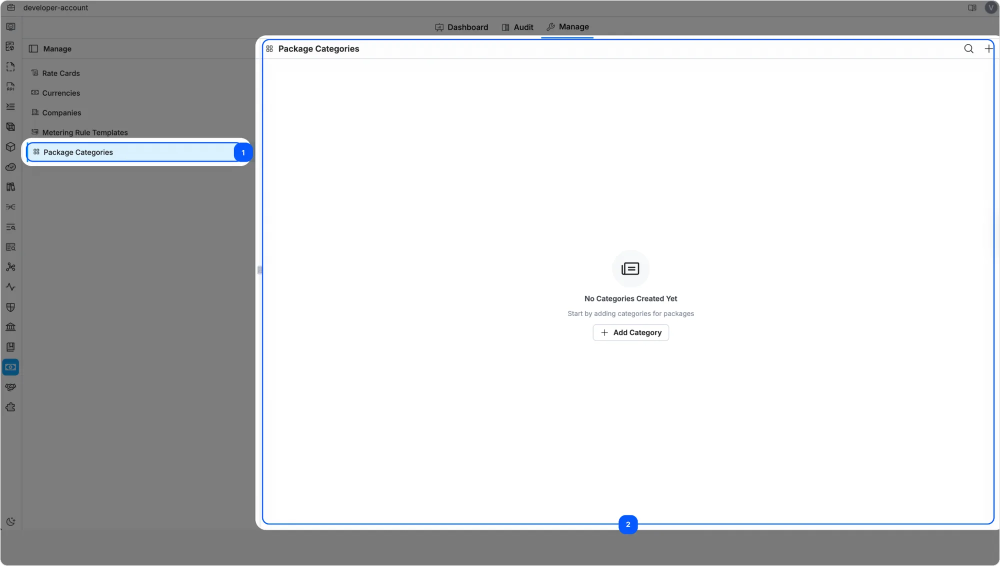

Package categories organize packages into logical groups. Categories make it easier to manage and identify related packages.

The **Package Categories** page is the fifth tab under **Manage**. You can use a package category during package creation.

## Creating a package category

To create a package category, follow these steps.

1. Go to **Manage** \> **Package Categories**.
1. Select **\+ Add Category** in the center panel, or select the **\+** icon in the top-right corner of the page.
  
1. Enter the category details.
1. Select **Save**.

The new category appears in the **Package Categories** list.

When you create a package, you can select one or more categories for it. The application links the selected categories to the package, and each associated package appears in the **Packages** column for that category. This lets you identify which packages belong to a category.

## Managing package categories

Locate a company and select the **More options** \(⋮\) menu, then select **Edit** to update the category details, or select **Delete** to remove the category.