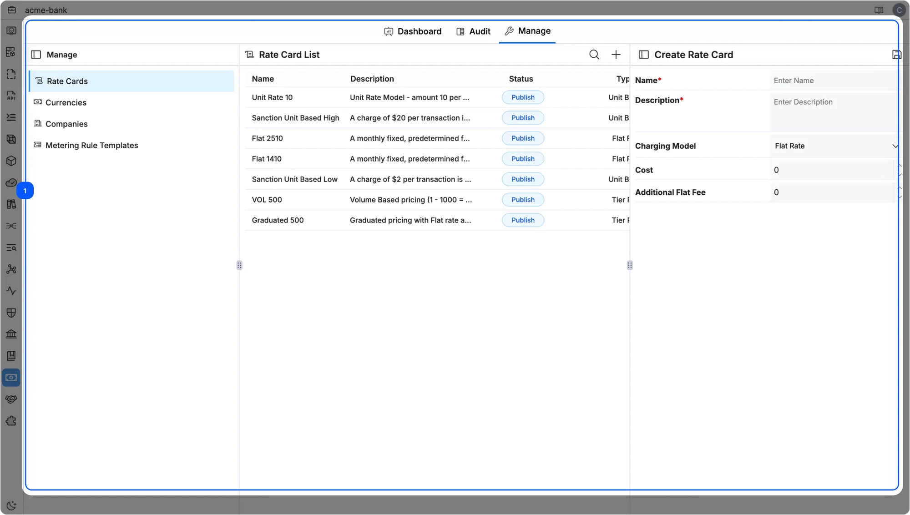
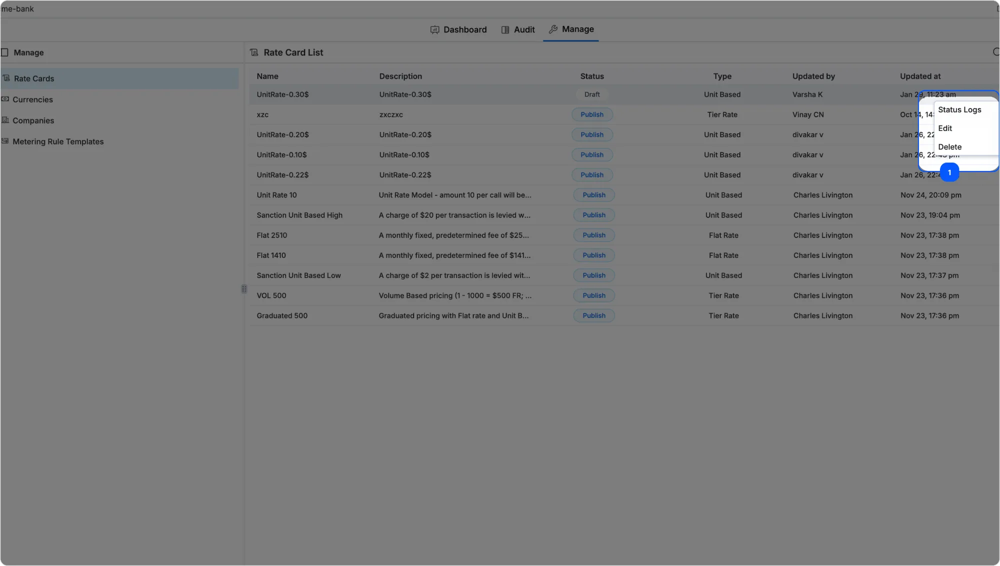
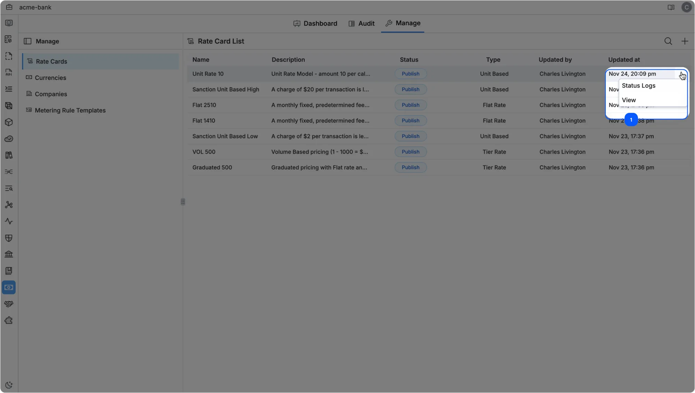

Rate cards are foundational monetization configurations that define how much and in what manner a consumer is charged for API calls. When a transaction executes, the rate card determines the pricing structure applied to calculate the bill: a flat fee, a simple price per call, or a threshold-based tiered rate.

### Monetization strategies

The platform supports three rate card strategies.

### Rate card types and billing examples

#### Flat Rate

Applies a fixed charge for a package, regardless of usage volume. The cost remains the same whether the API is called once or many times during the billing period.

#### Unit-Based Rate

Charges a fixed amount per unit of usage, such as per API call or transaction. The total cost increases proportionally with usage.

#### Tiered Rate

Applies pricing based on defined usage ranges, using one of the following models.

**Graduated pricing:** usage is split across tiers, and each tier is charged at its own rate. Charges accumulate incrementally as usage moves through each tier.

For 6,000 API calls: the first 1,000 calls cost 1,000 USD, the next 4,000 calls cost 3,200 USD, and the remaining 1,000 calls cost 500 USD, for a **total of 4,700 USD**.

**Volume-based pricing:** the entire usage volume is charged at the rate of the single tier it falls into.

For 6,000 API calls: all 6,000 calls are billed at 0.5 USD per call, for a **total of 3,000 USD**.

After you create a rate card, you bundle it inside a monetization package and map it to specific metering rules, such as successful `2xx` HTTP status calls. This ensures the rate card's pricing applies only to valid, qualifying business transactions, rather than failed or random gateway traffic.

### Creating a rate card

To create a rate card:

1. Select **Manage \> Rate Cards**.
1. In the top-right corner of the **Rate Cards** page, select **\+**. The **Create Rate Card** panel opens.

1. Enter the following details:

1. Select **Save**.

The newly created rate card appears in the **Rate Cards** list.

## Manage rate card

Rate cards can be in **Draft** or **Published** status. Depending on the status, you can view status logs, edit or delete the rate card, or view its read-only details.

### Draft rate card actions

For rate cards in **Draft** status, select the **More options** \(⋮\) menu at the end of the row to access the following actions.

### Published rate card actions

For rate cards in **Published** status, select the **More options** \(⋮\) menu at the end of the row to access the following actions.

