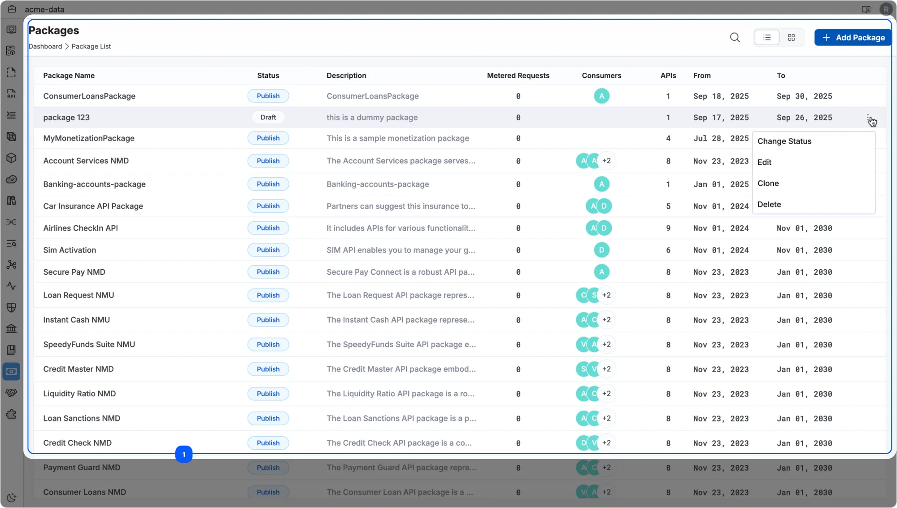
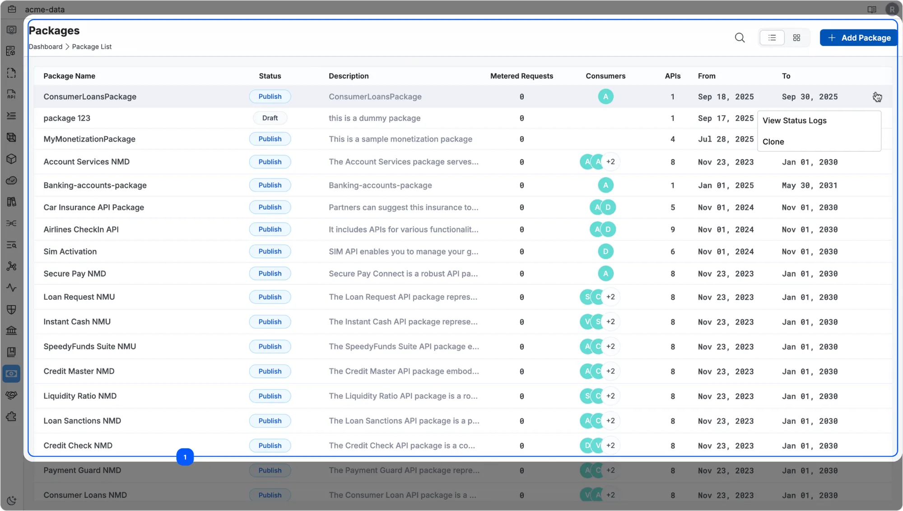

After you create a package, manage it from the **Package List**. The actions available in the **More Options** \(⋮\) menu depend on the package status. Draft packages support changing status, editing, cloning, and deleting. Published packages support viewing status logs and cloning.

# Draft package actions

For packages in Draft status, the **More Options** \(⋮\) menu provides the following actions:

# Published package actions

For packages in Published status, the **More Options** \(⋮\) menu provides the following actions:

## Change the package status

Change the status of a draft package to move it through its lifecycle, such as from Draft to Publish. The **Status Logs** panel records each change with a timestamp and the user who made it.

To change the package status:

1. In the **Package List**, hover over the package, and then select the **More Options** \(⋮\) menu.
1. Select **Change Status**.
  
1. Enter the following details:

1. Select **Save**.

The status of the package changes, and the **Status Logs** panel adds an entry for the change. 

## Edit a package

Edit a draft package to change its configuration before you publish it.

To edit a package:

1. In the **Package List**, hover over the package, and then select the **More Options** \(⋮\) menu.
1. Select **Edit**.
1. On the **Edit Package** page, update any of the following:
  - Package details
  - Selected resources
  - Metering rules
  - Rate plans
1. Select **Save**.

The package updates with your changes.

## Clone a package

Clone a draft or published package to reuse its configuration without recreating it manually. The copy inherits all configuration details from the original.

To clone a package:

1. In the **Package List**, hover over the package, and then select the **More Options** \(⋮\) menu.
1. Select **Clone**.
1. On the **Create Package** page, review the copied configuration, update the required details, and then select **Save**.

A new package is created from the configuration of the original package.

## Delete a package

Delete a draft package to remove it permanently.

To delete a package:

1. In the **Package List**, hover over the package, and then select the **More Options** \(⋮\) menu.
1. Select **Delete**.
1. In the confirmation dialogue box, select **OK**.

The package is removed from the **Package List**.

## View status logs

View the status logs to review the lifecycle of a package and audit earlier changes. The **Status Logs** panel lists all status changes in chronological order, so you can identify who changed the package and when.

To view the status logs:

1. In the **Package List**, hover over the package, and then select the **More Options** \(⋮\) menu.
1. Select **View Status Logs**.
  

The **Status Logs** panel opens on the right side of the page and lists each status change with the following details:

For draft packages, the **Status Logs** panel also appears when you select **Change Status**. The panel shows this change history below the **Status** and **Commit Message** fields.