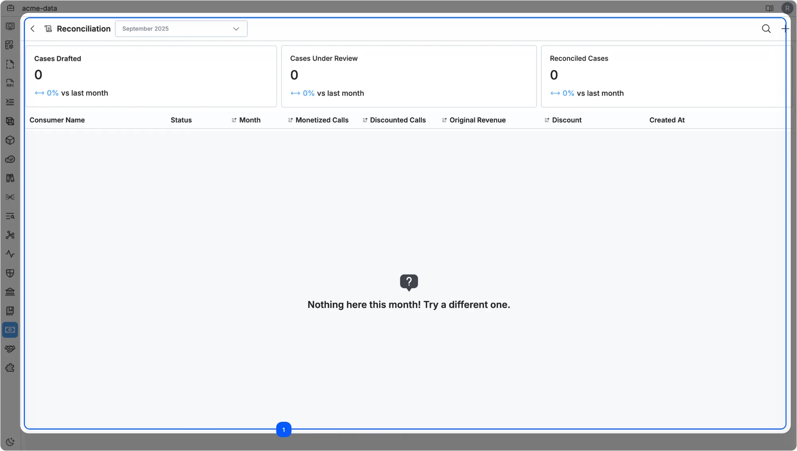

The **Reconciliation Cases** card displays the total number of reconciliation cases created during the selected reporting period. Use this card to monitor reconciliation activities and compare the number of cases with the previous reporting period.

To review reconciliation cases in detail, select the **View Details** \(\>\) icon. The **Reconciliation** page opens.

Use this page to create, review, and manage reconciliation cases for consumer invoices.

## Reconciliation page overview

The **Reconciliation** page provides a centralized view of all reconciliation cases created for API monetization.

Use this page to:

- Review reconciliation cases for a selected reporting period.
- Monitor the progress of reconciliation activities.
- Investigate billing discrepancies.
- Create reconciliation cases manually.

Search for reconciliation cases by consumer, and filter the results by the required reporting period. The page also provides summary metrics that help you monitor:

- Draft reconciliation cases.
- Cases under review.
- Successfully reconciled cases.

For each reconciliation case, you can review the following information.

If no reconciliation cases are available for the selected reporting period, the page displays a message indicating that no reconciliation records were found.

## Create a reconciliation case

To create a reconciliation case:

1. Select **\+** on the **Reconciliation** page.
1. Select the consumer for whom you want to create the reconciliation case.
1. Select the invoice for the required billing period.
1. Select **Save**. The **Reconciliation Wizard** opens.
  
1. On the **Transaction Logs** page, review the API transactions for the selected consumer.
1. Select the transactions to include in the reconciliation.
1. Select **Next**.
1. Review the reconciliation summary and, if required, update the deduction amount.
  
1. Select one of the following options:
  - **Submit for Approval**: Submits the reconciliation case for review. The system creates the reconciliation case with the **Review** status.
  - **Save Draft**: Saves the reconciliation case for later. The system creates the reconciliation case with the **Draft** status.

## Managing reconciliation cases

In the **Reconciliation** window, hover over a reconciliation entry and select the **More options \(⋮\)** menu to display contextual action icons on the right side of the row. The available actions depend on the current status of the reconciliation case, such as **Reconciled**, **Draft**, or **Review**.

### Draft or Review cases

For reconciliation cases in the **Draft** or **Review** status, you can perform the following actions.

### Reconciled cases

For reconciliation cases in the **Reconciled** status, you can perform the following actions.