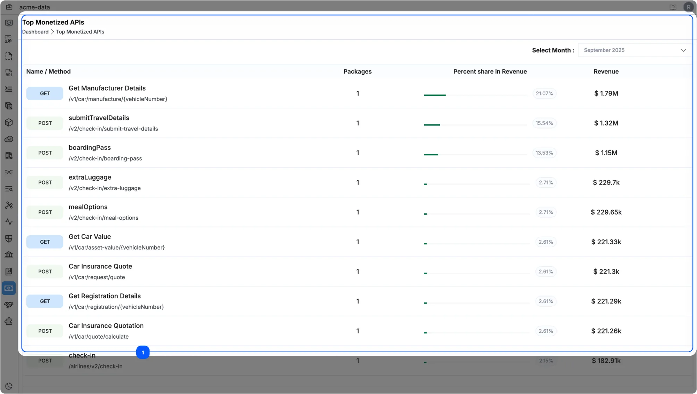
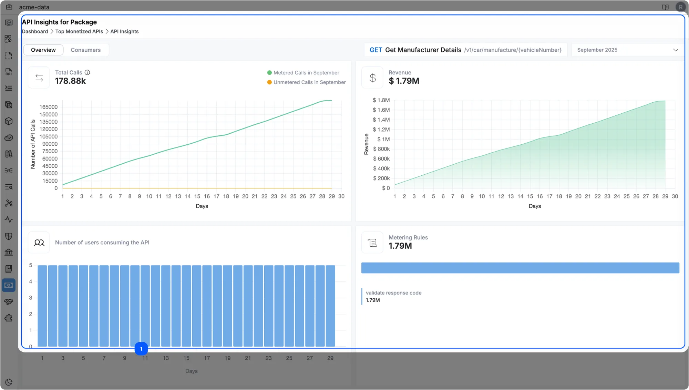
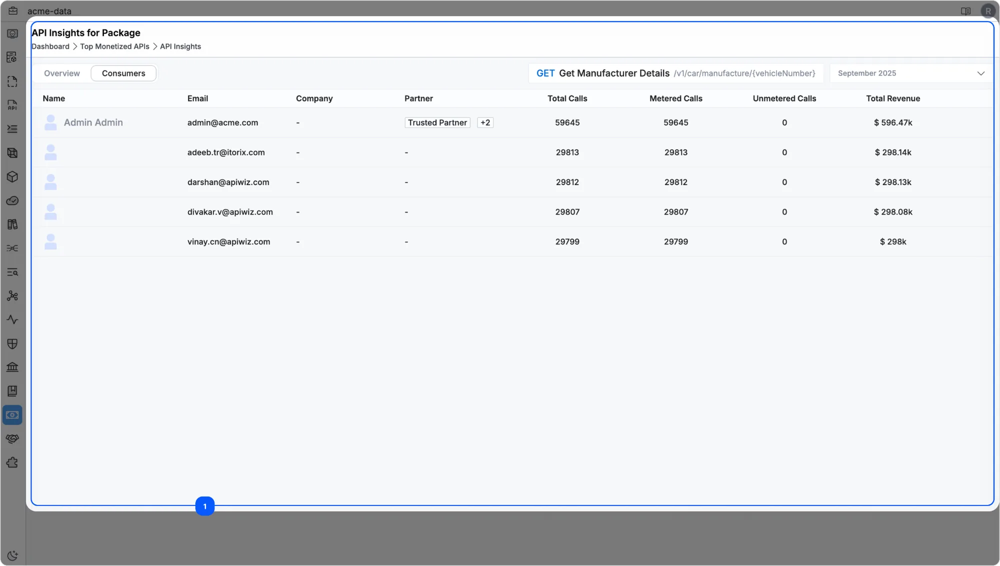
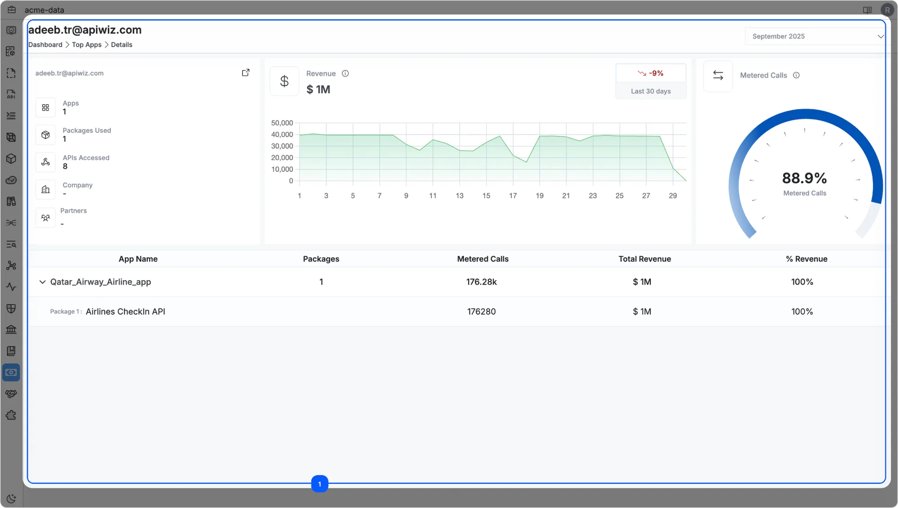
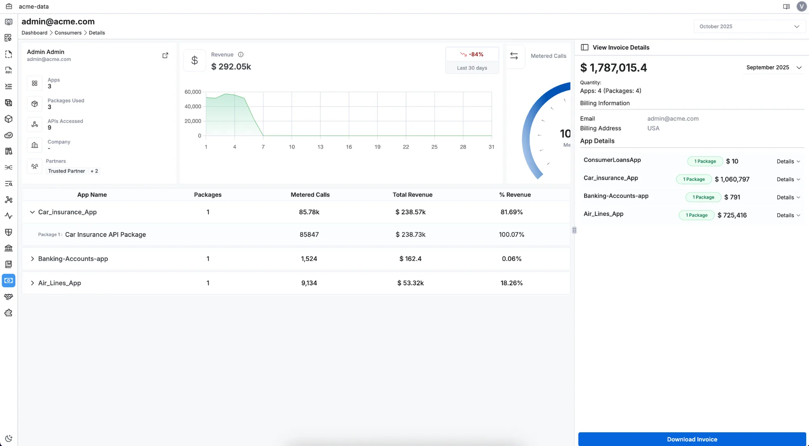

The **Monetized APIs** card provides an overview of the APIs that are actively generating revenue. Use this card to quickly assess the performance of your monetized APIs and identify changes in API adoption over time.

The card displays the following information:

- **Total Monetized APIs**: The total number of APIs that generated revenue during the selected reporting period.
- **Growth Indicator**: The percentage increase or decrease in monetized APIs compared to the previous 30-day period.

To analyze monetized APIs in more detail, select the **View Details** \(\>\) icon. The **Top Monetized APIs** page opens, where you can review revenue, package associations, and detailed usage metrics for each monetized API.

# Reviewing top monetized APIs

The **Top Monetized APIs** page lists all APIs that generated revenue during the selected reporting period.

Use the **Select Month** filter to view revenue and usage for a specific month.

For each API, you can review the following information.

To analyze the performance of a specific API, select the **Inspect** \(↗\) icon for the required API. The **API Insights** page opens.

## API Insights overview

The **API Insights** page provides detailed analytics for a selected API. Use this page to analyze the API's usage, monetization, and consumer activity.

The page provides the following views:

- **Overview**: Review API usage, revenue trends, consumer adoption, and metering rule performance.
- **Consumers**: Review the consumers using the API, their API consumption, and the revenue generated by each consumer.

### Reviewing API performance

Use the **Overview** tab to analyze the overall performance of an API. Select the reporting month to review historical usage and monetization metrics.

The Overview tab helps you monitor the following areas.

### Reviewing API performance

Use the **Overview** tab to analyze the overall performance of an API. Select the reporting month to review historical usage and monetization metrics.

The Overview tab helps you monitor the following areas.

### API usage

Review the total number of API calls made during the selected period. Usage metrics distinguish between the following call types:

- **Metered calls**: Billable calls.
- **Unmetered calls**: Non-billable calls.

These metrics help you understand how much API traffic contributes to revenue.

### Revenue

Review the revenue generated by the API during the selected reporting period. Use the revenue trend to identify growth or fluctuations over time.

### Consumer adoption

Review the number of consumers using the API to identify adoption trends throughout the selected period.

### Metering rule contribution

Review the metering rules applied to the API. For each rule, you can view its contribution to overall revenue, helping you understand which billing rules generate the highest value.

## Reviewing consumers

Use the **Consumers** tab to identify the consumers using the selected API.

For each consumer, you can review the following information.

To review detailed information for a specific consumer, select the **Inspect** \(↗\) icon.

The **Consumer Details** page opens.

## Analyze consumer details

Use the **Consumer Details** page to analyze a consumer's API usage, applications, subscribed packages, monetization metrics, and revenue contribution.

### Reviewing the consumer profile

The consumer profile summarizes the following information:

- Consumer information.
- Applications.
- Packages used.
- APIs accessed.
- Company.
- Partner associations.

### Reviewing consumer revenue

Use the revenue summary to monitor:

- Total revenue generated during the selected period.
- Revenue trends over time.
- Month-over-month revenue changes.

This information helps identify revenue growth or decline for an individual consumer.

### Reviewing metered API usage

Review the percentage of billable API calls made by the consumer. This metric indicates how much of the consumer's API usage contributes to monetization.

### Reviewing applications and packages

The Consumer Details page lists all applications used by the consumer.

For each application, you can review the following information.

## Reviewing invoice details

To review the billing details for a consumer, select the **Invoice History** \(↗\) icon on the **Consumer Details** page.

The **View Invoice Details** page opens, where you can review the invoice summary, application-level billing details, and revenue generated during the selected billing period.

### Invoice summary

The invoice summary displays:

- Total invoice amount.
- Billing period.
- Billing information.
- Number of applications and packages included in the invoice.

### Application details

Review the applications included in the invoice. For each application, you can view:

- Application name.
- Associated packages.
- Revenue generated.

### Detailed package usage

Open **Details** to review package-level usage, metered calls, and billing information.

### Downloading the invoice

To download the invoice for offline review or record-keeping, select **Download Invoice**.