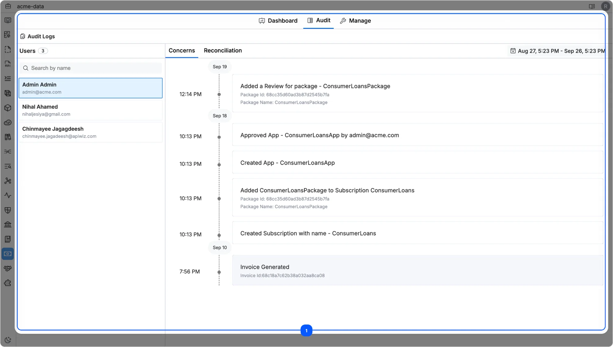

The **Audit** tab helps you investigate billing issues and monitor activities related to API monetization. It provides a complete history of monetization events, helping you validate invoices, investigate disputes, and maintain compliance.

Use the Audit module to:

- Review billing disputes raised by API consumers.
- Monitor reconciliation activities for invoices and payments.
- Investigate discrepancies between API usage and generated invoices.
- Track monetization-related activities throughout the billing lifecycle.
- Access historical records for auditing and compliance purposes.

### How the Audit module supports reconciliation

The Audit module works together with the **Reconciliation** feature to resolve billing discrepancies. When a consumer reports an issue with an invoice, the system records the request, allowing administrators to investigate the reported usage, verify billing information, and complete the reconciliation process.

During an investigation, you can review audit records to identify events that may have affected billing, such as:

- Package creation or updates.
- Subscription creation or modifications.
- Metering or pricing configuration changes.
- Other monetization-related activities.

By reviewing these records alongside invoice and usage information, you can determine the cause of a billing discrepancy and take the appropriate action.

## Accessing Audit tab

To access the reconciliation and dispute management workflow, select **API Monetization \> Audit**.

The **Audit** tab opens, displaying the reconciliation and dispute management interface.