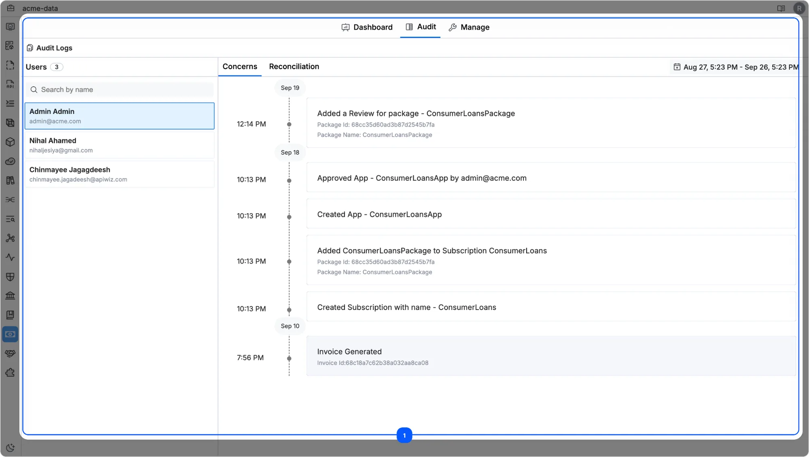
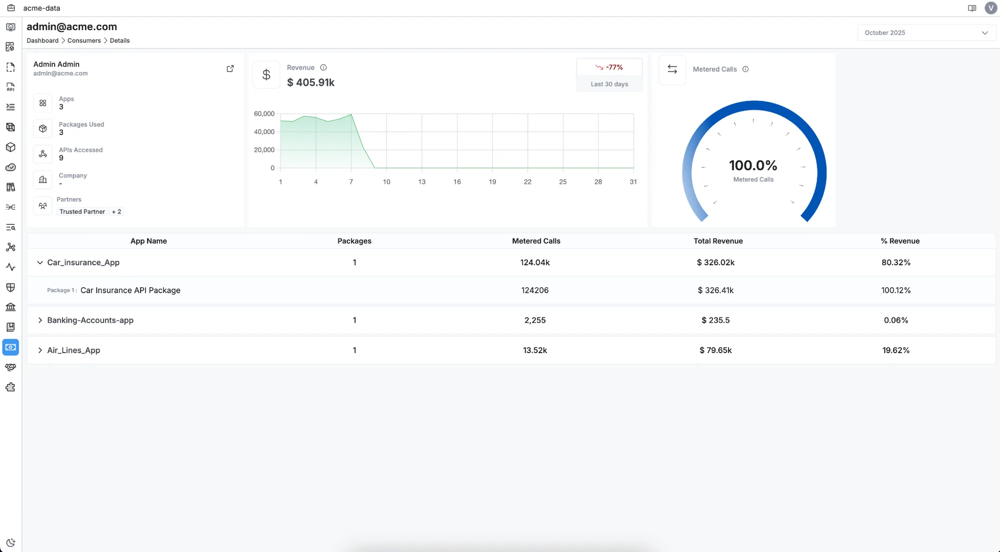
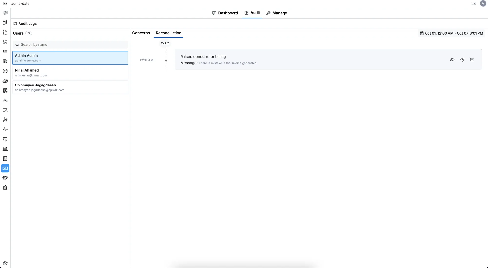

The **Audit** tab helps you monitor activities related to API monetization. It provides a complete history of actions performed throughout the monetization lifecycle, helping you investigate issues, validate financial transactions, and maintain compliance.

Use the Audit tab to:

- Track activities performed by users throughout the monetization process.
- Review billing-related concerns reported from the developer portal.
- Validate invoice and payment reconciliation.
- Investigate disputes using a complete activity history.
- Maintain audit records for compliance and financial reporting.
- Analyze historical events to improve operational processes.

The Audit module categorizes activities into **Concerns** and **Reconciliation**.

**Prerequisites:**

- Monetization packages and rate plans are created.
- Consumers have subscribed to packages and generated usage.
- Billing or reconciliation activities are available for review.

**Reviewing audit activities**

Use the Audit tab to review activities for a specific consumer or user.

To review audit activities:

1. Search for and select the required user.
1. Review the activity history associated with the user.
1. If necessary, filter the results by date or time range.
1. Select the required activity to review additional details.

# Reviewing billing concerns

Use **Concerns** to investigate issues reported from the developer portal related to packages or rate plans, such as billing questions, package configuration issues, or invoice discrepancies.

Each concern includes the following information:

- The date and time the issue was reported.
- A description of the reported issue or activity.
- Supporting information, such as the associated Package ID, Package Name, or Invoice ID.

To investigate a concern further, open the associated package. The **Consumer Details** page opens, where you can review the consumer's API usage, monetization metrics, revenue contribution, and related package information.

# Reviewing reconciliation activities

Use **Reconciliation** to review and validate invoice-related activities reported from the developer portal. Reconciliation helps you:

- Compare invoices with payments.
- Identify billing discrepancies.
- Track reconciliation progress.
- Complete settlement activities.

Each reconciliation record includes the following information:

- The date and time the activity occurred.
- The reconciliation status or action performed.
- Additional messages or comments, when available.
- Supporting invoice information.

For each reconciliation record, you can perform one of the following actions.

## Filtering audit records

Filter audit records to review activities for a specific period. Choose a custom date range or one of the following predefined time ranges.

Filtering audit records helps you locate recent activities or generate reports for a specific reporting period.