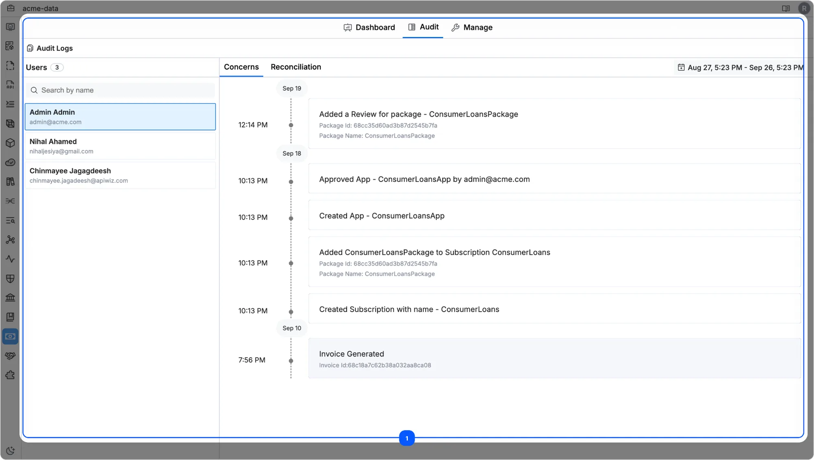
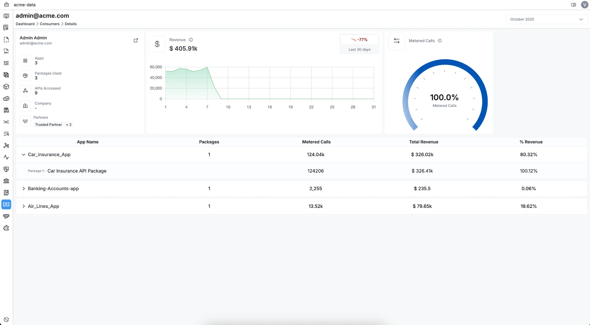
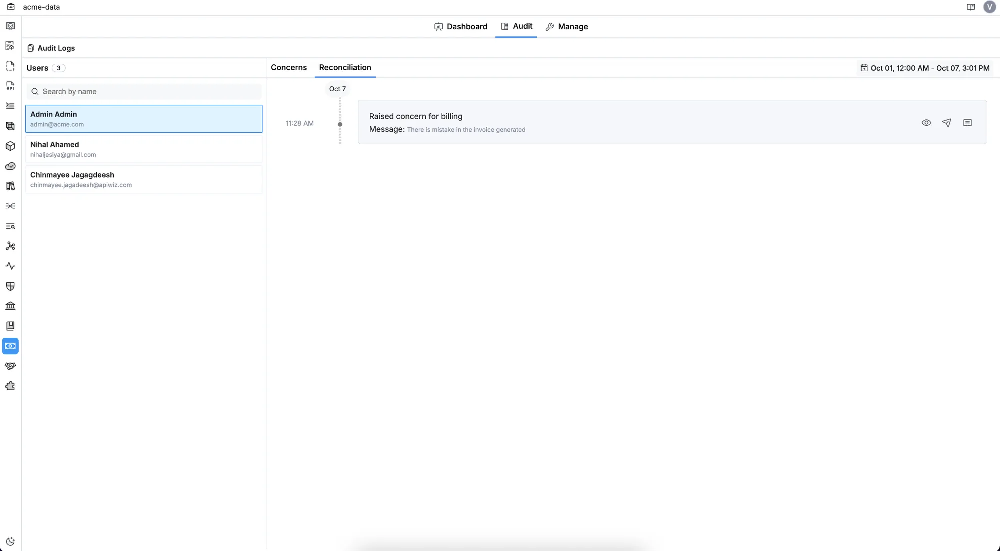

# Reviewing billing concerns

Use **Concerns** to investigate issues reported from the developer portal related to packages or rate plans, such as billing questions, package configuration issues, or invoice discrepancies.

Each concern includes the following information:

- The date and time the issue was reported.
- A description of the reported issue or activity.
- Supporting information, such as the associated Package ID, Package Name, or Invoice ID.

To investigate a concern further, open the associated package. The **Consumer Details** page opens, where you can review the consumer's API usage, monetization metrics, revenue contribution, and related package information. For more information, see [Analyze consumer details](/monetize/api-monetization/provider-side-analytics/viewing-monetized-apis/).

# Reviewing reconciliation activities

Use **Reconciliation** to review and validate invoice-related activities reported from the developer portal. Reconciliation helps you:

- Compare invoices with payments.
- Identify billing discrepancies.
- Track reconciliation progress.
- Complete settlement activities.

Each reconciliation record includes the following information:

- The date and time the activity occurred.
- The reconciliation status or action performed.
- Additional messages or comments, when available.
- Supporting invoice information.

For each reconciliation record, you can perform one of the following actions.

## Filtering audit records

Filter audit records to review activities for a specific period. Choose a custom date range or one of the following predefined time ranges.

Filtering audit records helps you locate recent activities or generate reports for a specific reporting period.