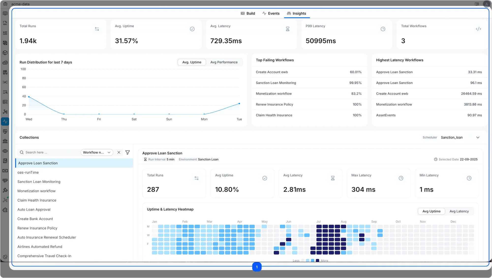

The **Insights** tab displays performance metrics and trends for all monitor workflows in one place. Review system-wide uptime, latency, and failure trends at a glance, or select an individual workflow in the Collections panel to drill into its own run history, uptime and latency heatmap, and per-run distribution.

To access this view, select **Insights** from the top navigation bar.

# Summary metrics

At the top of the tab, summary cards show system-wide metrics.

# Run Distribution for the last 7 days

A line chart shows execution trends over the last seven days, with days of the week on the X-axis.

Select one of the following toggles to change what the chart displays:

- **Avg. Uptime:** Plots the average uptime percentage per day.
- **Avg. Performance:** Plots the average latency per day.

# Top Failing Workflows

Lists the workflows with the highest failure rates, ranked from highest to lowest. Each entry shows the workflow name and its failure percentage \(for example, Sanction Loan Monitoring, 99.95%\).

# Highest Latency Workflows

Lists the workflows with the highest response times, ranked from highest to lowest. Each entry shows the workflow name and its latency in milliseconds \(for example, Create Account ewb, 26464.59 ms\).

# Collections

The **Collections** section lists all workflows configured for monitoring and lets you drill into an individual workflow's performance.

Select a workflow from the list to open its detail panel on the right. Use the **Search** bar to locate a workflow by name, and select the filter icon to filter the list by team.

## Workflow detail panel

In the section header, next to **Collections**, a **Scheduler** dropdown lets you filter the Collections section by scheduler \(for example, Sanction\_loan\).

When you select a workflow, the panel header displays:

Below the header, metric cards show:

## Uptime & Latency Heatmap

A calendar-style heatmap shows daily activity across the year, organized by month \(Jan–Dec\) and day rows.

Select one of the following toggles to change what the heatmap displays:

- **Avg Uptime:** Shades each day by its average uptime.
- **Avg Latency:** Shades each day by its average latency.

Shading intensity follows a **Less to More** scale, using four levels of blue: the lightest shade indicates the lowest value, and the darkest shade indicates the highest value.

## Uptime Distribution

Below the heatmap, the **Uptime Distribution** chart shows individual run results for the selected date \(for example, *September 22nd, 2025*\).

- The X-axis shows the number of runs.
- The Y-axis shows uptime on a 0–100% scale.

Each point on the chart represents a single run's uptime value.