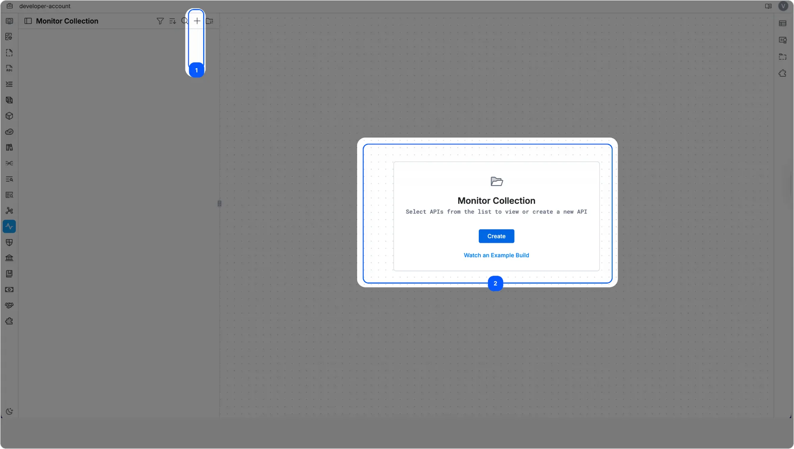
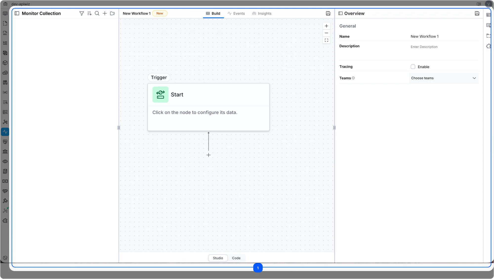

A **monitor workflow** defines a scheduled health check for one or more APIs. Unlike a scenario workflow in API Testing, which you run manually or on demand, a monitor workflow runs automatically at a fixed interval once you configure a scheduler and save it, without needing deployment or approval.

A monitor workflow consists of nodes that you connect to define the execution flow, starting with a **Start \(Trigger\)** node that also holds the scheduler configuration. Because API Monitoring isn't proxy-based, a workflow doesn't require a Response \(Stop\) node; the workflow executes its logic on schedule and logs the outcome as an event.

You create and manage monitor workflows on the canvas in the **Build** tab. In the Build tab, you can:

- Create monitor workflows.
- Modify workflow logic.
- Organize workflow nodes.
- Configure the scheduler that controls when the workflow runs.
- Arrange and connect nodes to define the workflow execution flow.

# Create a monitor workflow

This procedure creates a new monitor workflow.  Use the **Build** tab to design and edit monitoring workflows. It provides a visual interface to configure the sequence of nodes that define how monitoring checks are executed.

To create a monitor workflow:

1. In the center panel, select **Create**, or select **\+ \(Add\)** in the left navigation panel.
  
1. Enter the following details:
  
1. Select **Save.**

In the workflow canvas, a new workflow appears with a **Start \(Trigger\)** node. Use the **Build** tab to design and edit the workflow, using a visual interface to configure the sequence of nodes that define how monitoring checks are executed.