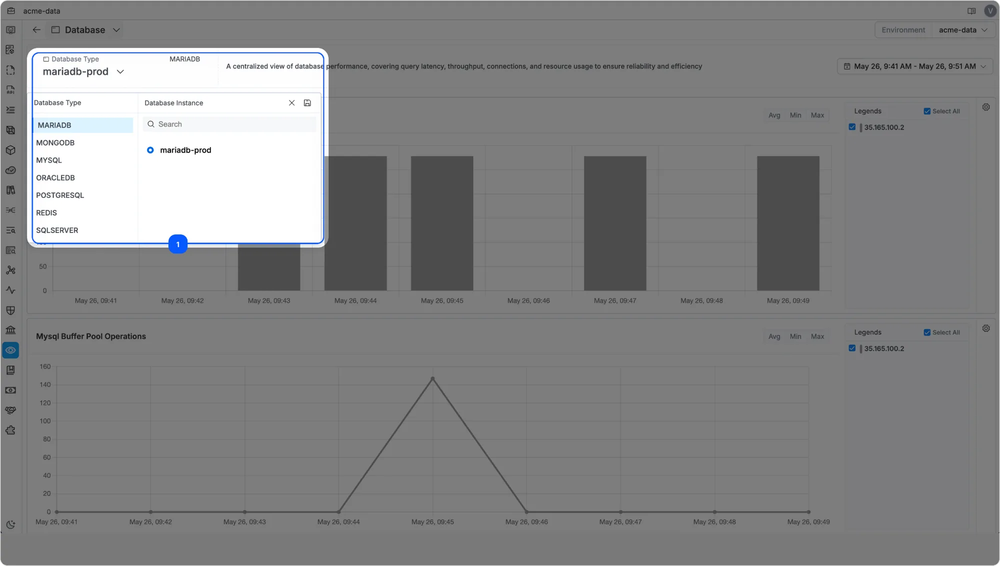

Database metrics provide visibility into the performance, health, and operational status of supported database platforms. Use the dashboard to monitor database activity, query performance, connection usage, and resource utilization.

The Observability module collects database metrics from supported database platforms and displays them in a centralized dashboard. These metrics help you understand how databases process workloads, manage resources, and respond to application requests across your environment.

Use database metrics to:

- Monitor database health, availability, and resource utilization.
- Track connection activity, memory, cache, and storage usage.
- Analyze query execution, transaction performance, and workload trends.
- Identify performance bottlenecks and slow-running database operations.
- Troubleshoot database-related issues before they affect applications and services.

### Prerequisites

Before you monitor database metrics, ensure that the target database is configured for OpenTelemetry-based metric collection.

### Supported database types

After you configure database metrics collection, the **Database Metrics** dashboard displays database activity, resource utilization, and performance data across your database infrastructure.

The Observability module supports the following database types:

- MariaDB
- MongoDB
- MySQL
- OracleDB
- PostgreSQL
- Redis
- SQL Server

The available metrics vary depending on the selected database type and runtime activity.

### Analyze database metrics

To analyze database metrics, follow these steps:

1. On the **Database Metrics** dashboard, select **Analyze**.

The detailed metrics view displays:

- Average metric values
- Database utilization statistics
- Memory and buffer usage details
- Transaction and operation metrics
- Runtime database performance metrics

>

### Filter by database type

To filter databases by type, follow these steps:

1. Go to **Observability** \> **Metrics** \> **Database Metrics**.
1. Select the **Database Type** filter.
  
1. Select the required database type.
1. Select the required database instance from the list.

The dashboard loads the runtime metrics and performance statistics for the selected database instance.

## MariaDB metrics

Use MariaDB metrics to monitor database performance, analyze workload activity, track resource utilization, and identify operational issues.

MariaDB metrics are available in the following categories:

- **Buffer pool metrics**: Monitor buffer pool pages, memory usage, page flushes, and buffer operations to evaluate caching effectiveness and storage access patterns.
- **Transaction and operation metrics**: Track database operations, row operations, page operations, and handler activity to analyze workload volume and transaction processing.
- **Lock metrics**: Monitor lock activity and row-level locks to identify contention issues and transaction delays.
- **Query processing metrics**: Track prepared statements and sort operations to evaluate query execution efficiency and statement reuse.
- **Logging and storage metrics**: Monitor log operations, double writes, and page flushes to assess write activity and data durability.
- **Resource utilization metrics**: Track opened resources, active threads, and temporary resources to understand database resource consumption.
- **Availability metrics**: Monitor database uptime to verify service availability and operational continuity.

Use MariaDB metrics to:

- Monitor database performance and availability.
- Track workload activity and transaction processing trends.
- Analyze memory utilization and caching effectiveness.
- Evaluate query execution and optimization efficiency.
- Identify lock contention and performance bottlenecks.
- Monitor storage activity and resource consumption.
- Support capacity planning and resource optimization.

Select **MariaDB** from the **Database Type** dropdown, then select the required MariaDB database instance.

The following table lists all available **MARIADB Metrics,** their graph types, and descriptions:

## MySQL metrics

Use MySQL metrics to monitor database performance, analyze workload activity, track resource utilization, and identify operational issues.

MySQL metrics are available in the following categories:

- **Buffer pool metrics**: Monitor buffer pool pages, memory usage, page flushes, and buffer operations to evaluate caching efficiency and storage access patterns.
- **Connection and thread metrics**: Track MySQLX connections and active threads to understand client connectivity and concurrent workload activity.
- **Transaction and operation metrics**: Monitor database operations, row operations, page operations, and handler activity to analyze workload volume and transaction processing.
- **Lock metrics**: Track lock activity and row-level locks to identify contention issues and transaction delays.
- **Query processing metrics**: Monitor prepared statements, sort operations, and handler activity to evaluate query execution efficiency.
- **Logging and storage metrics**: Track log operations, double writes, and page flushes to monitor data durability and write performance.
- **Resource utilization metrics**: Monitor opened resources and temporary resources to understand resource consumption.
- **Availability metrics**: Track MySQL uptime to verify database availability and service stability.

Use MySQL metrics to:

- Monitor database performance and availability.
- Track workload activity and transaction processing trends.
- Analyze memory utilization and caching efficiency.
- Evaluate query execution and optimization effectiveness.
- Identify lock contention and performance bottlenecks.
- Monitor storage activity and resource consumption.
- Support capacity planning and resource optimization.

Select **MySQL** from the **Database Type** dropdown, then select the required MySQL database instance.

The following table lists all available MYSQL metrics, their graph types, and descriptions:

## OracleDB metrics

Use OracleDB metrics to monitor database performance, analyze workload activity, track session usage, and identify operational issues.

OracleDB metrics are available in the following categories:

- **Execution metrics**: Monitor the number of SQL executions processed by the OracleDB instance to evaluate query activity and workload patterns.
- **Session metrics**: Track active session usage to understand connection activity, concurrent user access, and database resource utilization.

Use OracleDB metrics to:

- Monitor database performance and availability.
- Track query activity and workload trends.
- Analyze session usage and connection patterns.
- Evaluate database resource utilization.
- Identify performance bottlenecks and operational issues.
- Support capacity planning and performance optimization.

Select **OracleDB** from the **Database Type** dropdown, then select the required OracleDB database instance.

The following table lists all available **ORACLE Metrics**, their graph types, and descriptions:

## PostgreSQL metrics

Use PostgreSQL metrics to monitor database performance, analyze transaction activity, track storage utilization, and identify operational issues.

PostgreSQL metrics are available in the following categories:

- **Connection metrics**: Monitor active backend processes and maximum connection limits to understand database usage patterns and connection capacity.
- **Transaction metrics**: Track committed transactions, rollbacks, and overall database operations to evaluate workload activity and transaction throughput.
- **Storage metrics**: Monitor database size, table size, index size, and table count to track database growth and storage consumption.
- **I/O metrics**: Track block read activity and background writer operations to evaluate disk access patterns and write performance.
- **Background writer metrics**: Monitor buffer allocation, buffer writes, checkpoint activity, write durations, and write throttling events to assess memory management and disk write performance.
- **Maintenance metrics**: Track vacuum operations to monitor database cleanup activities and table maintenance effectiveness.
- **Database inventory metrics**: Monitor the number of databases hosted on the PostgreSQL instance to understand environment growth.

Use PostgreSQL metrics to:

- Monitor database performance and availability.
- Track transaction activity and workload trends.
- Analyze database growth and storage utilization.
- Evaluate I/O performance and background writer activity.
- Monitor maintenance operations and database health.
- Identify performance bottlenecks and operational issues.
- Support capacity planning and resource optimization.

Select **PostgreSQL** from the **Database Type** dropdown, then select the required PostgreSQL database instance.

The following table lists all available\*\* POSTGRESQL Metrics\*\*, their graph types, and descriptions:

## Redis metrics

Use Redis metrics to monitor performance, analyze memory utilization, track connectivity, and identify operational issues.

Redis metrics are available in the following categories:

- **Connection metrics**: Monitor connection requests, rejected connections, and connected replicas to understand client activity and server accessibility.
- **Memory metrics**: Track memory usage, memory fragmentation, peak memory consumption, resident memory, and Lua memory utilization to monitor resource efficiency.
- **Keyspace metrics**: Monitor stored keys, expiring keys, expired keys, evicted keys, cache hits, and cache misses to evaluate cache effectiveness and key lifecycle management.
- **CPU and network metrics**: Track CPU utilization, inbound network traffic, and outbound network traffic to assess workload intensity and server performance.
- **Persistence metrics**: Monitor RDB snapshot changes and latest fork duration to evaluate persistence operations and background save performance.
- **Replication metrics**: Track replication offsets, backlog positions, and connected replica nodes to monitor synchronization progress and replication health.
- **Availability metrics**: Monitor Redis uptime to verify service stability and operational continuity.

Use Redis metrics to:

- Monitor Redis performance and availability.
- Track memory utilization and resource consumption.
- Evaluate cache effectiveness and key lifecycle activity.
- Analyze connection activity and client access patterns.
- Monitor persistence operations and replication health.
- Identify performance bottlenecks and connectivity issues.
- Support capacity planning and performance optimization.

Select **Redis** from the **Database Type** dropdown, then select the required Redis database instance.

The following table lists all available **REDIS Metrics**, their graph types, and descriptions:

## MongoDB metrics

Use MongoDB metrics to monitor database health, analyze performance, track storage utilization, and identify operational issues.

MongoDB metrics are available in the following categories:

- **Connection metrics**: Monitor active client connections to understand database usage patterns and connection load.
- **Storage metrics**: Track storage size, data size, and index size to monitor database growth and support capacity planning.
- **Health and availability metrics**: Monitor database health status and uptime to verify service availability and operational stability.
- **Database and index metrics**: Track the number of databases and indexes to understand database structure, growth, and indexing strategies.
- **Memory and cache metrics**: Monitor memory consumption and cache operations to evaluate resource utilization and query performance.
- **Operation metrics**: Track operation counts and execution times to measure workload activity and query processing efficiency.

Use MongoDB metrics to:

- Monitor database health and availability.
- Track database growth and storage utilization.
- Analyze connection activity and usage patterns.
- Evaluate memory consumption and cache performance.
- Identify performance bottlenecks and operational issues.
- Measure query activity and operation efficiency.
- Support capacity planning and resource optimization.

Select **MongoDB** from the **Database Type** dropdown, then select the required MongoDB database instance.

The following table lists all available **MONGODB Metrics**, their graph types, and descriptions:

## SQL Server metrics

Use SQL Server metrics to monitor database performance, analyze workload activity, track user connectivity, and identify performance issues.

SQL Server metrics are available in the following categories:

- **Batch request metrics**: Monitor the number of SQL batch requests processed per second to evaluate database workload and transaction throughput.
- **Lock wait metrics**: Monitor lock wait activity to identify blocking sessions, detect contention issues, and troubleshoot transaction delays.
- **User connection metrics**: Track active user connections to evaluate database usage and verify database accessibility.

Use SQL Server metrics to:

- Monitor database performance and availability.
- Track workload activity and transaction throughput.
- Identify blocking sessions and lock contention issues.
- Detect connection-related issues and usage trends.
- Troubleshoot database bottlenecks and performance degradation.
- Support capacity planning and resource optimization.

Select **MSSQL** from the **Database Type** dropdown, then select the required SQL Server database instance.

The following table lists all available **MSSQL Metrics**, their graph types, and descriptions: