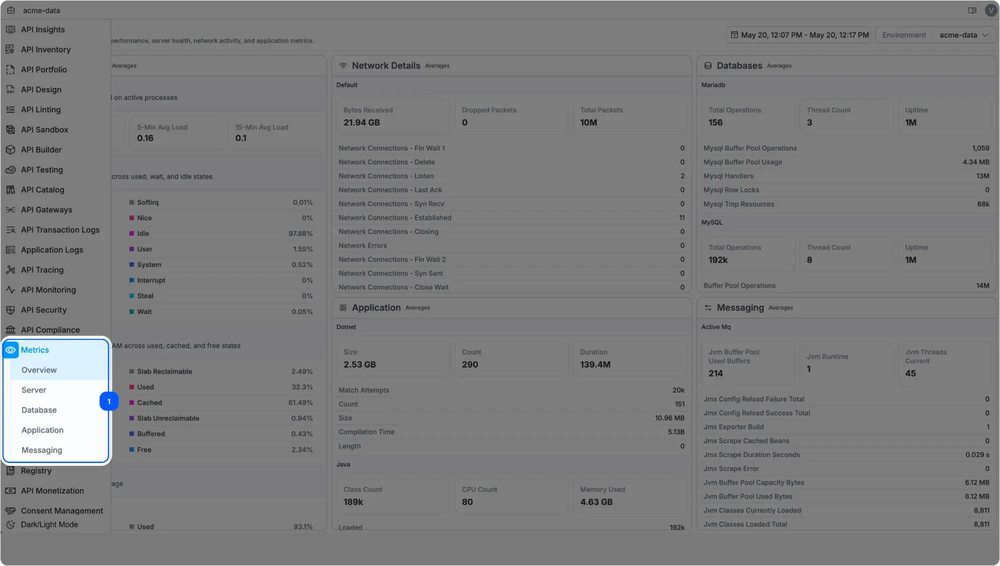

Use this procedure to access the Metrics module in the APIwiz platform and configure metrics collection for your applications and infrastructure.

### Prerequisites

Before you use the Metrics dashboard, make sure the following requirements are met based on the metrics type you want to monitor.

#### Application metrics

Developers must complete the following tasks:

- Attach the Java, .NET, or Node.js agent to the application code.
- Add the required attributes and properties.
- Enable metrics collection.

#### Infrastructure metrics

Administrators must complete the following tasks:

- Install the open-source OpenTelemetry \(OTel\) Collector.
- Configure the exporter with the required credentials.

### Access API Security

To open the Metrics module, follow these steps:

1. Sign in to the APIwiz platform with your credentials.
1. On the left side of the screen, point to the vertical navigation bar to view the names of the available modules.
1. Select the **Metrics** icon.
  

The Metrics module opens.