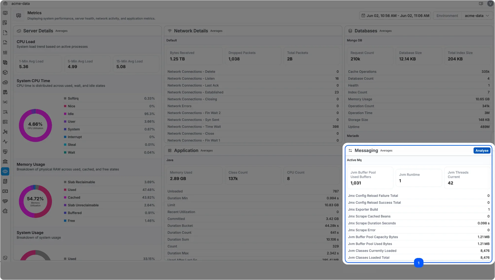
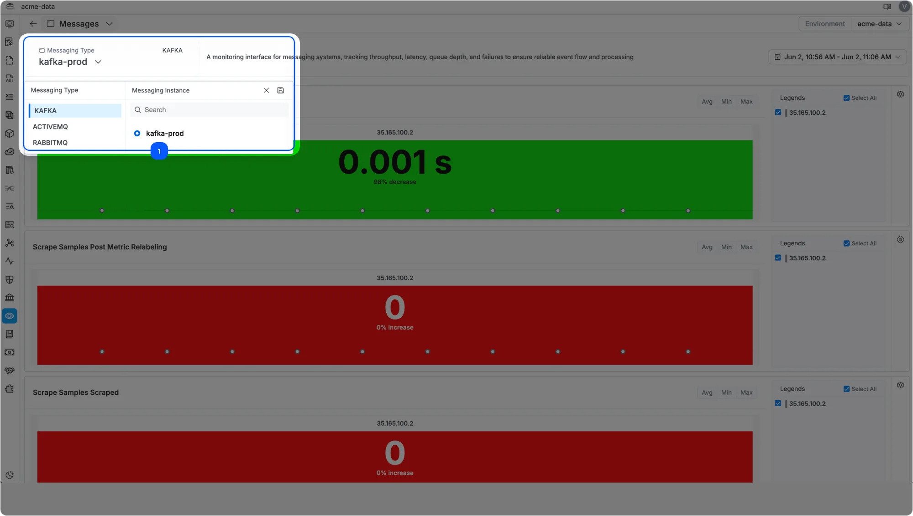

Messaging metrics provide visibility into the performance, health, and operational status of supported messaging platforms. Use the dashboard to monitor message flow, queue activity, consumer behavior, and broker resource utilization.

The Observability module collects messaging metrics from supported messaging platforms and displays them in a centralized dashboard. These metrics help you understand how messages are produced, processed, delivered, and consumed across distributed messaging environments.

Use messaging metrics to:

- Monitor the health of messaging brokers and platforms.
- Track message throughput, queue depth, and processing rates.
- Analyze producer and consumer activity across distributed environments.
- Monitor active connections, channels, and broker resource utilization.
- Identify message delivery delays, bottlenecks, and performance issues.
- Troubleshoot queue, consumer, and broker-related issues.

### Prerequisites

Before you monitor messaging metrics, ensure that the target messaging platform is configured for OpenTelemetry-based metric collection.

### Supported messaging platforms

After you configure the messaging metrics collection, the **Messaging Metrics** dashboard displays message broker activity, message flow, and performance data across your messaging infrastructure.

The Observability module supports the following messaging platforms:

- ActiveMQ
- Kafka
- RabbitMQ

The available metrics vary depending on the selected messaging platform and messaging activity.

### Analyze messaging metrics

To analyze messaging metrics, follow these steps:

1. On the **Messaging Metrics** dashboard, select **Analyze**.

The detailed metrics view displays:

- Average metric values
- Message throughput statistics
- Queue and topic utilization details
- Consumer and producer activity metrics
- Broker runtime performance metrics

### Filter by platform type

To filter messaging services by platform type, follow these steps:

1. Go to **Observability** \> **Metrics** \> **Messaging Metrics**.
1. Select the **Messaging Type** filter.
  
1. Select the required messaging platform: **ActiveMQ**, **Kafka**, or **RabbitMQ**.
1. Select the required messaging service from the list.

The dashboard loads the runtime metrics and performance statistics for the selected messaging service.

## Kafka metrics

Use Kafka metrics to monitor cluster health, analyze topic and partition activity, verify replication status, and identify operational issues.

Kafka metrics are available in the following categories:

- **Partition metrics**: Monitor partition offsets, replica counts, and synchronization status to evaluate message retention, replication health, and data consistency.
- **Topic metrics**: Track topic partition counts and distribution to assess workload balancing and scalability.
- **Replication metrics**: Monitor configured replicas and in-sync replicas to verify fault tolerance and high availability.
- **Scrape metrics**: Measure metric collection duration, sample counts, time-series creation, and target availability.
- **Availability metrics**: Monitor the operational status and reachability of Kafka monitoring targets.

Use Kafka metrics to:

- Monitor cluster health and availability.
- Track partition growth and message retention through offset metrics.
- Verify replication health and synchronization status across brokers.
- Analyze topic and partition distribution for scalability planning.
- Detect replication issues that could affect fault tolerance.
- Validate monitoring performance and metric collection health.

Select **Kafka** from the **Messaging Type** dropdown, then select the required Kafka messaging service.

The following table lists all available **KAFKA Metrics**, their graph types, and descriptions:

## ActiveMQ metrics

Use ActiveMQ metrics to monitor broker health, analyze message activity, track resource utilization, and identify operational issues.

ActiveMQ metrics are available in the following categories:

- **Broker metrics**: Monitor broker status, message throughput, queue activity, topic activity, producers, consumers, and connections.
- **JVM metrics**: Track JVM memory usage, garbage collection activity, thread utilization, class loading, and runtime performance.
- **Process metrics**: Monitor CPU utilization, memory consumption, file descriptor usage, process uptime, and virtual memory allocation.
- **JMX exporter metrics**: Monitor JMX exporter status, scrape operations, metric collection performance, and exporter configuration health.
- **Scrape metrics**: Measure metric collection duration, sample counts, time-series creation, and target availability.

Use ActiveMQ metrics to:

- Monitor broker health and availability.
- Analyze message production and consumption patterns.
- Detect bottlenecks, deadlocks, and resource constraints.
- Track JVM and process-level resource utilization.
- Validate metric collection and exporter performance.
- Identify performance degradation before it affects messaging workloads.

Select **ActiveMQ** from the **Messaging Type** dropdown, then select the required ActiveMQ messaging service.

The following table lists all available **ACTIVEMQ Metrics**, their graph types, and descriptions:

## RabbitMQ metrics

Use RabbitMQ metrics to monitor broker health, analyze message flow, track resource utilization, and identify messaging issues.

RabbitMQ metrics are available in the following categories:

- **Authentication metrics**: Monitor authentication attempts and connection access activity to identify connectivity issues and security-related events.
- **Connection and channel metrics**:Track active connections, opened connections, and channels used by publishers and consumers.
- **Queue metrics**: Monitor queue counts, queued messages, and message backlogs to evaluate broker workload and message processing efficiency.
- **Consumer metrics**: Track active consumers and their ability to process messages from queues.
- **Message acknowledgment metrics**: Monitor message acknowledgments and unacknowledged messages to identify message delivery and processing bottlenecks.

Use RabbitMQ metrics to:

- Monitor broker health and availability.
- Track client connections, channels, and consumer activity.
- Identify message backlogs and processing delays.
- Detect unacknowledged messages and consumer processing issues.
- Analyze message throughput and acknowledgment trends.
- Support capacity planning and performance optimization.

Select **RabbitMQ** from the **Messaging Type** dropdown, then select the required RabbitMQ messaging service.

The following table lists all available **RABBITMQ Metrics**, their graph types, and descriptions: