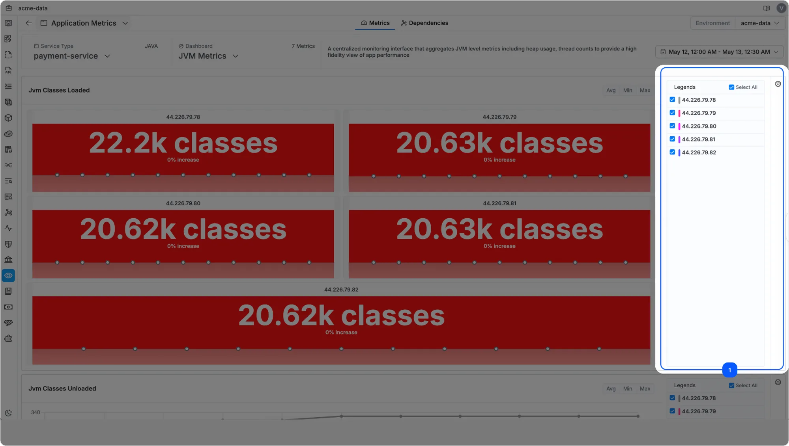
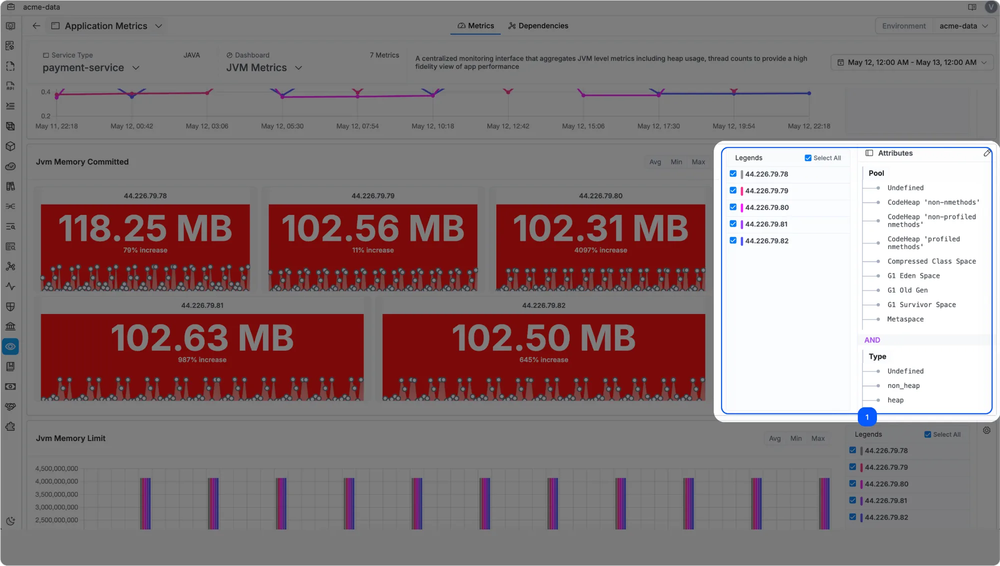
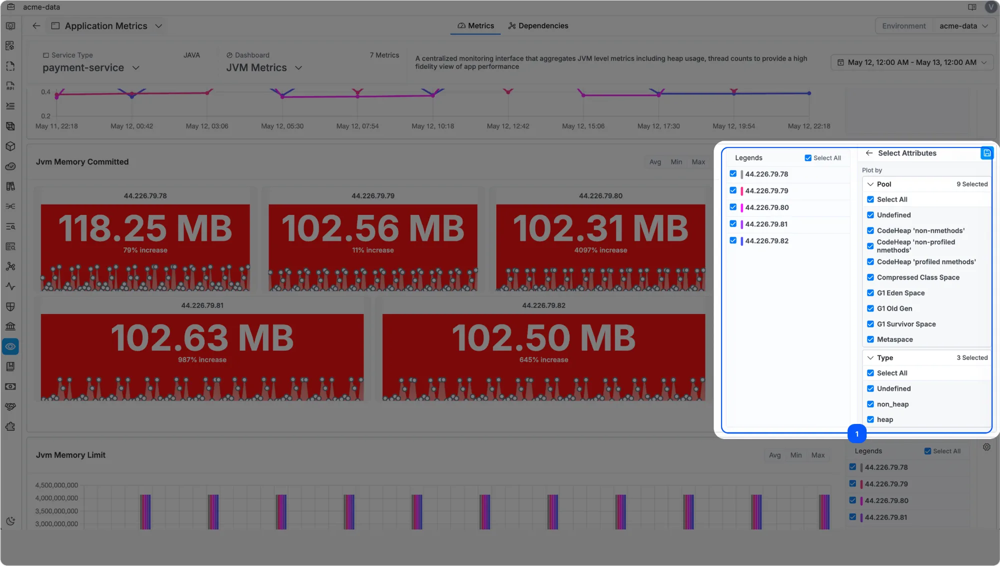

Use metric filters to control which data appears in the metric visualizations. You can filter by host instance to isolate performance patterns, or filter by attribute values to refine the data displayed for a specific metric.

## Filter by host instance

The **Legends** panel displays a checkbox for each monitored host instance. Use these checkboxes to control which host instances appear in the metric visualization.

To filter metrics by host instance, follow these steps:

1. In the **Legends** panel, select the checkbox for each host instance you want to display. To display all host instances at once, select **Select All**.
  

The dashboard updates automatically to display metrics for the selected hosts only.

### Analyze host-level metrics

Each metric visualization displays data separately for each monitored host instance. Use host-level filtering to isolate performance patterns and identify issues across distributed deployments.

Host-level filtering lets you:

- View and compare metrics across multiple host instances.
- Enable or disable specific host instances in the visualization.
- Identify host-specific performance issues.
- Analyze application performance across distributed environments.

Host-level filtering is available on the following dashboards:

- Server Metrics
- Application Metrics
- Database Metrics
- Messaging Metrics

## Filter by attribute values

The **Select Attributes** panel displays the available attribute groups and values for a selected metric. Use attribute values to refine the data displayed in the metric visualization.

To filter by attribute values, follow these steps:

1. In the metric widget, select the **Settings** \(⚙\) icon.
  
1. Select the **Edit** \(✏\) icon. The **Select Attributes** panel opens and displays the available attribute groups and values for the selected metric.
  
1. Expand an attribute group to view its values.
1. Select one or more attribute values to filter the metric data. To include all values within an attribute group, select **Select All**.

The dashboard updates the metric visualization to display data for the selected attributes only.

The following example shows the attribute groups available for the **JVM Memory** metric:

## Filter by date and time range

Use the date and time range filter to define the time period for which metrics are displayed on the dashboard. This helps you analyze performance data within a specific timeframe, focus on recent activity, or compare trends over defined periods.

To filter metrics by date and time range, follow these steps:

1. In the top-right corner of the dashboard, select the date and time range selector. The **Custom Range** panel opens.
  
1. Select a predefined time range, or set a custom start and end date and time. Predefined options include:

The dashboard refreshes and displays metrics for the selected time period only.

## Filter by environment

Use the **Environment** filter to display metrics for a specific deployment environment, such as acme-data or qa-dev. This helps you isolate and analyze metrics relevant to a particular environment without switching dashboards.

To filter metrics by environment, follow these steps:

1. In the top-right corner of the dashboard, select the **Environment** dropdown. A list of available environments appears.
  
1. Select the environment you want to view. For example: acme-data, qa-dev.

The dashboard updates to display metrics for the selected environment only.