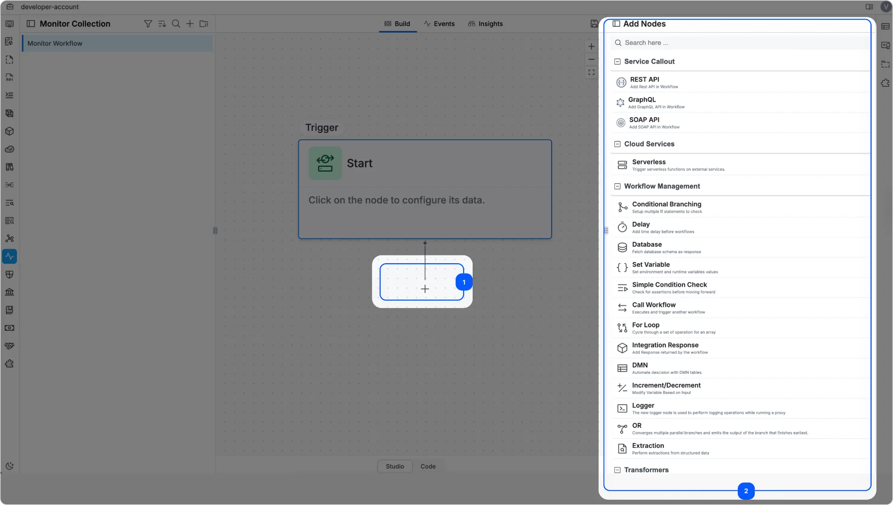

Once the Start node is configured, add the remaining nodes to build a complete and functional workflow. A workflow is a sequence of actions, represented as nodes, that defines a specific test flow within a scenario.

To add a node:

1. Select **\+**.
1. Select the required nodes and add them to the workflow. 
  

For a detailed description of all nodes and instructions on building a workflow, refer to the [Nodes](https://docs.apiwiz.io/guides?guideId=6a606b5269d1ae970571f1f1&pageId=6a88139af0c8e28fcc1bf9b2).