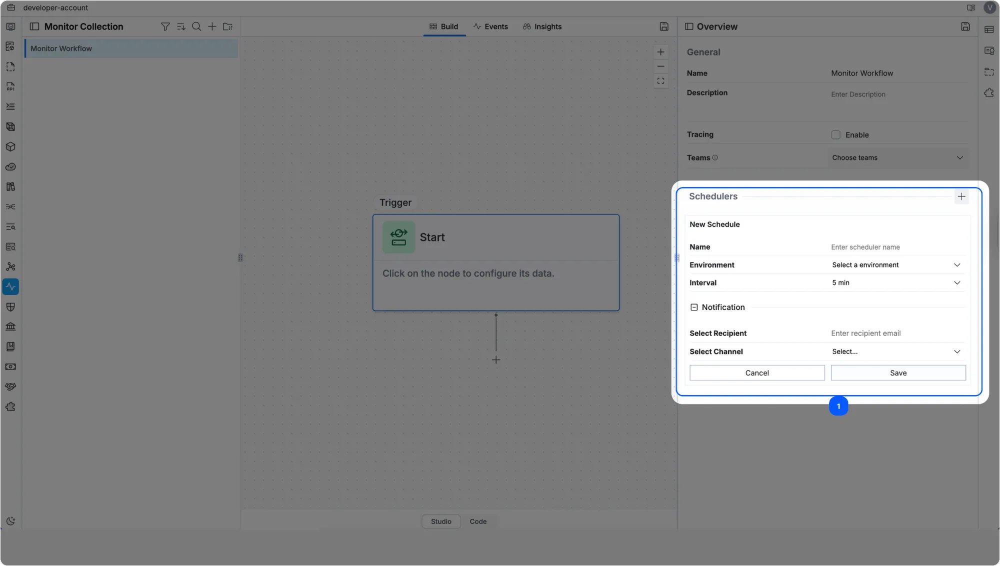

The **Start** node defines the entry point of the monitoring workflow and specifies how execution begins.

Select the **Start** node. The **Overview** configuration for the monitoring trigger opens, where you can edit general details, enable tracing, and manage schedulers that control when the monitoring workflow runs.

# Configure schedulers

**Schedulers:** Monitoring workflows are driven by schedulers. Configure how often the workflow runs \(for example, every 5 minutes\) by adding a scheduler.

To configure a scheduler:

1. Next to the **Schedulers** section, select **\+**.
  
1. Enter the following details:
  **Scheduler**

  **Notification**
1. Select **Save** to create the scheduler.
  >