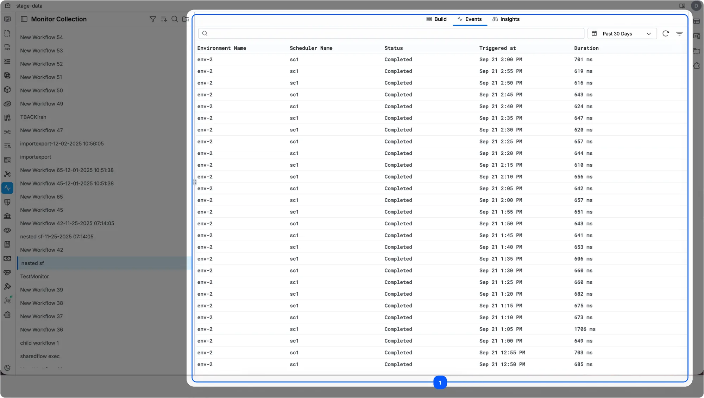

The **Events** tab lets you view the event details generated during the execution of a monitor workflow. It organizes and displays execution details in a tabular format, giving you centralized visibility into workflow execution status, performance, and triggered times.

Selecting any event from the list opens a detailed execution view, where you can examine request and response information, status, timestamps, and other relevant execution data.

To access this view, select **Events** from the top navigation bar.

The table includes the following columns:

The table includes the following columns:

# Viewing event details

Select any event row to open the detailed execution view.

- The upper section displays the executed workflow and visualizes the execution path \(trail\).
- The lower section shows the corresponding workflow events in chronological order.

The execution log includes:

- Timestamps for each step in the workflow
- Execution duration
- Request receipt time
- Execution status
- Response generation time

This view lets you trace the full execution flow, from the moment the request is received, through script or node execution, to the final response.

#### Actions available

#### Use cases

- **Monitoring workflow execution:** Quickly check whether all scheduled workflows are running successfully, or identify failures to address.
- **Performance optimization:** Use the Duration column to identify workflows with long execution times and optimize them.
- **Debugging:** Analyze the status of failed workflows and their corresponding timestamps to debug issues efficiently.