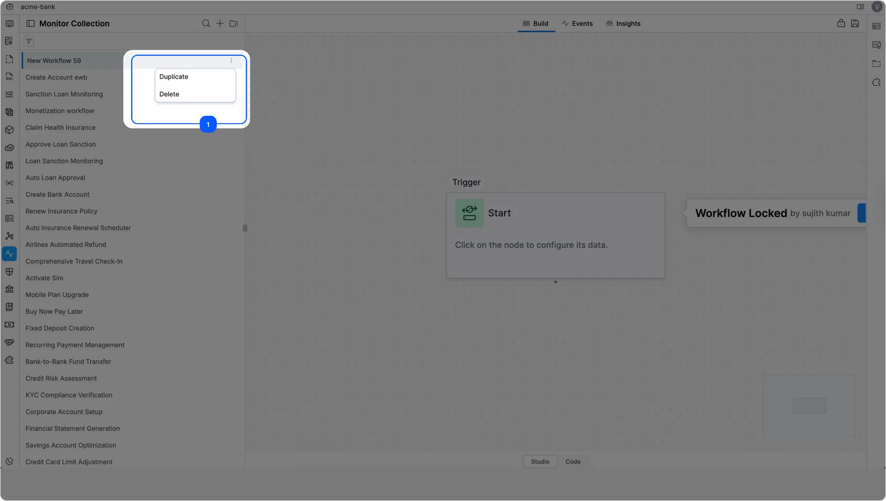
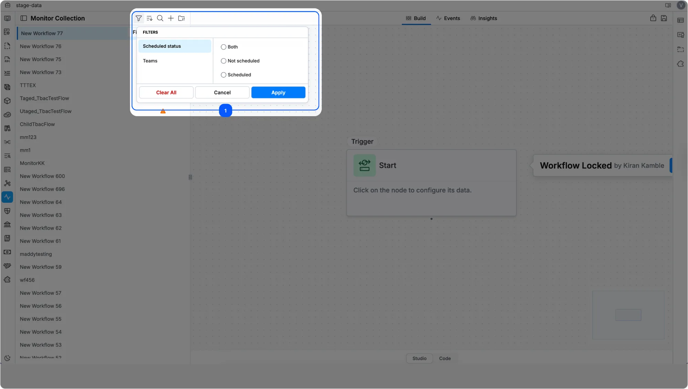
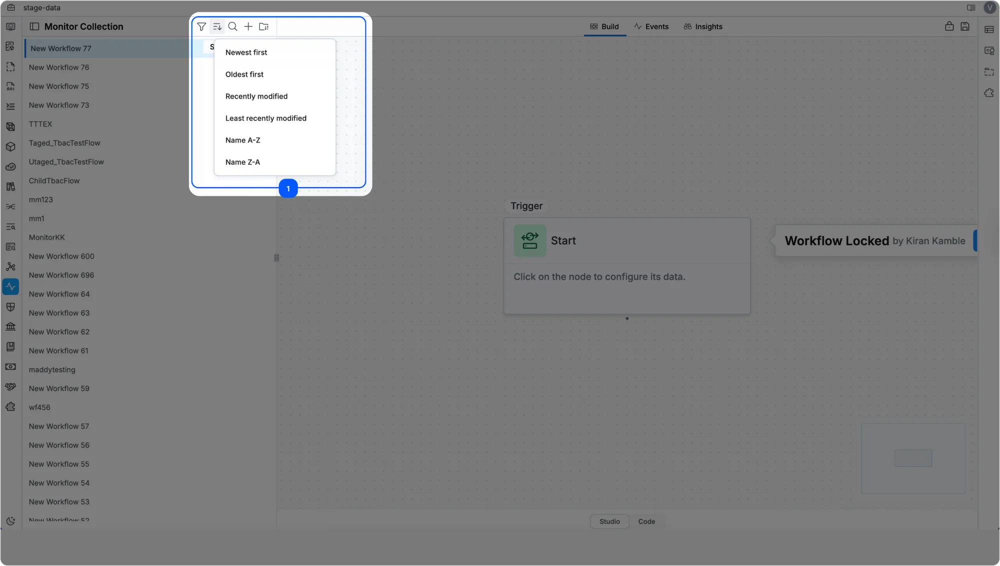
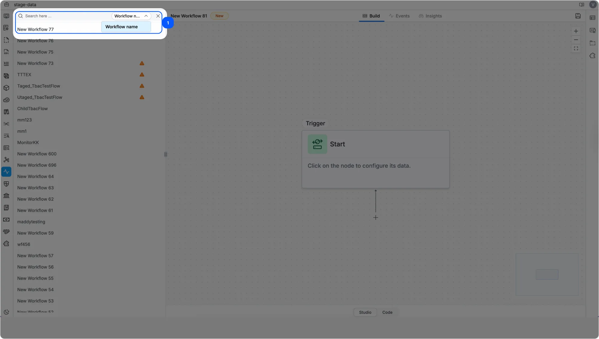

Hover over a workflow in the **Monitor Collection**, and select **More Options \(⋮\)** to access the following actions:

# Filter, sort, and search 

In the left **Monitor Collection** navigation panel:

- **Filter:** Select **Filters** to narrow the list by:
  - **Scheduled Status:** Both \(all workflows regardless of schedule status\), Not Scheduled \(workflows without a configured schedule\), or Scheduled \(workflows with an active schedule configured\).
  - **Teams:** Filters workflows based on the associated team.

  

  Apply one or more filters at once, then select **Apply**, or select **Clear All** to reset.
- **Sort:** Select **Sort** to reorder the list by Newest First, Oldest First, Recently Modified, Least Recently Modified, or Name A–Z / Z–A.
  
- **Search:** Use the **Search** bar to locate a workflow by name. Select the dropdown to set the search criterion, then enter a keyword; the list updates dynamically.
  