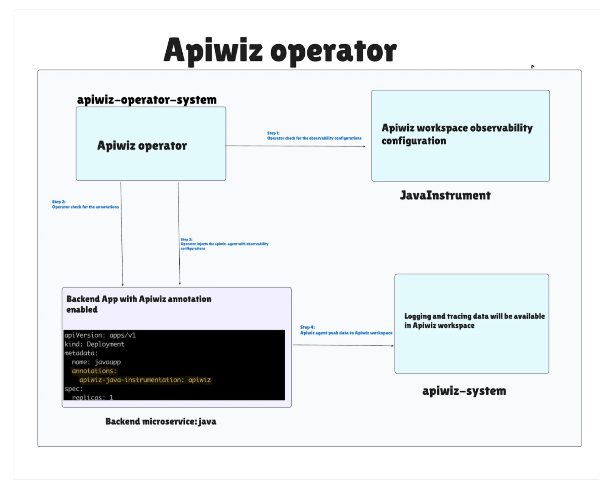

The Apiwiz Operator automates injection of the Apiwiz Java Agent into Kubernetes deployments. It monitors annotated deployments, applies the required configuration, and provides consistent observability across Java-based services.

### Purpose

This guide provides instructions for installing the Apiwiz Operator, configuring the `JavaInstrument` resource, and enabling agent injection through Kubernetes annotations. It helps administrators and developers automate observability setup for Java applications that run in Kubernetes environments.

### Advantages

- **Automated instrumentation**: Injects the Apiwiz Java Agent into deployments without manual edits or image rebuilds.
- **Centralized configuration**: Uses the `JavaInstrument` resource to configure workspace details, API \(application programming interface\) keys, and logging parameters from a single location.
- **Namespace flexibility**: Supports installation in the default operator namespace or a custom namespace.
- **Consistent observability**: Ensures all annotated Java applications receive the correct tracing, compliance, and logging configuration.
- **Reduced operational overhead**: Removes the need for configuring individual agents in each deployment, streamlining cluster-wide observability.
- **Selective, safe targeting**: Limits injection to applications the client explicitly annotates as Java, preventing the agent from being applied to incompatible runtimes such as .NET or PHP.

### Prerequisites

Before you begin, verify the following:

- A running Kubernetes cluster is available.
- You have administrator access or sufficient permissions to deploy the Apiwiz Operator in the cluster.

### APIwiz Operator Architecture for Java Observability

### How the operator works

The Apiwiz Operator continuously monitors annotated deployments and injects the Java Agent when it detects the required configuration.

- You add the instrumentation annotation to the application deployment. Only add this annotation to Java applications; the agent doesn't support other runtimes, and adding it to a non-Java application can cause that application to crash.
- The operator checks all deployments in the cluster at regular intervals, for example, every five minutes.
- When the operator detects the annotation, it appends the required configuration to JAVA\_TOOL\_OPTIONS, adds the required volume mount configuration, and injects the observability agent into the application runtime. 
- After a successful injection, the operator adds a success annotation APIwiz\_JAVA\_INSTRUMENTATION\_STATE: Successful, to the deployment file so it can skip already-instrumented applications on future checks. 
- You can verify the success annotation or the application logs to confirm that instrumentation succeeded.